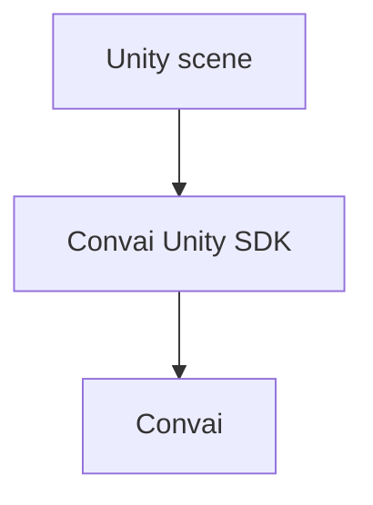

# GitBook block usage

Use a GitBook block when it matches what the content is: it is part of the page design, not
decoration. Never flatten structured content into plain paragraphs, generic bullets, or ad hoc HTML
when a block shows its structure better. This file covers the blocks most pages use.

## Choosing a block

| Content need | Block |
|---|---|
| Note, prerequisite context, non-critical constraint | Hint, `info` |
| Expected success state | Hint, `success` |
| Common mistake, compatibility issue, silent failure | Hint, `warning` |
| Security risk, destructive action, data loss, broken production behavior | Hint, `danger` |
| Short linear procedure | Stepper |
| Long or branching procedure | `##` sections, optionally with smaller steppers inside |
| Equivalent alternatives: OS, engine version, Inspector or C#, package source, language | Tabs |
| Optional detail that interrupts the main flow | Expandable section |
| Code, or code tied to a file path | Code block with its language, titled when the path matters |
| A strong related page or next step | Content reference |
| Field list, support matrix, comparison, troubleshooting matrix | Table |
| Architecture flow, state machine, decision tree | Mermaid diagram |
| REST endpoint reference | OpenAPI block |
| Changelog or versioned release notes | Updates block |
| UI state, Inspector configuration, visual result | Image with alt text and caption (`images.md`) |

Cards, columns and the page options are in `gitbook-blocks-navigation.md`; task lists, snippets,
conditional content, file blocks, embeds, quotes, math, and prompt blocks in `gitbook-blocks-more.md`.

Rules for every block:

- Prefer a native block when it improves the reader's ability to scan, decide, copy, verify, or navigate; never use one for decoration or to make weak content look important.
- Do not overload blocks. If a stepper, tab, hint, or expandable section becomes long, split into headings or pages.
- Keep required information visible in the main flow.
- Use wide layout only for tables, cards, OpenAPI blocks, or dense code (CV-74).
- Keep block titles specific: `Inspector`, `C#`, `Windows`, `Unity 2022.3` — not `Option 1`, `Tab 2`, or `More`.
- Every page review includes a block-fit pass: find structured content that should be upgraded to a native block.

## Hints

```md

Use a clean Unity project when evaluating the SDK for the first time. This makes package conflicts easier to isolate.

```

- `info`: optional context, prerequisites, neutral notes, near the affected step, not in a paragraph after it.
- `success`: the observable success condition at the end of a procedure; never end a procedure without one.
- `warning`: common mistakes, silent failures, compatibility issues, placed before the risky action.
- `danger`: data loss, broken builds, security risks, destructive actions, with the consequence and the safer action stated; never as normal prose.

Do not use hints for ordinary prose. At most two on a task or concept page (CV-39): more signals a
structural problem, so restructure instead.

## Steppers

For short, linear procedures: guided setup and walkthroughs with ordered steps.

```md


### Open Package Manager

In Unity, select **Window > Package Manager**.


```

Step headings are `###`, action-oriented, never `Step 1`, `Step 2`, or `Next`, and never replaced by
manual `Step 1` headings; put the expected result in the step body when useful. A long or branching
procedure stays in `##` sections, with smaller steppers inside if they help, so its branches stay
visible: never one large stepper with branches, warnings, and references hidden inside.

## Tabs

For equivalent alternatives: `Windows`/`macOS`/`Linux`, `Inspector`/`C#`, `Unity Package
Manager`/`Local package`.

```md


Configure the field in the Unity Inspector.


Configure the field from a script.


```

Never for unrelated topics or different reader intents: those are separate pages (CV-40). Keep a
critical warning or prerequisite out of a single tab.

## Expandable sections

For optional detail that would interrupt the main flow, as `<details>` with a `<summary>` line. Never
hide prerequisites, warnings, or required setup steps in one (CV-41).

## Code blocks

Always declare the language (CV-22), and never use a screenshot of code or terminal output (CV-47).
When the file path matters, title the block instead of using plain fenced code:

````md

```csharp
ConvaiSettings.ApiKey = "YOUR_API_KEY";
```

````

Examples compile or are marked as pseudocode (CV-23), use realistic names and paths, and use a
placeholder such as `YOUR_API_KEY` only when necessary.

## Content references

```md

[Configure the API key](../authentication/configure-api-key.md)

```

Put one after the sentence that explains why the link matters. No "Related articles" dump, and no long
list of content references where cards would work better.

## Tables

For comparisons, field references, platform support, and troubleshooting, with clear headers and
concise cells. Never for page layout (CV-44).

## Mermaid diagrams

For architecture flows, state machines, or decision trees, where prose would be harder to scan, as a
`mermaid` code block. Describe the diagram in nearby text for search and screen readers (CV-45).

````md

````

Never a drawing block. A Mermaid diagram is text: it diffs in a pull request, it is searchable, an AI
assistant can read it, and the next person can edit it. A drawing is none of those, so it goes stale
the moment the thing it shows changes, and nobody can tell (CV-69).

## OpenAPI blocks

Only for REST API reference pages, when an OpenAPI source exists, instead of hand-written endpoint
schemas that drift (CV-73).

```md


```

## Updates block

On changelog and release notes pages only (CV-42): timestamped entries, with optional tags and an
auto-generated RSS feed, instead of a long bullet-list changelog. Available on paid GitBook plans only.
