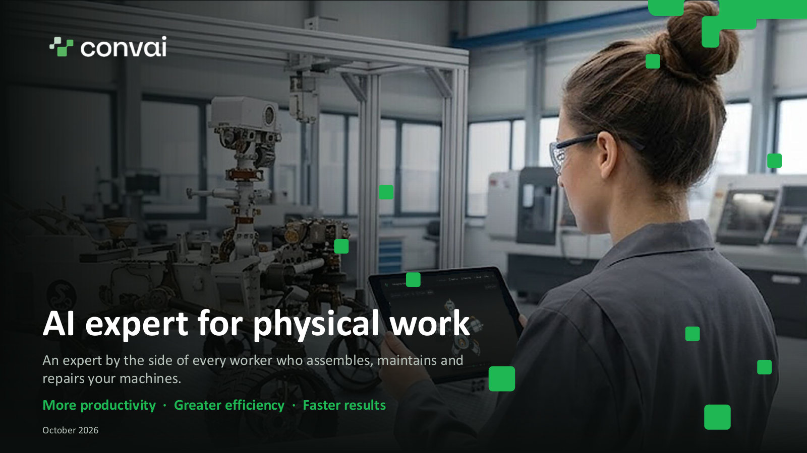
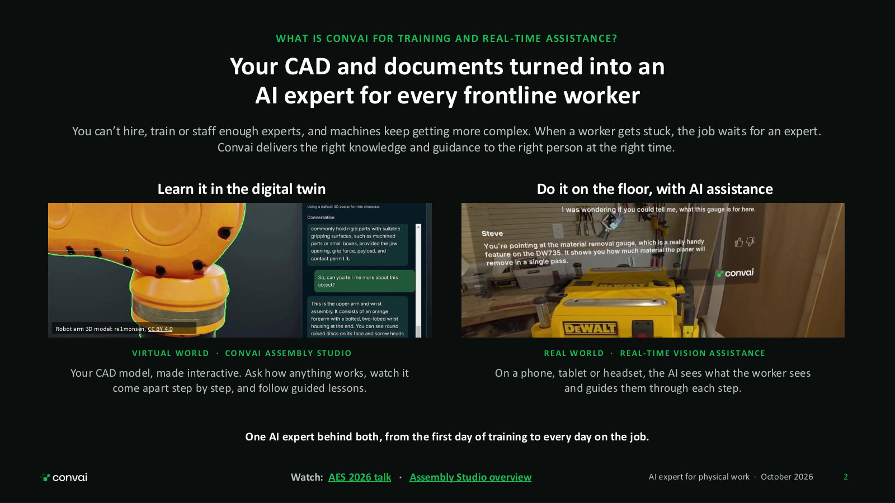
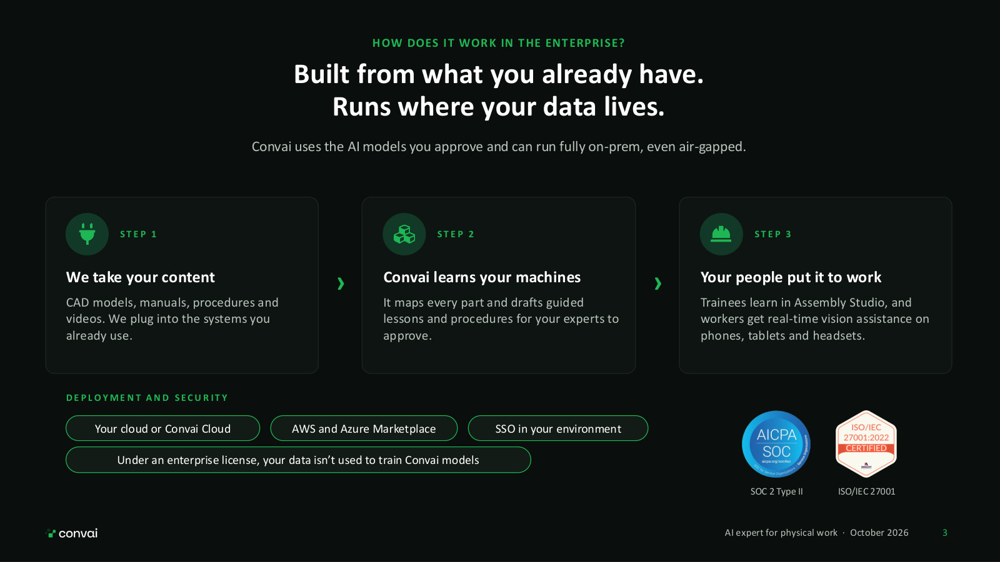
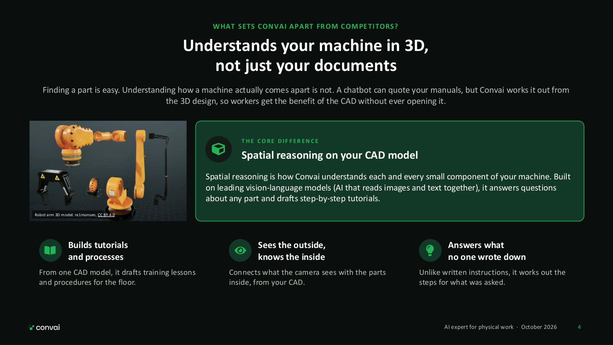
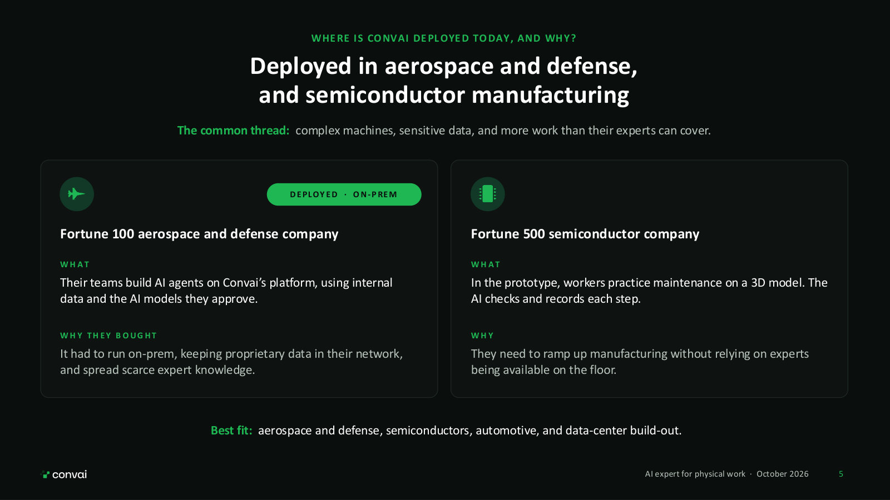
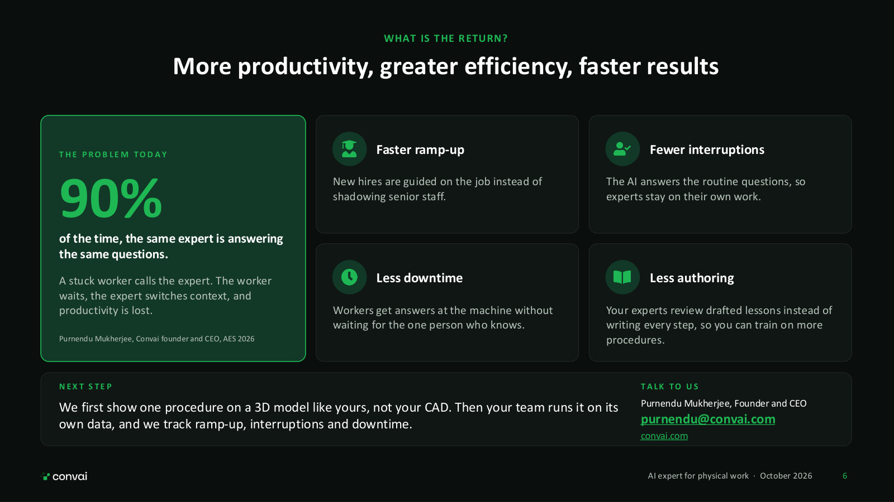

# AI Expert for Physical Work

An expert by the side of every worker who assembles, maintains and repairs your machines. Download the deck or preview the slides below.


AI Expert for Physical Work (PDF, 7 slides)


