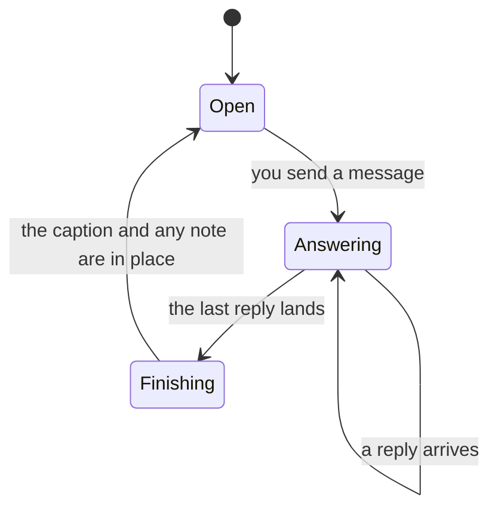

A chat experience room answers one message at a time, and it reports the result of each one under the message that prompted it. That report is where every wait, every count, and every note about a character that did not reply comes from. Knowing how a turn is measured tells you what the room is still waiting for and which characters said nothing.

## One message at a time

A message and the replies it draws are one turn, and the room runs one turn at a time. A turn moves through three states, and the message box tells you which one you are in:

Sending a message locks the message box. The lock holds while the characters answer and for a moment after the last reply lands, then the box unlocks and takes the next message. You cannot type into the box while it is locked, and focus comes back to it the moment the turn is over.

The reason is that a reply belongs to the message that prompted it. Every reply, every count, and every note is filed under one of your messages, and the thread reads as a record of what each message produced. A second message accepted mid-turn would have replies to the first arriving underneath it.

## What the turn caption reports

The caption under your own message is built from two halves: what the turn asked for, and what came back. A middle dot separates them.

A room opens on **Everyone must respond**. In a room of four characters left on it, a caption can read:

`Everyone must respond · 3 of 4 replied`

The first half names the mode the turn ran under. The second counts how many of the characters the turn asked have replied, out of how many it asked. While the room is still answering, the count climbs as replies arrive. Once the turn is over, a count short of the total means a character did not reply, and a note under the replies names it.

A caption describes the room as it stood when the message was sent, so seating or removing a character later leaves your earlier captions counting as they already did. See [Add or remove characters mid-conversation](add-or-remove-characters.md).

The other respond modes report in their own words. A turn that tags two or more characters counts `replied` against the number tagged, and a turn addressed to one character reads `replied` or `waiting`. **Anyone may respond** names the characters that replied instead of counting them, and adds `⟨n⟩ passed` for the ones that did not. Every caption shape is set out in [Respond modes reference](respond-modes-reference.md).

A saved transcript captions the same turns in slightly different words. See [Review a past session](../sessions-and-transcripts/review-a-past-session.md).

## Why a character may say nothing

On the default, every character in the room is asked to reply to every message, so a message addressed to nobody in particular still draws an answer from each of them. A character says nothing in three cases:

| Case | What the thread shows |
|---|---|
| The turn did not address it: you tagged other characters, or picked one under **Only one character** | Nothing for that character. A turn that tagged two or more adds a line under the replies naming who was left out |
| The turn ran under **Anyone may respond** and the character had nothing to add | `⟨n⟩ passed` in the caption, and a note under the replies: "⟨names⟩ had nothing to add and passed." |
| The character was asked to reply and did not | A note under the replies naming it: "⟨name⟩ did not answer" |

[Respond modes reference](respond-modes-reference.md) gives each wording in full, and a note kept in a saved transcript is worded differently—see [Review a past session](../sessions-and-transcripts/review-a-past-session.md).


To get an answer out of a character that passed or was left out, send another message that tags it. A tagged character has to reply. See [Choose who replies](choose-who-replies.md).


## What a one-character room reports

A room holding one character has a caption of its own, whatever the respond mode is set to. It names the character rather than the mode, because there is nobody to route between. The caption opens `Sent to ⟨name⟩`, and what follows the name reports the turn:

| What follows the name | What it means |
|---|---|
| `replied` | The character has answered |
| `waiting` | The room is still answering this message |
| Nothing | The turn is over and no reply came |

A message sent while one character was seated keeps this caption afterwards, even once you have seated more.

## What the message box shows while the room is answering

The message box carries the wait in place of its usual prompt, and the wording moves on as the turn settles. While replies are still outstanding it reads `Waiting for 2 of 4…`, where the first number is how many characters are still to answer and the second how many the turn asked for. Once the last reply has arrived and the room is closing the turn, it reads `Finishing the turn…`. The box unlocks when the turn is over.

A message you have already started—typed text, or a file you have attached but not sent—hides the prompt, so the wait appears on a line under the box instead.

A turn is not the only thing that locks the box, and the box always says which reason applies. [You cannot send a message](../troubleshooting/composer-is-locked.md) reads each one and tells you what clears it.

## Related pages

The mode you pick decides most of what a caption reports, the message box tells you how far the turn has got, and a finished conversation keeps a shorter record of both.


[Choose who replies](choose-who-replies.md)



[Respond modes reference](respond-modes-reference.md)



[You cannot send a message](../troubleshooting/composer-is-locked.md)



[Review a past session](../sessions-and-transcripts/review-a-past-session.md)

