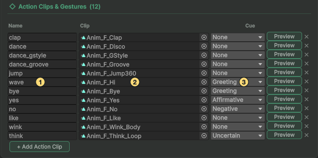
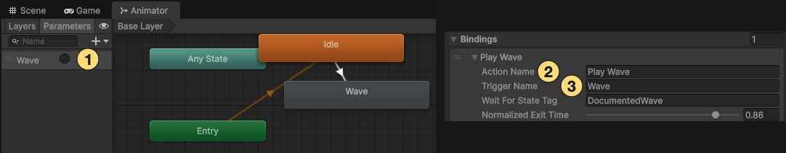
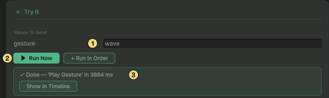

Configure a Convai character to play a clip recorded with the **Convai XR Animation Capture** app. The Unity steps start once you have the recording in a format Unity can import.


Recording a motion on Meta Quest


## Prerequisites

* A scene with a working Convai character. Follow [Unity SDK getting started](../../plugins-and-integrations/convai-unity-sdk/getting-started/README.md) to set up a project.
* A recording available as a Unity-importable animation file or a clip already in your project's **Assets**. The [recording guide](creating-animations-for-ai-avatars.md) covers capture and upload to your Convai account.

## Import the animation clip

If the clip is already in your project, continue to [Configure the character action](#configure-the-character-action). Otherwise, put the animation file in the project's `Assets/` folder. Select the imported clip in the **Project** window and preview it on the intended avatar.

## Configure the character action

Open **Convai > Actions Editor** and select the character. For a character without actions, enable actions and add a **Convai Action Runner**. Follow the [character actions quick start](../../plugins-and-integrations/convai-unity-sdk/features/character-actions/quick-start.md) for those setup steps.

### Character with Body Animation

1. Open **Convai > Body Animation Editor** and select the character. In **Content > Actions & Gestures**, add an entry to the character's Animation Set. Give it a name and assign the imported clip.
2. In the Actions Editor, add **Play Gesture**. Use the Animation Set entry's name as the `gesture` value.

<figure><figcaption>
The sample <strong>wave</strong> entry (1) pairs a name with an animation clip (2) and an optional cue (3). Use the same fields for your imported recording.
</figcaption></figure>

See [Build an animation set](../../plugins-and-integrations/convai-unity-sdk/embodiment/body-animation/build-an-animation-set.md) for clip and loop settings.

### Character with its own Animator Controller

1. Use the imported clip in a state in the character's Animator Controller. Add an Animator Trigger parameter and a transition that enters the state when that trigger is set. If the clip should repeat, enable **Loop Time** on the clip.
2. In the Actions Editor, add **Play Animator State**. In the executor's Inspector, add a binding from the action name to the Animator Trigger parameter.

<figure><figcaption>
(1) Add the <strong>Wave</strong> Trigger in the Animator Controller. In the executor binding, (2) set <strong>Action Name</strong> to <strong>Play Wave</strong> and (3) set <strong>Trigger Name</strong> to <strong>Wave</strong>. This locally tested example uses the SDK’s bundled wave animation.
</figcaption></figure>

See [Play Animator State](../../plugins-and-integrations/convai-unity-sdk/features/character-actions/action-executors.md#play-animator-state) for the binding fields.

## Verify the animation

Enter Play mode. In the Actions Editor, select the action and open **Try It**. For **Play Gesture**, enter the Animation Set entry's name in **Values To Send**. Select **Run Now** and confirm that the character plays the recorded motion.

<figure><figcaption>
(1) Enter the Animation Set’s <strong>wave</strong> gesture name. (2) Select <strong>Run Now</strong>. (3) <strong>Done</strong> reports completion. This local example uses the SDK’s bundled wave animation on Sofia.
</figcaption></figure>

After the local test passes, start a conversation and give the character a request that should trigger the action. Check that the same clip plays when the action runs.
