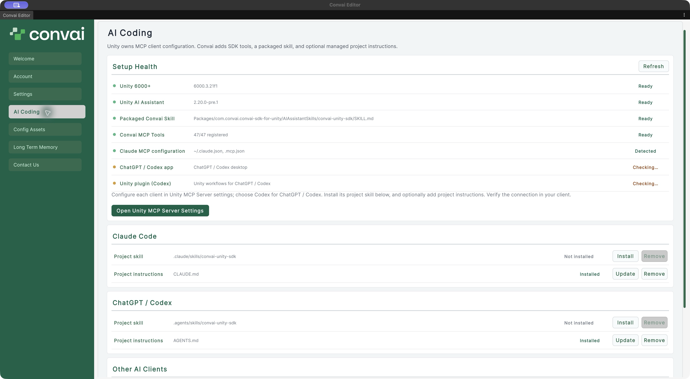

Convai extends Unity's MCP server with SDK-aware tools so a coding agent such as Codex, Claude Code, or Cursor can configure Convai components directly in your project. Use this quick start the first time you connect an agent to a project that already has the Convai Unity SDK installed. At the end, your agent can find the project skill or managed instructions and the AI Coding section reports every Convai tool as registered.

## Prerequisites

* <code class="expression">space.vars.unity_recommended_version</code> or later — Convai's AI coding tools require Unity 6000 or newer.
* The Convai Unity SDK installed in the project. See [Install the Convai Unity SDK](../getting-started/installation.md).
* A compatible Unity AI Assistant package (`com.unity.ai.assistant`, version `2.13.0` or later and below `3.0.0`). A `2.13.0` pre-release build must be `pre.2` or later to count as compatible; any version strictly between `2.13.0` and `3.0.0` is accepted regardless of pre-release tag; and `3.0.0` itself is accepted only as a pre-release, never the final release. Install it manually, or install it from inside this walkthrough.
* A supported coding agent installed on your machine, such as Codex CLI, Claude Code, or Cursor. See [Supported coding agents](supported-coding-agents.md) for the full list.

## Open the AI Coding section



### Select AI Coding in the Convai Editor

In the Unity Editor menu bar, select **Convai > Convai Editor**. In the window's navigation rail, select **AI Coding**.

The section's **Setup Health** card reports four readiness rows: **Unity 6000+**, **Unity AI Assistant**, **Packaged Convai Skill**, and **Convai MCP Tools**. Three more rows report **Claude MCP configuration**, **ChatGPT / Codex app**, and **Unity plugin (Codex)**. These last three are read-only installation/configuration checks, not proof that an agent is connected.



### Accept the Unity MCP terms

Unity may prompt you to accept the Unity AI Assistant and MCP server terms of service the first time the feature activates in this project. Accept the prompt so Unity's MCP server and Convai's tools can register. If no prompt appears, open **Project Settings > AI > Unity MCP Server** directly to accept the terms and confirm which MCP clients are connected to your project.



### Resolve any row that shows a warning

A repairable unready row shows a **Fix** button. Unity version and client-detection rows have no repair button. Click **Fix** next to **Unity AI Assistant** to install `com.unity.ai.assistant@2.14.0-pre.1` through Package Manager — Unity recompiles and the row updates automatically. Click **Fix** next to **Packaged Convai Skill** or **Convai MCP Tools** to refresh package assets and re-register Convai's tools without reinstalling the Assistant package.




Clicking **Fix** while Unity is compiling, updating packages, or in Play Mode shows a warning and does not start the repair — exit Play Mode first, since repair never exits Play Mode for you. All **Fix** buttons are disabled while any repair is running. The tools repair also requires a compatible Unity AI Assistant package.


## Configure the client and install its skill

1. Click **Open Unity MCP Server Settings** and follow Unity's client configuration. Choose **Codex** for ChatGPT / Codex.
2. Return to **AI Coding**. In the **Claude Code** or **ChatGPT / Codex** card, click **Install** beside **Project skill**. See [Install the project skill](install-project-skill.md) for existing or modified copies.
3. Optionally install **Project instructions** in that card. For Cursor, Gemini, or VS Code Copilot, install the instructions under **Other AI Clients** instead.
4. Start or reconnect your coding client so it can load the project skill and the Unity tools.

Instruction installation preserves text outside the `<!-- BEGIN CONVAI UNITY SDK -->` and `<!-- END CONVAI UNITY SDK -->` block. With an installed project copy, the block names the skill; otherwise it points to the resolved packaged `SKILL.md`.

<figure><figcaption>
The AI Coding section separates Unity setup checks, project skills, and project instructions.
</figcaption></figure>

## Verify the tool count

The **Convai MCP Tools** row reads `47/47 registered` once Unity's MCP registry has registered all 47 Convai tools under tool contract version 10. If the count is lower or the row lists a missing or unexpected tool name, click **Fix** next to **Convai MCP Tools** to refresh the registry and recompile.


The Unity side is ready when the four readiness rows read **Ready** and **Convai MCP Tools** reads `47/47 registered`. From the coding client, call `Convai.GetProjectStatus` and confirm contract version `10`, then `Convai.InspectScene`. Those successful read-only calls verify the connection. Installation-detection rows need only match the client you use.


## Prompt the agent to build your scene

With managed instructions installed and the tool count verified, prompt your agent in plain language. Convai's tools handle SDK-specific configuration; your agent's Unity MCP tools handle generic GameObjects, scripts, and scene operations.

| Task | Example prompt |
|---|---|
| Build a scene | "Set up a training-simulation room with a Convai Player and a Convai Character named Instructor." |
| Add the chat UI | "Add the shipped chat UI to the scene so the transcript is visible during the conversation." |
| Switch push-to-talk or hands-free | "Switch the room to Push to Talk input mode." |
| Add objects | "Add a red fire extinguisher GameObject next to the workbench." |
| Enable vision | "Turn on vision for the Instructor character so it can see the workbench." |
| Add a second character | "Add a second Convai Character named Trainee, and switch conversation targeting to Proximity." |

Vision setup is not among Convai's 47 tools, so your agent configures it by editing `ConvaiRoomManager` and adding `ConvaiVisionPublisher` directly. See [Vision quick start](../features/vision/quick-start.md) for the exact fields it sets.

## What to try next

Prompt your agent for two or three of the tasks above in your own project, and check the resulting scene in the Hierarchy before entering Play Mode.


[AI coding assistant](README.md)



[Supported coding agents](supported-coding-agents.md)



[MCP tools reference](mcp-tools-reference.md)



[Troubleshoot AI coding assistant setup](troubleshooting.md)

