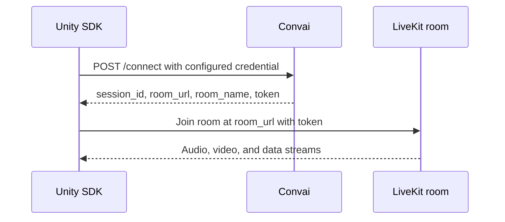

The Convai Unity SDK requires outbound internet access during runtime. Speech, language understanding, and text-to-speech run through Convai over HTTPS and LiveKit WebRTC — there is no offline or LAN mode. Use this page when preparing a corporate network, validating a firewall allowlist, or confirming that a Play mode session reached the correct LiveKit room.

## Required outbound access

Runtime sessions use Convai service endpoints plus LiveKit hosts returned in the connect response. The selected Environment and API Mode determine which REST hosts are needed. Allow outbound traffic from the machine running Unity to the hosts below.

### Convai endpoints

| Host | Port | Protocol | Purpose |
| --- | --- | --- | --- |
| <code class="expression">space.vars.live_server_url</code> | `443` | HTTPS | Connect API — session setup and room credentials |
| `api.convai.com` | `443` | HTTPS | Legacy REST operations, and `POST /vision/object-autotag` from `ConvaiObjectAutotagClient`. |
| `api2.convai.com` | `443` | HTTPS | Upgraded Character details and Narrative reads. |
| `beta.convai.com`, `api2-stg.convai.com` | `443` | HTTPS | Beta environment service and upgraded Character API hosts, when selected. |
| Your token endpoint | Usually `443` | HTTPS | Credential acquisition in endpoint-based Auth Token mode. |

Custom environments need their configured endpoints instead. `ConvaiObjectAutotagClient` is the exception: it posts to `https://api.convai.com/` whatever the project Environment is, unless you pass another `baseUri`. See [Call Convai Vision directly](../features/scene-metadata/scene-auto-tagger-scripting-api.md#call-convai-vision-directly). Emotion configuration travels in the room connect request; there is no separate WebGL emotion preflight.

The Editor also downloads native transport libraries from GitHub release assets. Allow `github.com` and the release-download destinations your network follows. Downloads are written under `Assets/Convai/Plugins/client-sdk-unity-livekit/Runtime/Plugins`; see [Native transport libraries](../platform-guides/native-transport-libraries.md).

### LiveKit minimum requirements

After Convai accepts the connect request, the SDK joins a LiveKit room using the `room_url` and `token` from the response. The wildcard rules below cover signaling and TURN/TLS for LiveKit Cloud:

| Host | Port | Protocol | Purpose |
| --- | --- | --- | --- |
| `convai-technologies-lfslae7c.livekit.cloud` | `443` | TCP | Convai LiveKit signaling endpoint |
| `*.livekit.cloud` | `443` | TCP | LiveKit WebSocket signaling |
| `*.turn.livekit.cloud` | `443` | TCP | TURN/TLS fallback when UDP is blocked |

### Optional direct media paths

LiveKit documents these paths for direct WebRTC media and TCP fallback. Add them when your network policy permits UDP or when the LiveKit connection test shows that the minimum TCP rules are not enough.

| Host | Port | Protocol | Purpose |
| --- | --- | --- | --- |
| `*.host.livekit.cloud` | `3478` | UDP | TURN/UDP connectivity |
| All LiveKit hosts | `50000`–`60000` | UDP | WebRTC media transport |
| All LiveKit hosts | `7881` | TCP | WebRTC TCP fallback |

No inbound ports are required on the client machine. If wildcard domains are disallowed, use the current deployment-specific and regional hostname list in the LiveKit reference rather than allowing only the example Convai hostname. For the full firewall reference, see [Configuring firewalls](https://docs.livekit.io/deploy/admin/firewall/) in the LiveKit documentation.

## How realtime sessions connect

Each character session follows this sequence:

| Connect response field | Runtime use |
| --- | --- |
| `session_id` | Convai session ID for the live session |
| `character_session_id` | Conversation continuity across reconnects |
| `room_url` | LiveKit WebSocket endpoint — for example `wss://convai-technologies-lfslae7c.livekit.cloud` |
| `room_name` | LiveKit room name the client joins |
| `token` | Temporary LiveKit room token used to join the room |

The SDK reads `room_url` from the connect response and passes it to the transport layer. It does not hardcode a LiveKit hostname. The example host `convai-technologies-lfslae7c.livekit.cloud` is one Convai deployment; your logs may show a different `room_url` for the same account over time.

## Authentication

Two credential types are involved in a runtime session.

### API key

Your project API key authenticates requests to Convai. Store it in **Edit > Project Settings > Convai SDK**.

| Request type | Header | Used for |
| --- | --- | --- |
| Connect, API Key mode | `X-API-Key` | Starting a realtime session. |
| Connect, Auth Token mode | `API-AUTH-TOKEN` | Starting a session with a short-lived token from the endpoint or provider. |
| REST using an API key | `CONVAI-API-KEY` | Legacy REST and upgraded Character API reads. |
| `ConvaiObjectAutotagClient` with an API key | `CONVAI-API-KEY` | Sending your own images to Convai Vision. |
| `ConvaiObjectAutotagClient` with an auth token | `API-AUTH-TOKEN` | Sending your own images to Convai Vision with a short-lived token. |

`ConvaiObjectAutotagClient` does not read the project API key. It sends only the credential you pass to `ConvaiObjectAutotagOptions.WithApiKey` or `ConvaiObjectAutotagOptions.WithAuthToken`.

The SDK resolves the selected credential before connecting. Auth Token player builds strip the project API key. A runtime Auth Token is not an upgraded Character API credential; see [Authentication](../authentication/README.md) for the supported paths.

### LiveKit room token

Each successful connect response includes a temporary `token`. The SDK passes this token to LiveKit when joining the room. The token is short-lived and grants access only to that room. Treat it like a password — do not share it in public forums, support tickets, or version control.

## Inspect connection details

Enable **Transport** logging at **Debug** under **Convai > Settings > Diagnostics**, then connect. The 5.0 room summary reports the room name, URL without its query, a shortened session ID and whether a token is present. It does not print a reusable token.

For a structured view, use **Convai Character > Session > Diagnostics > Connect Response > Copy JSON**, or the room manager's **Runtime > Connect Response** control after a connect response exists. The copied response replaces the token with its length. Review the remaining room, session and trace identifiers before sharing it.

Debug log calls compile out of non-development builds unless `CONVAI_DEBUG_LOGGING` is defined. See [Debug tools reference](../troubleshooting/debug-tools-reference.md).

## Test connectivity

Use a live Unity session to confirm that signaling, media and data work together. Check the connection state and exchange a short voice or text turn.

The [LiveKit connection test](https://livekit.com/webrtc/connection-test) requires a room URL and valid test credential. The sanitized SDK logs and copied response cannot supply that credential. If your team maintains a diagnostic workflow, obtain a dedicated test token through that authorized workflow; do not re-enable token logging. This test checks LiveKit connectivity, not Convai authentication or character configuration.

## Firewall validation checklist

Work through this checklist with your network or IT team before deploying to a restricted environment.

1. Confirm outbound TCP `443` to <code class="expression">space.vars.live_server_url</code> and the REST or token hosts selected by your configuration.
2. Confirm outbound TCP `443` to `convai-technologies-lfslae7c.livekit.cloud`, `*.livekit.cloud`, and `*.turn.livekit.cloud`.
3. When UDP is permitted, allow UDP `3478` to `*.host.livekit.cloud` and outbound UDP `50000`–`60000`.
4. Exclude Convai and LiveKit hostnames from TLS inspection if your proxy performs man-in-the-middle decryption on HTTPS or WSS traffic.
5. Enter Play mode, enable **Transport** logs at **Debug**, and confirm a sanitized `Room details received` summary appears with the expected room URL.
6. Confirm the room connects, the character becomes ready and a voice or text turn receives a response.

If steps 5 or 6 fail with `transport.ice_failed` or `transport.signal_disconnected`, see [Connection and API issues](../troubleshooting/connection-and-api-issues.md).

## Troubleshooting

| Symptom | Likely cause | Fix | Verify |
| --- | --- | --- | --- |
| `connection.network_error` or `connection.timeout` | Convai endpoints blocked on TCP `443` | Allow <code class="expression">space.vars.live_server_url</code> and `api.convai.com` | Session reaches `Connected` state |
| `transport.ice_failed` or `transport.peer_connection_failed` | LiveKit UDP or TURN hosts blocked | Add the LiveKit minimum rules and optional direct media paths from this page | `Room details received` log appears; character responds in Play mode |
| No `Room details received` log line | Transport logging below **Debug** | Open **Diagnostics** in Project Settings; set **Transport** category override to **Debug** | Sanitized room summary appears in the Console |
| LiveKit connection test fails after connect succeeds | UDP media or TURN fallback path blocked | Allow UDP `50000`–`60000`, UDP `3478` to `*.host.livekit.cloud`, and TCP `443` to `*.turn.livekit.cloud` | A Unity session exchanges media, or a separately authorized LiveKit test succeeds |
| `connection.connect_invalid_api_key` | Invalid or revoked API key | Copy a fresh key from the [Convai dashboard](https://convai.com) into Project Settings | Connect error no longer fires |
| WebGL mic unavailable | Build served over HTTP | Serve the build over HTTPS or from `localhost` | Microphone permission prompt appears in the browser |


Proxy servers that perform TLS inspection on HTTPS or WSS traffic can break LiveKit signaling. Exclude Convai and LiveKit hostnames from TLS inspection when your environment uses a corporate proxy.


## WebGL deployments

WebGL builds must be served over HTTPS or from `localhost`. HTTP deployments block microphone access due to browser security policy. WebGL uses the same Convai and LiveKit endpoints as desktop builds. See [Platform support matrix](platform-support-matrix.md) and the [WebGL deployment guide](../platform-guides/webgl.md) for browser-specific constraints.

## Next steps

With network requirements confirmed, install the SDK or review connection error codes.


[Install the Convai Unity SDK](../getting-started/installation.md)



[Connection and API issues](../troubleshooting/connection-and-api-issues.md)

