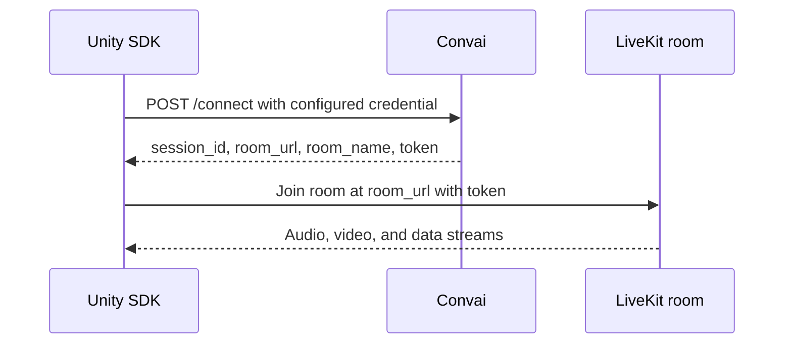

The Convai Unity SDK requires outbound internet access during runtime. Live conversations use Convai over HTTPS and LiveKit WebRTC. The offline Group Conversation simulator is available for local rehearsal. See [Run the Group Conversation sample](../features/group-conversation/run-the-sample.md). Use this page when preparing a corporate network, validating a firewall allowlist, or confirming that a Play mode session reached the correct LiveKit room.

## Required outbound access

Runtime sessions use Convai service endpoints plus LiveKit hosts returned in the connect response. The selected **Environment** and operations determine which service hosts are needed. Allow outbound traffic from the machine running Unity to the hosts below.

### Convai endpoints

| Host | Port | Protocol | Purpose |
| --- | --- | --- | --- |
| <code class="expression">space.vars.live_server_url</code> | `443` | HTTPS | Connect API — session setup and room credentials |
| `api.convai.com` | `443` | HTTPS | Platform API operations and Editor development token acquisition. |
| `api2.convai.com` | `443` | HTTPS | Character API operations. |
| `beta.convai.com`, `api2-stg.convai.com` | `443` | HTTPS | Beta environment service and upgraded Character API hosts, when selected. |
| Your token endpoint | Usually `443` | HTTPS | Credential acquisition in endpoint-based Auth Token mode. |

For a custom environment, allow the configured endpoints. Scene Auto Tagger runs through its [Editor authoring workflow](../features/scene-metadata/scene-auto-tagger.md). Runtime Vision publishes through the room.

The Editor also downloads native transport libraries from GitHub release assets. Allow `github.com` and the release-download destinations your network follows. Downloads are written under `Assets/Convai/Plugins/client-sdk-unity-livekit/Runtime/Plugins`; see [Native transport libraries](../platform-guides/native-transport-libraries.md).

### LiveKit signaling and media

After Convai accepts the connection request, the SDK joins the LiveKit room using the returned URL and token. Use that URL to identify the deployment, then use LiveKit's current hostname list when you need a restricted allowlist. [LiveKit firewall configuration](https://docs.livekit.io/deploy/admin/firewall/)

| Destination | Outbound access | Purpose |
| --- | --- | --- |
| `*.livekit.cloud` | TCP `443` | Secure WebSocket signaling. |
| `*.turn.livekit.cloud` | TCP `443` | TURN relay over TLS when a direct UDP path is unavailable. |
| `*.host.livekit.cloud` | UDP `3478` | TURN over UDP. |
| LiveKit media hosts | UDP `50000`–`60000`, TCP `7881` | LiveKit's recommended media paths. |

Keep regional subdomains in scope. When wildcard rules are unavailable, use the regional and deployment-specific names published by LiveKit. Test the selected path from the network on which your application runs.

## How realtime sessions connect

Unity establishes a room before it can exchange audio, video, or data.

| Connect response field | Runtime use |
| --- | --- |
| `session_id` | Convai session ID for the live session |
| `character_session_id` | Conversation continuity across reconnects |
| `room_url` | LiveKit WebSocket endpoint returned for this room |
| `room_name` | LiveKit room name the client joins |
| `token` | Temporary LiveKit room token used to join the room |

The SDK uses the `room_url` in the response. Use the returned hostname when debugging a deployment.

## Authentication

Two credential types are involved in a runtime session.

### API key

Your project API key authenticates requests to Convai. Store it in **Edit > Project Settings > Convai SDK**.

| Request type | Header | Used for |
| --- | --- | --- |
| Connect, API Key mode | `X-API-Key` | Starting a realtime session. |
| Connect, Auth Token mode | `API-AUTH-TOKEN` | Starting a session with a short-lived token from the endpoint or provider. |
| REST using an API key | `CONVAI-API-KEY` | Platform and Character API operations that use an API key. |

The SDK resolves the selected credential before connecting. Auth Token player builds strip the project API key. The Character API uses its own credential rules; see [Authentication](../authentication/README.md) for the supported paths.

### LiveKit room token

Each successful connect response includes a temporary `token`. The SDK passes this token to LiveKit when joining the room. The token is short-lived and grants access only to that room. Treat it like a password — do not share it in public forums, support tickets, or version control.

## Inspect connection details

Enable **Transport** logging at **Debug** under **Convai > Settings > Diagnostics**, then connect. The room summary reports the room name, URL without its query, a shortened session ID and whether a token is present. It does not print a reusable token.

For a structured view, use **Convai Character > Session > Diagnostics > Connect Response > Copy JSON**, or the room manager's **Runtime > Connect Response** control after a connect response exists. The copied response replaces the token with its length. Review the remaining room, session and trace identifiers before sharing it.

Debug log calls compile out of non-development builds unless `CONVAI_DEBUG_LOGGING` is defined. See [Debug tools reference](../troubleshooting/debug-tools-reference.md).

## Test connectivity

Use a live Unity session to confirm that signaling, media and data work together. Check the connection state and exchange a short voice or text turn.

The [LiveKit connection test](https://livekit.com/webrtc/connection-test) requires a room URL and valid test credential. Use a test room and a dedicated test credential from your team. The SDK logs omit the room token. This test checks LiveKit connectivity, not Convai authentication or character configuration.

## Firewall validation checklist

1. Verify HTTPS access from the client to the Connect, REST, and token endpoints that its configuration uses.
2. Allow the LiveKit signaling and media paths required for your deployment. Ask your network administrator to check TLS inspection and regional endpoint rules if the room cannot exchange media.
3. Connect from the target build on that network. Check the sanitized room URL and whether the character becomes ready.
4. Complete a voice or text turn and verify the reply plays. When the session connects but voice or video fails, inspect the device and media path independently.

## Troubleshooting

| Symptom | Likely cause | Fix | Verify |
| --- | --- | --- | --- |
| `connection.network_error` or `connection.timeout` | Convai endpoints blocked on TCP `443` | Allow <code class="expression">space.vars.live_server_url</code> and `api.convai.com` | Session reaches `Connected` state |
| `transport.ice_failed` or `transport.peer_connection_failed` | LiveKit UDP or TURN hosts blocked | Check the LiveKit signaling and media paths from this page | `Room details received` log appears; character responds in Play mode |
| No `Room details received` log line | Transport logging below **Debug** | Open **Diagnostics** in Project Settings; set **Transport** category override to **Debug** | Sanitized room summary appears in the Console |
| LiveKit connection test fails after connect succeeds | UDP media or TURN fallback path blocked | Allow UDP `50000`–`60000`, UDP `3478` to `*.host.livekit.cloud`, and TCP `443` to `*.turn.livekit.cloud` | A Unity session exchanges media, or a separately authorized LiveKit test succeeds |
| `connection.connect_invalid_api_key` | Invalid or revoked API key | Copy a fresh key from the [Convai dashboard](https://convai.com) into Project Settings | Connect error no longer fires |
| WebGL mic unavailable | Build served over HTTP | Serve the build over HTTPS or from `localhost` | Microphone permission prompt appears in the browser |


Proxy servers that perform TLS inspection on HTTPS or WSS traffic can break LiveKit signaling. Exclude Convai and LiveKit hostnames from TLS inspection when your environment uses a corporate proxy.


## WebGL deployments

WebGL builds must be served over HTTPS or from `localhost`. HTTP deployments block microphone access due to browser security policy. WebGL uses the same Convai and LiveKit endpoints as desktop builds. See [Platform support matrix](platform-support-matrix.md) and the [WebGL deployment guide](../platform-guides/webgl.md) for browser-specific constraints.

## Next steps

With network requirements confirmed, install the SDK or review connection error codes.


[Install the Convai Unity SDK](../getting-started/installation.md)



[Connection and API issues](../troubleshooting/connection-and-api-issues.md)

