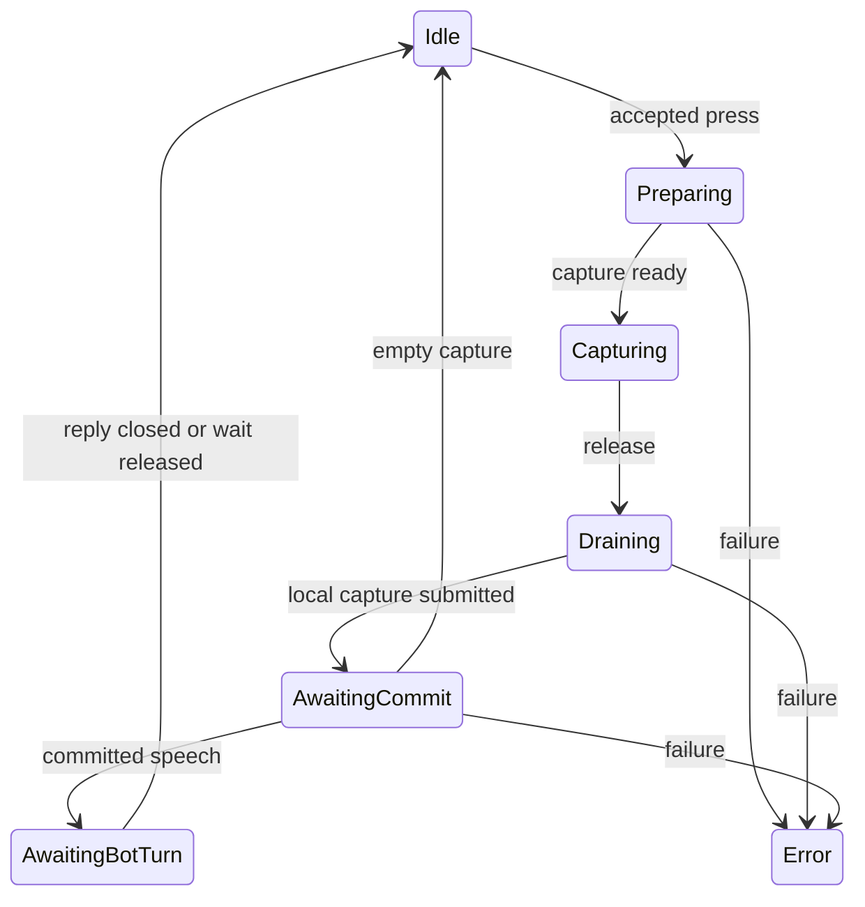

Push-to-talk includes capture, submission, and waiting for the character's reply. A released button does not prove that the service accepted the speech. The controller exposes these stages so input and UI can follow the actual outcome.

## Correlated release

`Auto` release uses this path only when server STT toggling and microphone capture draining are supported. Draining stops local capture and submits its remaining audio to transport; it does not acknowledge server receipt. A correlated stop request then produces `PttCommitResult`, whose status is `Committed`, `Empty`, or `Failed`. Inspect `ReconnectRequired` even after `Committed`: the result can preserve accepted speech while reporting that the connection needs recovery.

The controller's `ReleaseId` identifies this local release. `ResponseId`, when returned, connects the accepted speech to its response. Use `CommitCompleted` for submission outcome and character/audio events for response progress.

## Compatibility release

`Legacy` release, or an unsupported Auto path such as WebGL capture, uses bounded waits around final transcription. `ReleaseTailMs` controls these compatibility windows, not correlated capture draining. A final result can close capture early; otherwise the stop signal and a further bounded window finish the release. Zero skips the tail windows.

The compatibility path does not emit `CommitCompleted` or `PttCommitResult`. Observe `StateChanged` and `IsAwaitingTurnCompletion` for local progress, and use `CompatibilityReason` to identify this path. These signals do not provide a correlated server commit receipt.

Read `CompatibilityReason` before adjusting `ReleaseTailMs`: changing that setting does not tune the Auto drain protocol.

## Waiting for a reply

The next press can be gated by `RequireTurnCompletionBeforeNextPress`. The inactivity timeout pauses while audio is playing or any tracked tool call is active. After the last tool call returns, it restarts only when speech is silent. Expiry returns to `Idle` with `PttError` set to `bot_turn_timeout`, rather than treating it as a capture `Error`. A separate short fallback handles speech-stopped recovery where enabled.

Logical turn completion can arrive while audio remains buffered. Use playback events when the next action must wait for audible completion. A completion event or no-response outcome can close the wait without spoken audio. A tool-call start or stop event does not by itself complete the reply.

## Input ownership and cleanup

`Press()` normally releases on focus loss. `Press(true)` keeps only that accepted press through focus loss for an input source that can still observe release, such as a global hotkey. Pausing, disabling the controller, a disconnect, a target or mode change, and input holds still end it. Background audio policy is separate.

Keep input directed to the controller's `Press`, `Release`, or `SetPressed` methods. Custom input can acquire the manager's disposable push-to-talk input lease to suppress its built-in polling. Group voice captures the accepted target for the held press and requires the supported native Auto path.

## Related pages

- [Push-to-talk scripting reference](../scripting-reference/push-to-talk-api.md)
- [Use your own push-to-talk input](../getting-started/use-your-own-push-to-talk-input.md)
- [Turn-taking modes](turn-taking-modes.md)
