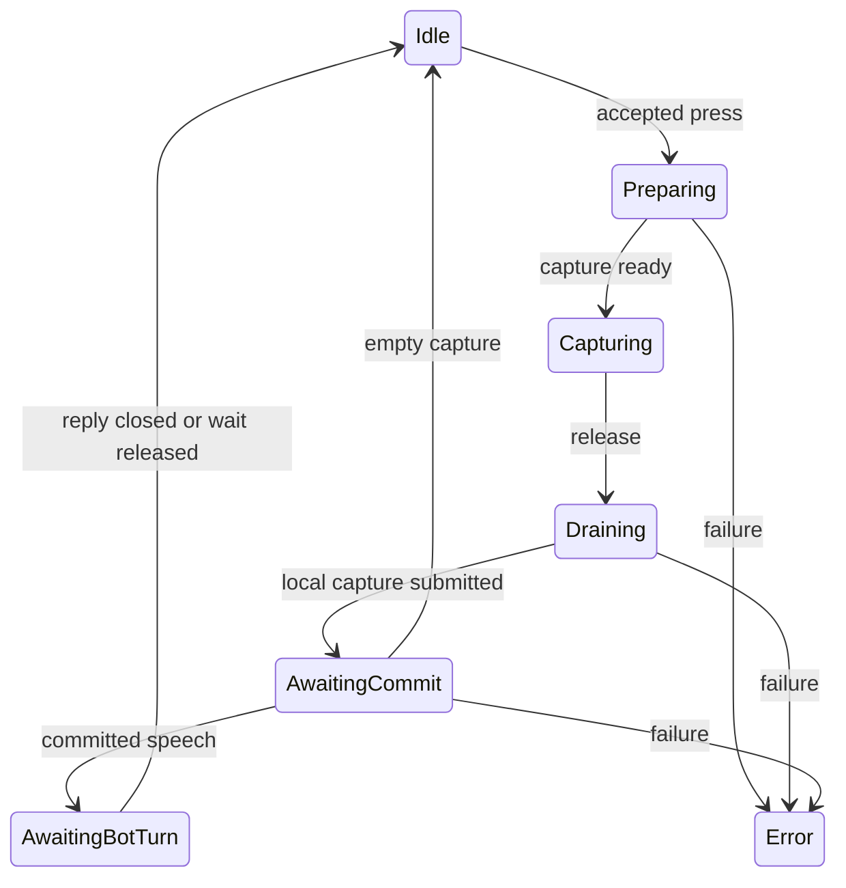

Push-to-talk includes capture, submission, and waiting for the character's reply. A released button does not prove that the service accepted the speech. The controller exposes these stages so input and UI can follow the actual outcome.

## Correlated release

The capture source determines how the SDK finishes the local audio before sending the correlated stop request. A native source that supports sender drain lets the SDK wait for its final samples and then unpublish the track. Other sources, including WebGL, keep capturing for the `ReleaseTailMs` interval before muting. They keep the track published for the next press.

Both capture paths use the same correlated stop request and return a `PttCommitResult`. Local capture completion only confirms the client finished releasing its audio. Check the result's `Status` for `Committed`, `Empty`, or `Failed`. Even a committed result can have `ReconnectRequired` set.

`ReleaseId` identifies the release. `ResponseId`, when supplied, associates accepted speech with a reply. Use `CommitCompleted` for the submission outcome. A turn that has already finished by the time the button is released can keep its accepted reply.

## Waiting for a reply

The next press can be gated by `RequireTurnCompletionBeforeNextPress`. The inactivity timeout pauses while audio is playing or any tracked tool call is active. After the last tool call returns, it restarts only when speech is silent. Expiry returns to `Idle` with the controller’s `BlockedReason` set to `bot_turn_timeout`, rather than treating it as a capture `Error`. A separate short fallback handles speech-stopped recovery where enabled.

Logical turn completion can arrive while audio remains buffered. Use playback events when the next action must wait for audible completion. A completion event or no-response outcome can close the wait without spoken audio. A tool-call start or stop event does not by itself complete the reply.

## Input ownership and cleanup

`Press()` normally releases on focus loss. `Press(true)` keeps only that accepted press through focus loss for an input source that can still observe release, such as a global hotkey. Pausing, disabling the controller, a disconnect, a target or mode change, and input holds still end it. Background audio policy is separate.

Keep input directed to the controller's `Press`, `Release`, or `SetPressed` methods. Custom input can acquire the manager's disposable push-to-talk input lease to suppress its built-in polling. Group voice captures the accepted target for the held press and uses that press ID for its release, including when the capture source uses a release tail.

## Related pages

- [Push-to-talk scripting reference](../scripting-reference/push-to-talk-api.md)
- [Use your own push-to-talk input](../getting-started/use-your-own-push-to-talk-input.md)
- [Turn-taking modes](turn-taking-modes.md)
