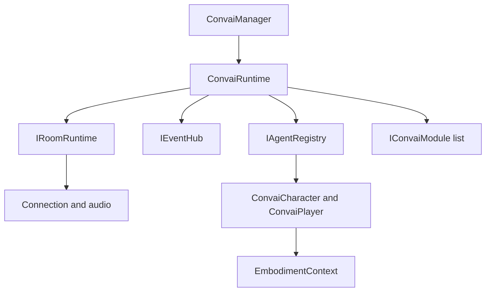

The SDK separates scene components, room services, and character presentation. `ConvaiManager` builds and owns a `ConvaiRuntime`; scene scripts normally use the manager's facades instead of creating a second runtime.

## Runtime ownership

A multi-character room shares transport and connection state. Each character retains its membership, readiness, session identifier, and presentation state. These are different from the current conversation target.

| `IConvaiRuntime` member | Responsibility |
| --- | --- |
| `State` | Runtime lifecycle, separate from room connection state |
| `Room` | `Connection`, `Audio`, `Ownership`, and `Diagnostics` coordinators |
| `Events` | Shared typed event bus |
| `Agents` | Character and player registry |
| `Modules` | Registered feature modules |
| `Transport` | Platform transport provider |
| `Conversation` | Optional standalone conversation provider; null in the default manager setup |
| `Config`, `RuntimePreferences` | Bootstrap configuration and runtime preferences |
| `FeatureVariants`, `Telemetry` | Optional providers; null unless supplied |

There is no `IConvaiRuntime.Persistence`, `IPersistenceProvider`, or `UsePersistence` builder method. See [Stored data](../advanced-topics/stored-data.md) for the stores actually used by the room and presentation services.

## Runtime construction

`ConvaiRuntimeBuilder.Build()` requires a room runtime factory supplied through `UseRoomRuntime(Func<IRoomRuntime>)`. A bare builder does not provide the manager's room wiring. `ConvaiManager` supplies its deferred room runtime and the native or WebGL transport provider.

| Builder method | Purpose |
| --- | --- |
| `UseRoomRuntime` | Required room runtime factory |
| `UseTransport`, `UseConversation` | Transport and optional standalone conversation provider |
| `UseConfig`, `WithRuntimePreferences` | Bootstrap configuration and runtime preferences |
| `UseEventHub`, `UseAgentRegistry` | Event bus and registry |
| `WithEndUserIdentityProvider`, `WithEndUserMetadataProvider` | Connection identity and metadata |
| `UseTelemetry`, `WithFeatureVariants` | Optional telemetry and feature selection |
| `UseLogger` | Runtime logger |
| `AddModule`, `AddModule<T>` | Modules added before build |

For scene customization, use the manager's supported provider setters and `RegisterModule`/`UnregisterModule`. A custom manager subclass can override `CreateRuntimeBuilder`, `BuildRuntime`, `GetPlatformTransportProvider`, or `GetConversationProvider` where appropriate. Creating a separate builder does not modify the runtime already owned by a scene manager.

## Runtime modules and embodiment

Lip sync, Vision, and Narrative Design components implement `IConvaiModule` and register with the runtime. A custom module receives an `IModuleContext`, declares dependencies through `RequiredModules`, and participates in start, pause, resume, and stop. Modules communicate through the event hub or registered module services. See [Implement a custom module](../advanced-topics/implement-a-custom-module.md).

Embodiment controllers share a per-character `EmbodimentContext`. Gaze, Body Animation, Body Language, Conversation Flow, and Emotion use its rig binding, events, and scheduler. This composition root is separate from the runtime builder's module list.

The embodiment scheduler runs Cognition, Expression, and Finalize phases from `Update`. Lower `TickOrder` values run first within a phase; ties use registration order. The Animator conductor applies submitted parameter writes immediately. Facial composition and pose flushing run later in `LateUpdate`. See [Character embodiment](character-embodiment.md).

## Runtime lifecycle

The runtime passes through `Created`, `Starting`, `Running`, `Pausing`, `Paused`, `Resuming`, `Stopping`, `Stopped`, and `Disposed`. A stopped runtime cannot restart. Await lifecycle operations to observe completion and handle failures; merely creating an operation is not proof it succeeded.

The manager owns cleanup. If you build and own a concrete `ConvaiRuntime` yourself, stop it and call its `DisposeAsync()`. Do not dispose the scene manager's facades from consumer code.

## Related pages

- [Session lifecycle](session-lifecycle.md) explains room connection and resume.
- [Event system](event-system.md) explains scene relays and typed events.
- [Extending the SDK](../advanced-topics/extending-the-sdk.md) covers supported extension points.
