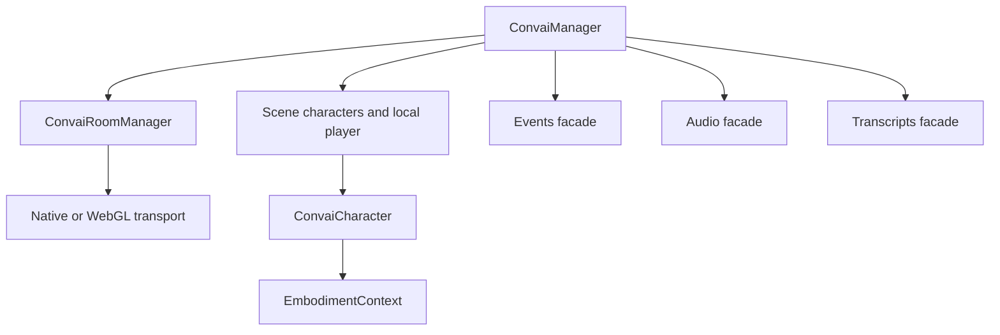

`ConvaiManager` owns the runtime for a Unity scene. The runtime connects scene characters and the local player to a room and exposes separate facades for commands, audio, events, and transcripts.

## Runtime ownership

A multi-character room shares transport and connection state. Each character retains its own membership, readiness, session identifier, and presentation state. The conversation target identifies the route for the next player turn. See [Session lifecycle](session-lifecycle.md) for the difference between connection and readiness.

## Public entry points

| Surface | Responsibility |
| --- | --- |
| `ConvaiManager` | Connect, disconnect, select the roster and initial character, and route the conversation |
| `ConvaiRoomManager` | Configure the room in the Inspector and read room diagnostics |
| `ConvaiManager.Events` | Subscribe to typed events or the subscription-only raw event interface |
| `ConvaiManager.Audio` | Control local capture, playback, and track subscriptions |
| `ConvaiManager.Transcripts` | Read history entries and live captions |
| `ConvaiPlayer` and `ConvaiCharacter` | Supply display identity, submit typed player input, and act on character-specific features |

The manager builds its services during `Awake` and disposes them when the runtime ends. Use `IsInitialized` before accessing facade properties. Register listeners for only as long as their consumers need them.

## Runtime modules and embodiment

Lip sync, Vision, and Narrative Design register functionality with the runtime. A custom `IConvaiModule` receives an `IModuleContext`, declares module dependencies, and participates in start, pause, resume, and stop. Use the manager's `RegisterModule` and `UnregisterModule` methods for the module's lifetime.

Embodiment controllers share a per-character `EmbodimentContext`. The context supplies rig bindings and schedules Cognition, Expression, and Finalize phases. Facial composition and pose flushing run in `LateUpdate`. See [Character embodiment](character-embodiment.md).

## Related pages

- [ConvaiManager API](../scripting-reference/convaimanager-api.md)
- [Event system](event-system.md)
- [Runtime module system](../advanced-topics/extending-the-sdk.md)
