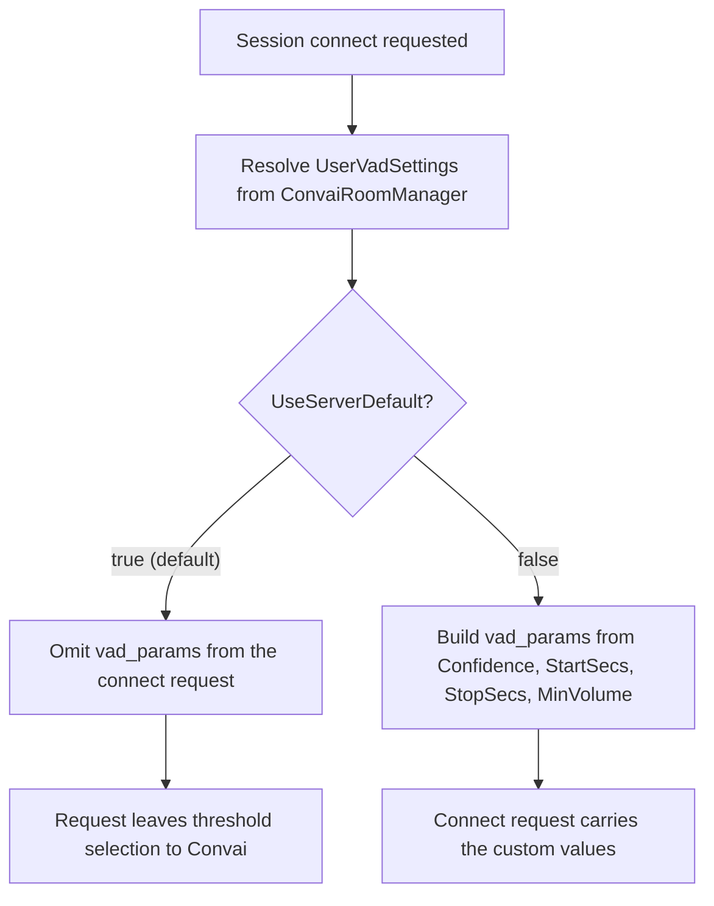
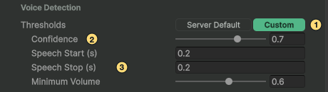

Voice activity detection (VAD) is how Convai decides whether the audio arriving from a user's microphone contains speech. The Convai Unity SDK exposes `UserVadSettings` so a scene can tune that decision — confidence, timing, and volume thresholds — instead of always relying on Convai's built-in defaults. The SDK resolves these settings once, at the moment a session connects, and sends them as part of the connect request.

`UserVadSettings` applies to Convai's discrete LLM/STT processing path. It does not affect a realtime provider's own voice activity detection or how push-to-talk decides when a turn ends — those paths use their own turn-ending logic, covered in [Turn-taking modes](turn-taking-modes.md).

***

## Why voice activity detection is a connect-time setting

`UserVadSettings` tunes Convai's audio pipeline rather than a value a scene needs to change moment-to-moment. A factory-floor training simulation with background noise needs a higher `MinVolume` and `Confidence` threshold than a quiet home-office scene, but neither scenario needs to change that threshold while a conversation is already in progress. The SDK reflects this: it reads `UserVadSettings` once, immediately before it builds the connect request for a session, and does not expose any API to push updated values into a session that is already `Connected`.

This also means `UserVadSettings` behaves differently from `TurnTakingOptions`. `RoomSessionConnectOptions` — the per-invocation override object passed to a connect call — carries a `TurnTaking` field, so turn-taking behavior can be overridden per connection attempt. It has no equivalent field for `UserVadSettings`. The SDK reads the field on `ConvaiRoomManager`.

***

## `UserVadSettings` field reference

| Field | Type | Default | Valid range | Description |
| --- | --- | --- | --- | --- |
| `UseServerDefault` | `bool` | `true` | — | When enabled, the SDK omits `vad_params` from the connect request entirely and the backend chooses its defaults. Disable it to send the four fields below instead. |
| `Confidence` | `float` | `0.7` | `0`–`1` | Confidence threshold Convai's voice activity detector requires before treating incoming audio as speech. |
| `StartSecs` | `float` | `0.2` | `≥ 0` seconds | Duration of continuous speech required before Convai treats the user's speech as started. |
| `StopSecs` | `float` | `0.2` | `≥ 0` seconds | Duration of silence required before Convai treats the user's speech as stopped. The backend may interpret or constrain requested values. |
| `MinVolume` | `float` | `0.6` | `0`–`1` | Minimum input volume Convai's voice activity detector requires before considering audio a speech candidate. |

These are client defaults. Omitting `vad_params` delegates the choice to the backend; the client source does not guarantee equivalence to sending these numbers explicitly.

***

## Server default vs. custom values at connect

Each time a session connects, the SDK resolves `UserVadSettings` from its configured source and decides what to send.

When `UseServerDefault` is `true`, the connect request's `vad_params` field is left `null`, and the SDK's request serializer omits `null` fields entirely — `vad_params` does not appear in the payload sent to Convai at all. When `UseServerDefault` is `false`, the SDK sends `vad_params` as an object with `confidence`, `start_secs`, `stop_secs`, and `min_volume`.

The SDK logs the resolved decision on every connect attempt:

- Server default: `Using server default vad_params (field omitted from connect payload).`
- Custom values: `Sending custom vad_params: confidence=<value>, start_secs=<value>, stop_secs=<value>, min_volume=<value>`


These log lines come from the SDK's internal logger and only appear if your project's log level surfaces `Debug`- and `Info`-severity messages.


***

## Where the room gets its thresholds

`ConvaiRoomManager` stores `UserVadSettings` on the scene component. `EffectiveUserVadSettings` returns a clone.

To send custom detection thresholds instead of Convai's defaults, use **Listening > Voice Detection > Thresholds > Custom** on the **Convai Room Manager**. The next connect request carries the **Confidence**, **Speech Start (s)**, **Speech Stop (s)**, and **Minimum Volume** values.

<figure><figcaption>
(1) Select <strong>Custom</strong> under <strong>Thresholds</strong>. (2) <strong>Confidence</strong> sets how sure Convai must be that the audio contains speech. (3) <strong>Speech Start (s)</strong> and <strong>Speech Stop (s)</strong> set timing thresholds.
</figcaption></figure>


`UserVadSettings` has no public setter and no per-connect override on `RoomSessionConnectOptions`. Set it on `ConvaiRoomManager` before the scene connects — changes made while a session is already `Connected` do not apply until the next connect attempt.


***

## Next steps

You now know what `UserVadSettings` controls, how the SDK decides between Convai's defaults and your custom values, and where to configure it. Read Turn-taking modes to see how voice activity detection relates to hands-free turn-ending behavior, then Event system to subscribe to session and character events at runtime.


[Turn-taking modes](turn-taking-modes.md)



[Event system](event-system.md)

