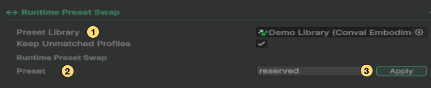
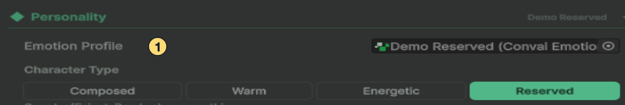

An embodiment preset bundles one profile per module — Gaze, Body Animation, Body Language, Conversation Flow, and Emotion — into a single asset, so a character archetype's whole personality ships and updates as one unit instead of five separate profile assignments. Use this page to build a preset and apply it to a character.

## Prerequisites

- The Convai Unity SDK installed
- A character with the embodiment modules you want to bundle already added, each with its own profile assigned in the Inspector

## Create a preset asset

Select **Assets > Create > Convai > Embodiment > Preset**. This creates a `ConvaiEmbodimentPreset` asset with an **Identity** section holding **Preset ID** (defaults to `default`) and **Description**.

**Preset ID** is a short identifier other systems reference this preset by — for example a `ConvaiEmbodimentPresetLibrary` entry. Set it to something specific, such as `guide-npc` or `drill-instructor`, rather than leaving the default.

## Add features to the preset

Under **Features**, click **Add Feature** to add one profile slot. Each row offers a **Feature** dropdown scoped to the embodiment modules present in the project — **Body Animation**, **Body Language**, **Conversation Flow**, **Emotion**, and **Gaze** — and a **Settings** field that only accepts the profile asset type that feature declares, so you cannot assign a mismatched profile.

| Feature | Module id | Profile type |
|---|---|---|
| Body Animation | `convai.body-animation` | `ConvaiBodyAnimationProfile` |
| Body Language | `convai.body-language` | `ConvaiBodyLanguageProfile` |
| Conversation Flow | `convai.conversation-flow` | `ConvaiConversationFlowProfile` |
| Emotion | `convai.emotion` | `ConvaiEmotionProfile` |
| Gaze | `convai.gaze` | `ConvaiGazeProfile` |

Add one row per module you want the preset to control. You do not need a row for every module — a preset that only bundles Gaze and Emotion is valid. Click **Remove Last** to delete the most recently added row, or the **×** button on a row to delete that one.


Use one row per feature. **Setup Check** flags duplicate rows. At runtime, the binding uses the first matching row.


Read a slot's profile from a script with `TryGetProfile(string moduleId, out ScriptableObject profile)`, which returns `false` when no slot matches the given module id.

## Apply a preset to a character

Add the **Preset** component (`Convai/Embodiment/Preset` in the Add Component menu) to the character root and assign the preset asset to **Embodiment Preset** in the **Preset** section.

**Keep Unmatched Profiles** is under **Advanced**; its scripting property is `PreserveMissingSlots`. When enabled, the binding applies the matching slot to each profile receiver registered with the character's `EmbodimentContext`. A module with no matching slot either keeps its Inspector-assigned profile or receives no profile, depending on **Keep Unmatched Profiles**:

| **Keep Unmatched Profiles** (`PreserveMissingSlots` in code) | Behavior for a module with no matching preset slot |
|---|---|
| `true` (default) | Keeps the profile already assigned on that module in the Inspector |
| `false` | Clears the module to no profile |

Call `Apply(ConvaiEmbodimentPreset)` from a script to switch presets at runtime; it applies the preset to the receivers registered at the time. The binding also applies its current preset when a module enables and registers later. Derive custom modules from `ConvaiCharacterModule<TProfile>` so they register with the context.

## Swap presets at runtime with a library

Assign a `ConvaiEmbodimentPresetLibrary` asset (**Assets > Create > Convai > Embodiment > Preset Library**) to **Preset Library** under **Runtime Preset Swap** to enable id-based swapping at runtime. A library holds an ordered list of presets and resolves one by `Find(id)`, matching each preset's `PresetId` case-insensitively.


Assigning a library does not apply anything by itself. In Play mode, open **Runtime Preset Swap**, choose a **Preset**, and select **Apply**. Alternatively, call `ApplyPresetById(string id)` on the `Preset` component to look up a preset in the library and apply it — the library is a lookup table, not an active binding.


<figure><figcaption>
In the binding Inspector, assign <strong>Preset Library</strong> (1), choose a <strong>Preset</strong> (2), and select <strong>Apply</strong> (3).
</figcaption></figure>

<figure><figcaption>
After the swap, <strong>Emotion Profile</strong> (1) shows the Demo Reserved profile assigned by the selected preset.
</figcaption></figure>

## Verify a preset applied

Open the preset asset's **Setup Check** section: it lists findings such as duplicate feature rows, empty entries, unselected or uninstalled features, and wrong settings types. An entry without settings is informational. These checks inspect the asset, not characters that use it. Use individual fixes or **Fix Everything Above** where offered. A preset with no findings shows a clean status.

After entering Play mode, check each module's profile field in the Inspector on the character: it should show the profile from the preset's matching slot, or the module's own profile if **Keep Unmatched Profiles** left it untouched. A receiver that cannot accept a profile logs a warning naming the module and profile. Use **Setup Check** on the preset asset to find invalid or duplicate slots.

## Next steps


[Character rig setup](character-rig-setup.md)



[Embodiment Editor window](embodiment-editor.md)



[Asset ownership and copy-on-write](../core-concepts/asset-ownership.md)

