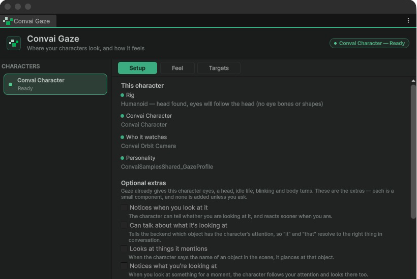

Open **Convai > Gaze Editor** to inspect gaze across characters in the scene. The window is titled **Convai Gaze** and provides **Setup**, **Feel**, **Targets**, and **Live** tabs. The component Inspector's **Advanced settings & targets →** button opens the same window.

## Character selection

Select a character in the left **CHARACTERS** list. A **Ready** card can drive gaze; **Not working** directs you to its **Setup** tab. This window label differs from the component Inspector's **Action Needed** status chip.

If the list is empty, the window shows **No characters with Gaze**. Add **Convai > Embodiment > Gaze** to a character before returning to the window.

## Setup tab

**This character** reports the rig, owning character, player anchor, and personality setup. A blocking rig issue takes priority over optional tuning. A fixable row offers its own action, such as **Add Rig Binding**, **Show Me** for duplicate bindings, **Use This Camera**, or **Add a Personality**.

**Optional extras** lists six capabilities. Enabling one adds or enables its provider component on the selected character:

| Capability | Provider |
|---|---|
| Notices when you look at it | `PlayerAttentionSensor` |
| Can talk about what it's looking at | `GazeDynamicContextBridge` |
| Looks at things it mentions | `GazeReferentialGlances` |
| Notices what you're looking at | `GazeJointAttention` |
| Looks at other Convai characters | `CharacterGazeTargetProvider` |
| Pupils widen with excitement | `ConvaiEyePupilDriver` |

The checkboxes establish component presence. Confirm the behavior in Play mode, especially for providers that require world-object metadata, action configuration, or suitable eye materials. See [Gaze targets and providers](targets-and-providers.md) for those dependencies.

**Rig report** and **Facing direction** explain the resolved head, neck, eyes, and axis convention. Eye-backend warnings appear under **Worth knowing**; successful or informational diagnostics are not all repeated as separate rows. A custom rig can work with explicit mappings and calibrated gaze axes. Use [Character rig setup](../character-rig-setup.md) for those controls.

<figure><figcaption>
This sample has a resolved head but no eye bones or eye shapes. Ready means gaze can run with head motion; it does not mean every eye channel is available.
</figcaption></figure>

## Feel tab

**Personality** selects the character's `ConvaiGazeProfile`. With none assigned, **Using the SDK defaults** explains that the character can still run and offers a personality-creation action.

With a profile assigned, the tab hosts the profile Inspector. Its **Personality** section contains **Character Type**, the **Eye contact**, **Liveliness**, and **Head movement** dials, and **Behaviour per conversation state**. Further sections cover **Who It Looks At**, **While Walking**, **Head & Body**, **Eyes & Blinking**, **Reactions**, and **Advanced**.

A shared-profile notice means edits affect every character using that asset. See [Tune gaze personality](tune-gaze-personality.md) before making a character-specific variation.

## Targets tab

**Worth looking at** lists marked scene targets. Select a scene object and use **Mark the selected object** to add a gaze target. Ordinary targets yield to the player during conversation unless given a higher priority.

**Advanced targeting** contains controls omitted from the normal component Inspector:

| Control | Purpose |
|---|---|
| **Create A Player Anchor Automatically** | Provides the default player target when needed. |
| **Aim Point** | **Automatic**, **Exact**, or **Offset** aiming on the player anchor. |
| **Aim Offset** | Anchor-local offset; shown only with **Offset**. |
| **Focus Style** | **Relaxed** (`Social`) or **Locked** (`Exact`) fidelity while focus is active. |
| **Let Scripts Override A Locked Focus** | Allows explicit `GazeAt` requests to interrupt `Exact` focus. |
| **Ignore Glances While Focused** | Absorbs brief glances while conversational focus is held. |

The player's transform, eye-contact mode, and conversation-following mode remain in the component's **Who It Looks At** section. See [Configure eye contact](configure-eye-contact.md).

## Live tab

The tab requires Play mode; otherwise it shows **Not running** and asks you to enter Play mode. **Looking at** displays the target transform's name when one exists, or the target kind for a point without a transform. Inspect engagement, movement, and conversation-attention diagnostics while the character talks or changes targets.

**Off target** measures the remaining angular error. A small changing error can come from normal fixation movement; a persistently large one can indicate an unreachable target or incorrect rig axes. **Following the conversation** describes the speaker or the condition preventing attention. A scripted look can take priority over automatic conversation attention.

## Related reference


[Gaze profile reference](profile-reference.md)



[Troubleshoot gaze](troubleshooting.md)

