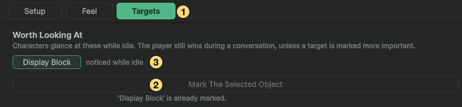
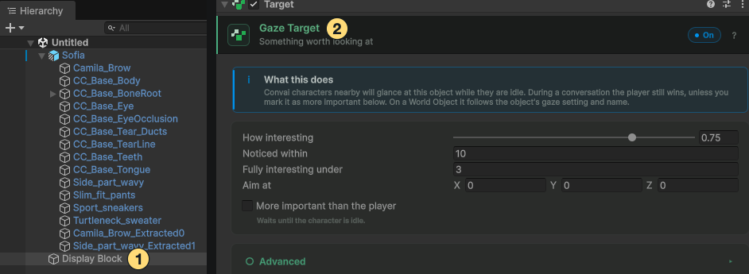

Mark scene objects as gaze candidates, configure advanced gaze components, or register a custom provider from code. Use this page after adding `ConvaiGazeController` to a character, when you want it to notice specific scene objects, other characters, or the player in a non-default way.

## Prerequisites

* `ConvaiGazeController` added to the character (`Convai/Embodiment/Gaze`).
* A scene object to mark, or a script that supplies its own candidates.

## Mark a scene object as a gaze target

Add `ConvaiGazeTarget` (`Convai/Gaze/Target`) to any `GameObject` to make it a gaze candidate for every Convai character in the scene. No scene metadata is required.

<figure><figcaption><p>Open <strong>Targets</strong> (1), select a prop in the Hierarchy, and choose <strong>Mark The Selected Object</strong> (2). The marked prop appears under <strong>Worth Looking At</strong> (3).</p></figcaption></figure>

<figure><figcaption><p>(1) Select a prop in the Hierarchy. (2) Its <strong>Gaze Target</strong> component lets you check range, relevance, and the aim point.</p></figcaption></figure>

| Field | Default | Purpose |
|---|---|---|
| **More important than the player** | off | Switches priority between `5` and `15`. Use **Advanced > Priority** for a custom value. The player anchor normally publishes at `10`. |
| **How interesting** (`baseRelevance`) | `0.75` | Relevance while inside **Fully interesting under**; range `0`–`1`. |
| **Noticed within** (`maxDistance`) | `10` (meters) | Distance beyond which the target stops being a candidate. |
| **Fully interesting under** (`fullRelevanceDistance`) | `3` (meters) | Distance below which relevance is at its maximum. |
| **Aim at** (`aimOffset`) | `(0, 0, 0)` | Local-space offset from the transform to the exact point the eyes aim at, such as the top of a painting. |

## Add advanced gaze providers

The Gaze Editor's **Setup > Optional extras** checkboxes add or enable six optional capabilities. **Targets > Worth looking at > Mark the selected object** adds a scene target. Player Anchor is a separate provider.

The advanced providers live under `Convai/Gaze/Advanced/` in the Add Component menu. Each is opt-in — adding `ConvaiGazeController` gives a character eyes, a head, idle life, blinking, body turns, and conversational rhythm with no further setup; these components add further capabilities on top.

### Character Target — mutual gaze between characters

`CharacterGazeTargetProvider` (`Convai/Gaze/Advanced/Character Target`) changes the defaults for looking at other characters and being visible to them. Characters running Gaze already participate in mutual gaze. Add **Character Target** to change those settings or to expose a character without a Gaze controller as a target.

| Field | Default | Purpose |
|---|---|---|
| `Publish Self` | `true` | Register this character as a target other characters can look at. |
| `Look At Others` | `true` | Generate gaze candidates for the other registered characters. |
| `Priority` | `7` | Between the player anchor (`10`) and world objects (`5`), so the player wins during conversation but characters beat background props. |
| `Speaking Priority` | `9` | Priority tier used while this character is the one speaking — above the idle `Priority` tier so a listener that has settled on the speaker is not pulled away to a bystander, and still below the player anchor (`10`). |
| `Max Distance` | `12` (meters) | Distance beyond which another character stops being a candidate (`0` = unlimited). |
| `Full Relevance Distance` | `4` (meters) | Distance below which another character is at full relevance. |
| `Idle Glance Relevance` | `0.35` | Relevance of a non-speaking character. A speaking character is always fully relevant, so listeners turn to the active speaker. |
| `Eye Line Offset` | `1.6` (meters) | Eye-line height other characters aim at until this character's head bone resolves from the rig binding. |
| `Enable Idle Glances` | `true` | While idle, exchange occasional brief glances with nearby characters. |
| `Idle Glance Interval Min` / `Max` | `5` / `12` (seconds) | Interval range between idle character-to-character glances. |
| `Idle Glance Duration` | `1.4` (seconds) | Duration of one idle character glance. |
| `Idle Glance Engagement` | `0.5` | Commitment level of an idle glance. |

### Eye Pupil Driver — pupil dilation

`ConvaiEyePupilDriver` (`Convai/Gaze/Advanced/Eye Pupil Driver`) dilates a character's pupils with the gaze module's smoothed arousal signal. It writes through a reused `MaterialPropertyBlock` per renderer, so the shared material asset is never mutated.

| Field | Default | Purpose |
|---|---|---|
| `Renderers` | empty | Explicit renderer targets. Leave empty to auto-discover every `SkinnedMeshRenderer` under the character whose material exposes the shader property. |
| `Shader Property Name` | `_PupilScale` | Shader float property to drive. Defaults to the Reallusion RL5 cornea shader's pupil-scale property. |
| `Max Dilation Percent` | `12` (range `5`–`20`) | Maximum pupil dilation at full arousal, as a percentage of each renderer's base property value. |
| `Invert Sign` | `false` | Flips the dilation direction for a rig where a larger property value shrinks the pupil. |

### Dynamic Context Bridge — attention grounding

`GazeDynamicContextBridge` (`Convai/Gaze/Advanced/Dynamic Context Bridge`) mirrors the character's current gaze object into the Convai dynamic context key `current_attention_object`, to supply the object name for attention grounding. This is client context submission; it does not guarantee how a response will resolve a pronoun. In the current SDK, the named object must exist in the character's runtime action configuration. A missing action object is skipped quietly, with any previous attention cleared.

| Field | Default | Purpose |
|---|---|---|
| **Report only when committed** (`_engagementThreshold`) | `0.5` | Minimum gaze engagement required before the object is published. |

### Joint Attention — notice what the player looks at

`GazeJointAttention` (`Convai/Gaze/Advanced/Joint Attention`) notices what the player is looking at and glances there too, then returns to whatever the gaze policy dictates — the "I see what caught your eye" beat. It is built entirely on the public `GlanceAt` API, so it needs no changes to the gaze core.

| Field | Default | Purpose |
|---|---|---|
| `Cone Angle Degrees` | `8` | Cone half-angle used to decide whether the player's gaze ray is aimed at a candidate object. |
| `Max Distance Meters` | `12` | Maximum distance from the player at which a candidate object can be noticed. |
| `Dwell Seconds` | `0.7` | Continuous dwell the player must hold on an object before the character notices it. |
| `Glance Duration Seconds` | `1.4` | Duration of the glance at the noticed object. |
| `Reaction Delay Min/Max Seconds` | `0.2` / `0.5` | Delay range between noticing and glancing. |
| `Cooldown Seconds` | `10` | Per-object cooldown before the same object can be noticed again. |
| `Global Min Interval Seconds` | `4` | Minimum interval between any two joint-attention glances. |
| `Evaluation Interval Seconds` | `0.2` | Interval between player-gaze evaluations (~5 Hz by default). |
| `Publish Attention Context` | `false` | Publish the noticed object's name to the Convai dynamic context. |
| `Active When Idle` / `Active When Listening` | `true` / `true` | Dialogue states in which joint attention is active. |

### Referential Glances — glance at mentioned objects

`GazeReferentialGlances` (`Convai/Gaze/Advanced/Referential Glances`) makes the character glance at a registered world object when its own spoken line mentions it — "take a look at the painting". It subscribes to `ConvaiCharacter.OnSpokenLine` and matches registered `ConvaiWorldObject.ObjectName` values, not plain `ConvaiGazeTarget` names. For a logical group it resolves a nearby physical member's interaction point. Call `NotifyUtterance(string)` to supply a line from another integration; the glance still uses the public `GlanceAt` API.

| Field | Default | Purpose |
|---|---|---|
| `Glance Duration` | `1.6` (seconds) | Duration of the glance at a mentioned object. |
| `Cooldown Seconds` | `10` | Per-object cooldown before the same object can be re-glanced. |
| `Max Mention Words` | `4` | Longest object name, in words, that is matched. |
| `Min/Max Delay Seconds` | `0.3` / `0.8` | Delay range between the mention and the glance. |

### Player Anchor — override how the character finds "the player"

`PlayerAnchorTargetProvider` (`Convai/Gaze/Advanced/Player Anchor`) is the out-of-the-box "look at the player" provider. `ConvaiGazeController` auto-provisions one at runtime when the character has no other provider. Add it manually to override the anchor per character — split-screen, multiplayer, or cutscene rigs.

| Field | Default | Purpose |
|---|---|---|
| `Priority` | `10` | Static priority tier compared across providers. |
| `Explicit Anchor` | none | When empty, resolves the manager's conversation view camera, `Camera.main`, the first enabled Game camera, then the `ConvaiPlayer` transform. |
| `Eye Line Offset` | `1.6` (meters) | Vertical lift applied to explicit non-camera anchors. |
| `Aim Mode` | `Auto` | `GazeAnchorAimMode` — where on the anchor gaze aims. |
| `Face Presence` | `Auto` | `GazeAnchorFacePresence` — whether the character treats the anchor as a face and looks around it (its eyes, its mouth) instead of aiming exactly at it. `Auto` decides from the anchor: one assigned by hand is treated as a face, while a camera the SDK resolved on its own is a viewpoint and is aimed at exactly. `Face` always treats the anchor as a face — correct in VR, where the camera sits between the player's eyes. `Point` always aims exactly at the anchor. |
| `Local Aim Offset` | `(0, 0, 0)` | Anchor-local aim offset used by `Local Offset` mode. |
| `Max Distance` | `8` (meters) | Distance beyond which the player is no longer a candidate. |
| `Full Relevance Distance` | `4` (meters) | Distance below which relevance is at its maximum. |
| `Check Line Of Sight` | `false` | Require an unobstructed line to the player. When occluded, relevance decays and the reappearance plays the normal acquisition saccade. |
| `Obstruction Mask` | `Physics.DefaultRaycastLayers` | Layers treated as vision obstructions for the line-of-sight test. |
| `Line Of Sight Interval` | `0.1` (seconds) | Throttle between line-of-sight raycasts. |
| `Line Of Sight Origin Height` | `1.6` (meters) | Eye-line height above the character root the vision ray starts from. |

### Player Attention Sensor — know when the player is looking back

`PlayerAttentionSensor` (`Convai/Gaze/Advanced/Player Attention Sensor`) tells the character whether the player is looking at it. The default signal is the resolved player view's forward ray. XR eye tracking plugs in through `IPlayerGazeRaySource` (see [Supply a custom player gaze ray for XR](#supply-a-custom-player-gaze-ray-for-xr)) without any XR package dependency. The smoothed signal publishes to the Convai dynamic context key `player_attention` (`looking_at_me` / `away`, edge-triggered).

| Field | Default | Purpose |
|---|---|---|
| `Detection Interval` | `0.1` (seconds) | Interval between detection samples. |
| `Base Half Angle` | `6` (degrees) | Base acceptance cone half-angle at conversational distance. |
| `Max Half Angle` | `28` (degrees) | Maximum acceptance cone half-angle at close range. |
| `Character Angular Radius` | `0.35` (meters) | Approximate angular radius of the character's head/upper body. |
| `Head Height` | `1.6` (meters) | Eye-line height used when no Head bone is resolved. |
| `Rise Seconds` / `Fall Seconds` | `0.5` / `1.5` | Time constants for the attention signal to build and decay. |
| `Enter Threshold` / `Exit Threshold` | `0.6` / `0.35` | Hysteresis thresholds for publishing `looking_at_me` / `away`. |
| `Publish To Context` | `true` | Publish the looking/away state to the Convai dynamic context. |

### Gaze targets on world objects

Add `ConvaiGazeTarget` to a `ConvaiWorldObject` to make it a candidate. The object and its logical group must both have **Gaze Enabled** on. The candidate uses the logical object's name and, when **Aim at** has no offset, aims at the object's visible bounds.

The [Scene Auto Tagger](../../features/scene-metadata/scene-auto-tagger.md) can add `ConvaiGazeTarget` while applying tags. If a scene still has the old World Object Target component, replace it with **Convai > Gaze > Target**.

## Extend targeting from code

### Register a custom target provider

Implement `IGazeTargetProvider` and call `ConvaiGazeController.RegisterTargetProvider` for candidates that do not come from a `MonoBehaviour` on the character hierarchy — a systems-level source, a netcode-synced target, or a test double.

```csharp
using System.Collections.Generic;
using Convai.Domain.Embodiment.Semantics;
using Convai.Modules.Gaze.Components;
using Convai.Modules.Gaze.Providers;
using UnityEngine;

public sealed class ScannerBeaconProvider : IGazeTargetProvider
{
    private readonly Transform _beacon;

    public ScannerBeaconProvider(Transform beacon) => _beacon = beacon;

    public void CollectCandidates(in GazeObserver observer, List<GazeTargetCandidate> into)
    {
        if (_beacon == null) return;

        into.Add(new GazeTargetCandidate(
            GazeTargetKind.WorldObject,
            priority: 6,
            relevance: 0.8f,
            target: _beacon,
            worldPoint: _beacon.position,
            debugName: observer.WantsNames ? "Scanner Beacon" : null));
    }
}

// Attached to the character (or holding a serialized ConvaiGazeController reference):
public sealed class ScannerBeaconRegistrar : MonoBehaviour
{
    [SerializeField] private Transform beaconTransform;

    private ConvaiGazeController _gaze;
    private ScannerBeaconProvider _provider;

    private void OnEnable()
    {
        _gaze = GetComponent<ConvaiGazeController>();
        if (_gaze == null || beaconTransform == null) return;
        _provider = new ScannerBeaconProvider(beaconTransform);
        _gaze.RegisterTargetProvider(_provider);
    }

    private void OnDisable()
    {
        if (_gaze != null && _provider != null)
            _gaze.UnregisterTargetProvider(_provider);
        _provider = null;
        _gaze = null;
    }
}
```

`CollectCandidates` runs every cognition tick. Append zero or more candidates to the supplied list. Leave the list untouched when you have no candidate, and use `WantsNames` before constructing debug labels. Call `UnregisterTargetProvider` when the provider is no longer valid.

### Supply a custom player gaze ray for XR

`IPlayerGazeRaySource` supplies the world-space ray the player is currently looking along, so `PlayerAttentionSensor` and `GazeJointAttention` can tell whether the player is looking at something without a hard XR package dependency in the SDK. Implement it over an OpenXR or vendor eye-tracking adapter and register it once on the character's Gaze controller. The example leaves the eye-tracking call for your XR adapter.

```csharp
using Convai.Modules.Gaze.Components;
using Convai.Modules.Gaze.Providers;
using UnityEngine;

public sealed class OpenXrEyeTrackingSource : IPlayerGazeRaySource
{
    public bool TryGetPlayerGazeRay(out Ray ray)
    {
        // Populate `ray` from the XR eye-tracking API. Return false while tracking is lost.
        ray = default;
        return false;
    }
}

// Attached to the character:
public sealed class XrGazeRaySetup : MonoBehaviour
{
    private ConvaiGazeController _gaze;
    private OpenXrEyeTrackingSource _source;

    private void OnEnable()
    {
        _gaze = GetComponentInChildren<ConvaiGazeController>();
        if (_gaze == null) return;
        _source = new OpenXrEyeTrackingSource();
        _gaze.SetGazeRaySource(_source);
    }

    private void OnDisable()
    {
        if (_gaze != null) _gaze.SetGazeRaySource(null);
        _source = null;
        _gaze = null;
    }
}
```

The Player Attention and Joint Attention components read the same source from the character's Gaze controller. Disabling this setup resets the controller to its default source.

Return `false` when no ray is available this frame — tracking lost, headset off — so the consumer falls back to the camera ray. Register a source on each character that needs it.

## How target movement is filtered

Every gaze target's aim point is smoothed before the head's movement detector sees it, so a centimetre or two of ordinary motion — a talking character's head bob, camera sway on a handheld rig — never reads as a moving target and never triggers a head re-plan. A genuine discontinuity, such as a camera cut or a teleport, is detected on the raw jump rather than the smoothed one, so the eyes still snap to the new position immediately instead of sliding toward it.

## Verify targets are found

Enter Play mode and open `Convai > Gaze Editor` while the character is selected. Select **Live** in Play mode. **Looking at** shows the target transform's name when available, otherwise its kind (`Player`, `WorldObject`, `Character`, `Scripted`, `Ambient`, or `TravelPath`). A target that never appears usually means its provider component is disabled, out of `Max Distance`, or below another provider's priority tier.

## Troubleshooting

### A `ConvaiGazeTarget` is never selected

**Symptom:** the object never appears as the engaged target in the Gaze Editor live view.

**Cause:** the target's `Priority` is at or below another candidate's tier, or the character is outside `Max Distance`.

**Fix:** enable **More important than the player**, or set **Advanced > Priority** above the competing tier. Adjust **Noticed within** and **Fully interesting under** if distance is the cause.

**Verify:** re-open the Gaze Editor live view and confirm the target's name appears as the engaged target.

### An advanced provider does nothing

**Symptom:** no console warning, but the behavior never fires.

**Cause:** dependency handling differs. Joint Attention logs and disables itself if its context or Gaze controller is missing. Pupil Response logs and disables itself for a missing context; an empty shader-property name logs but leaves it enabled. Dynamic Context Bridge and Player Attention Sensor can remain enabled but do nothing without a context; Referential Glances can remain enabled without a controller. Character Target resolves the owning character using its embodiment context.

**Fix:** check the Console for a `component is inert` warning naming the missing dependency, and confirm the component sits under the same character hierarchy as `ConvaiGazeController`.

**Verify:** fix the hierarchy and re-enable a component that disabled itself. Its chip should be **Live** in Play mode rather than **Off**, then verify the actual behavior. An enabled provider's **Live** chip alone does not prove it has its dependencies.

## Next steps


[Scripted gaze](scripted-gaze.md)



[Configure eye contact](configure-eye-contact.md)



[Gaze scripting reference](scripting-reference.md)

