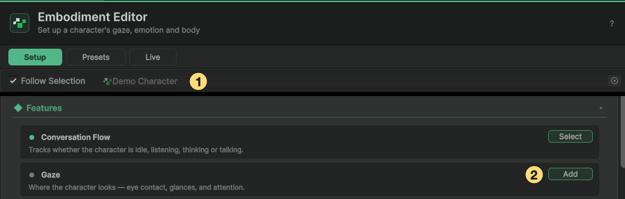
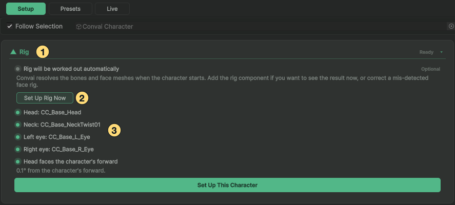

Add the Gaze module to an existing Convai character and confirm that the character makes eye contact with the player in Play mode. Use this page once you have a working `ConvaiCharacter` in your scene and want to see embodiment behavior for the first time before configuring the other four modules.

***

## Prerequisites

- A `ConvaiCharacter` in your scene that already connects and responds — complete [Validate your setup](../getting-started/validate-your-setup.md) first if you have not.
- An `Animator` on the character. A **Humanoid** rig lets Convai map the head and eyes automatically; a **Generic** rig works too once a `Character Rig` binding assigns at least the head.


You do not need to author a settings asset before trying a module. Every module runs on built-in defaults tuned to look right — a profile is for reshaping the behavior later, not for turning the module on.


***

## Add the Gaze module



### Select the character

In the Hierarchy, select the `GameObject` that carries the `ConvaiCharacter` component.



### Add the Gaze component

In the Inspector, select **Add Component**, then **Convai > Embodiment > Gaze**. This adds `ConvaiGazeController` to the character.

Alternatively, open **Convai > Embodiment Editor**, select **Setup**, and select **Add** beside **Gaze**.

<figure><figcaption>
Confirm the selected character (1), then select <strong>Add</strong> on the <strong>Gaze</strong> row (2).
</figcaption></figure>

Convai also adds the shared infrastructure the module needs — an `EmbodimentContext` — automatically. The `StandardRigBinding` appears when the character starts in Play mode, or immediately when you use **Set Up This Character** or **Set Up Rig Now** in the Embodiment Editor.



### Review the rig detection

Open **Convai > Embodiment Editor** and select the **Setup** tab. Open **Rig** to check which bones Convai detected. Select **Set Up Rig Now** to see the detected face-blendshape convention and how confident Convai is in the result.

This step is optional — Gaze already works without it — but it is how you see what Convai worked out before you enter Play mode.

<figure><figcaption>
(1) Open Rig to review detection. (2) Select Set Up Rig Now to add the rig component and see the resolved face rig. (3) Check which bones Convai detected.
</figcaption></figure>




## Verify the setup

Enter Play mode and start a conversation with the character. Gaze's default eye contact mode is `Natural` — the character's eyes and head should visibly track you as you move around it, instead of staying fixed on a point in space.


**Expected result:** the character's head and eyes turn toward you shortly after the conversation starts, and continue to track your position while the conversation is active.


***

## Troubleshooting

If the character's eyes and head do not move, open **Convai > Embodiment Editor > Setup** and check the detected rig convention and its confidence — a low-confidence detection is the most common cause. See [Character rig setup](character-rig-setup.md) to fix bone or blendshape mapping, or [Troubleshoot embodiment](troubleshooting.md) for the full set of failure modes.

***

## Next steps


[How embodiment works](how-embodiment-works.md)



[Character rig setup](character-rig-setup.md)



[Embodiment presets](embodiment-presets.md)

