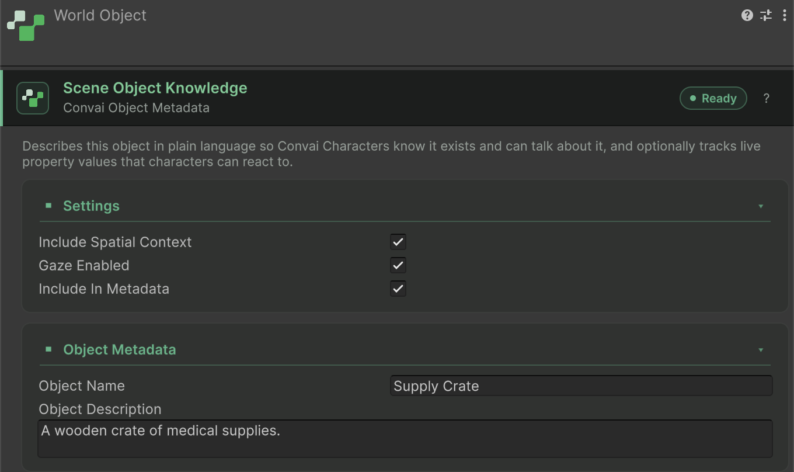

Spatial context gives each connected character a description of nearby registered objects relative to that character. Enable it when dialogue needs facts such as which object is in front of the character or whether an object is moving. These facts use Dynamic Context; they are separate from camera-frame vision.

## Prepare the objects

Start with a connected `ConvaiCharacter` and a scene object with `ConvaiObjectMetadata`, shown in the Inspector as **World Object** (**Add Component > Convai > World Object**). The object needs a non-empty **Object Name**, an active and enabled component, and **Include In Metadata** enabled.

Spatial context is disabled by default. It works with the same physical-object projection used by scene metadata, including logical groups. A logical group's physical representative can change as the character moves.

## Enable spatial facts

1. Select the object's `ConvaiObjectMetadata` component.
2. Under **Settings**, leave **Include In Metadata** enabled and enable **Include Spatial Context**.
3. Connect a character and place the object within 30 meters of it. The radius is measured from the character root to the resolved physical object's aim point.
4. Move or turn the character, or move the object, and inspect the resulting context.

<figure><figcaption><p>A World Object that contributes its name, description and spatial facts.</p></figcaption></figure>

The equivalent runtime setting is `metadata.IncludeSpatialContext = true`, where `metadata` is the object's `ConvaiObjectMetadata` component.

## Understand the generated facts

The shared world-object polling loop runs at a default interval of 0.25 seconds. For each active character in a conversation, it selects at most 24 eligible objects within 30 meters, prioritizing visible objects and then distance. This is a polling cadence, not a network delivery deadline.

Each fact uses an owned key, `scene-object.<object-id>.spatial`, and a value with this shape:

```text
Pressure valve: 2.5 m in front of Ava; visible to Ava; stationary
```

Every fact names the character it is measured from, so the model does not repeat a direction as the player's. The name is the character's `CharacterName`, or `the character` when that is blank.

| Fact | Client calculation |
|---|---|
| Distance | Approximate bands: half-meter steps below 5 meters, one-meter steps below 10 meters, and five-meter steps farther away. A whole-meter band prints without a decimal (`3 m`); a half-meter band prints as `2.5 m`. A small hysteresis band prevents constant rewrites near boundaries. |
| Direction | Written as `in front of Ava`, `to Ava's right`, `behind Ava`, or `to Ava's left`, relative to the character root. Direction changes hold until the bearing passes the sector boundary by a margin. |
| Visibility | A physics linecast from 1.6 meters above the character root to the aim point, ignoring triggers. A clear line or a hit on the physical object or one of its descendants counts as visible. The fact reads `visible to Ava` or `hidden from Ava`. |
| Movement | Aim-point movement greater than 0.02 meters between polls. The fact stays `moving` for four polls, counting the poll that detected the movement, to reduce flicker. The fact reads `moving` or `stationary`. |

A logical group with more than one active member reports its nearest member and how many objects share its name, as in `Robotic arm (nearest of 3): 4 m to Ava's left; visible to Ava; stationary`.

Visibility is a physics estimate, not a claim that a rendered object is on screen. Distance and direction are deliberately approximate descriptions, not navigation coordinates.

## Verify the update flow

Spatial facts call `SetState` with `Silent`, and stale facts call `RemoveState`. They share the regular context tracker, batching window, and room routing. Another update in the same ordinary batch can request a stronger reaction; group context remains silent.

Verify that a fact changes when the object crosses a meaningful distance or direction boundary. Then move the object out of range or disable spatial context and verify its owned state is removed. Objects omitted by the 24-fact selection also have their previous spatial state removed. Stopping a character's conversation retires its spatial facts.

To inspect a key, use the Dynamic Context debug panel or `TryGetStateValue` with the emitted key. Local state inspection confirms what was staged; acknowledgement and a live conversation check establish different parts of delivery.

## Troubleshoot missing facts

| Symptom | Check |
|---|---|
| No fact for an object | Check its name, active state, metadata inclusion, spatial toggle, resolved physical object, and distance. |
| Nearby object omitted | Check whether 24 visible or nearer objects already take priority. |
| Small movements do not change text | Distance and direction bands intentionally suppress minor changes. |
| Visibility seems wrong | Inspect colliders and the eye-to-aim-point linecast; this feature does not inspect rendered pixels. |
| Local state exists but the character does not use it | Check [room delivery rules](multi-character-and-group-rooms.md) and [context troubleshooting](troubleshoot-dynamic-context.md). |

## Next steps


[Context in multi-character and group rooms](multi-character-and-group-rooms.md)



[Scene metadata](../scene-metadata/README.md)

