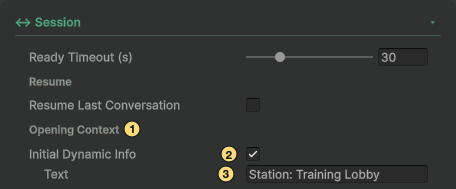

Initial Dynamic Info supplies saved scenario facts when a character connects. Use the character's toggle to edit the text and choose whether later context updates retain it. Use runtime Dynamic Context for facts that change during the conversation.

Use this mechanism for facts that are true before the conversation begins and will not change during the session: the facility name, the character's role, the training scenario type, or the starting conditions of a drill. Use runtime Dynamic Context (`ConvaiDynamicContextRelay` or `IConvaiDynamicContext`) for everything that evolves as the session progresses.

## Inspector configuration

Select `ConvaiCharacter`, open **Session → Opening Context**, and enable **Initial Dynamic Info**. The **Text** field appears only while the toggle is enabled.

<figure><figcaption><p>(1) Find <strong>Opening Context</strong> under <strong>Session</strong>. (2) Enable <strong>Initial Dynamic Info</strong> to show the saved field and retain its contents through later context updates. (3) Enter the opening facts in <strong>Text</strong>.</p></figcaption></figure>

| Field | Type | Default | Description |
|---|---|---|---|
| **Initial Dynamic Info** | `bool` | `false` | Sets the keep-in-context flag and reveals the saved text. |
| **Text** | `string` | _(empty)_ | Scenario text included in the request when the field has a value. The Inspector field is a single line, so separate facts with semicolons. |

Turning the toggle off hides **Text** and clears the keep-in-context flag. The SDK can still send the saved text. To remove opening text entirely, clear **Text** while visible, then turn the toggle off.

### Example configuration

For a fire suppression certification drill, enable **Initial Dynamic Info** and set **Text** to:

```text
Facility: Offshore Platform Alpha; Scenario: Fire Suppression Drill; Role: Operator under assessment
```

Connect and ask the character about the facility and scenario. Check that the opening facts are available before adding runtime updates.

## Relationship to runtime Dynamic Context

Initial context and runtime Dynamic Context are complementary — not alternatives.

| | Initial Dynamic Info | Runtime Dynamic Context |
|---|---|---|
| **When sent** | During connection or group member initialization | During the session, on demand |
| **Content** | Fixed facts set at design time | Live state and events set at runtime |
| **Suitable for** | Facility name, scenario type, character role | Trainee location, equipment state, hazard level |
| **Modifiable at runtime** | No — sent once per connection | Yes — via `SetState`, `AddEvent`, `Reset` |

In an ordinary multi-character room, the connection request includes the active character's saved text. A group opens with empty shared text, then the SDK sends each member its own nonblank text. The retention setting controls how later updates treat those opening facts. See [Context in multi-character and group rooms](multi-character-and-group-rooms.md).

```csharp
// These complement the initial context — not replace it
_character.DynamicContext.SetState("Station", "Chemical Storage Bay");
_character.DynamicContext.SetState("HazardLevel", "Extreme");
_character.DynamicContext.AddEvent("Trainee bypassed manual lockout procedure");
```

## What `Reset()` does and does not clear

Calling `Reset()` on the runtime Dynamic Context layer clears all tracked states and events. By default it leaves initial dynamic info in place:

* **Initial Dynamic Info** is excluded from the default reset request. `Reset(removeStatic: true)` also requests removal of static dynamic context for the session.
* **Dashboard configuration and conversation history** are separate from the local tracker. A reset request is not an erasure guarantee for facts present in those sources.


To change the initial context for a new session, end the current conversation, update the **Text** field, and reconnect. The next connection uses the updated configuration.


## Scripting access

Both fields are readable via C# properties on `ConvaiCharacter`:

```csharp
string initialText = _character.InitialDynamicInfoText;
bool keepInContext = _character.InitialDynamicInfoKeepInContext;
```

These properties are read-only at runtime. Set the values in the Inspector before the scene is played, or via `SerializedObject` in a custom Editor tool.

## Next steps


[Relay component reference](relay-component-reference.md)



[Dynamic context scripting API](dynamic-context-scripting-api.md)



[Sync behavior and timing](sync-behavior-and-timing.md)

