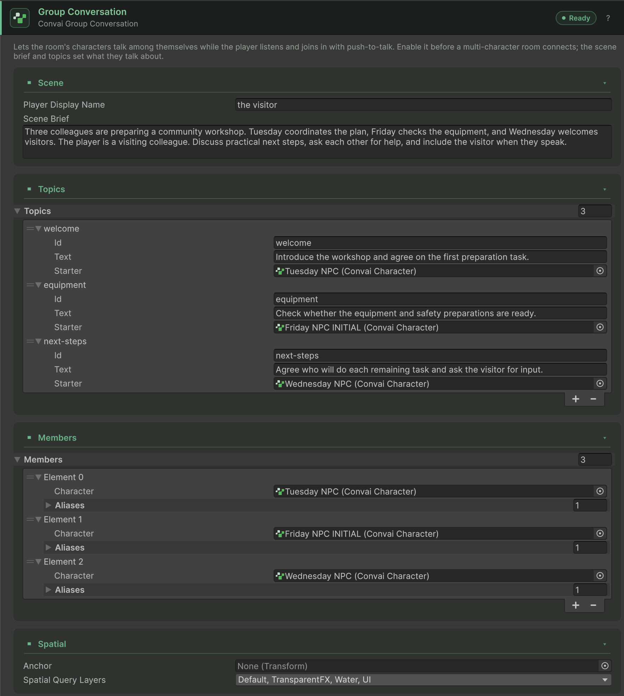

Configure a small group, rehearse its client behavior, then perform a live test only when the service owner has confirmed preview access.


Group conversation is an opt-in 5.0 preview. The SDK's validation rules describe what it can send; they do not guarantee backend availability, account entitlement, or production platform qualification.


## Prerequisites

- A working manager, room manager, player, and 2–4 active selected `ConvaiCharacter` components.
- A distinct Character ID and **Live** version for every member.
- Push To Talk input with correlated release support. Keep **Release Mode** on **Auto** and **Enable Server Stt Toggle** enabled unless the service owner provides a supported alternative.
- Audio-only configuration and confirmed service access for the later live test.

## Configure and verify



### Add the group component

Before connecting, add **Convai > Group Conversation**, preferably to the manager GameObject. Keep exactly one enabled group component in the loaded scenes. The most recently enabled one wins if several exist, and the SDK warns about the conflict.


### Describe the situation

Fill **Scene Brief** with where the characters are, their relationship, and the current situation. Add optional **Topics** and per-member aliases. Keep every optional starter and member reference inside the selected room roster.

Use **Player Display Name** for how the group refers to the player. Set **Anchor** if the group's centre should be fixed to a scene transform; otherwise the character centre at session start is used.


### Check input and validation

Set the room's conversation input mode to **Push To Talk**. Resolve the Group Conversation Inspector warnings, including missing brief, member count, legacy release, and Video configuration. A Ready chip means the local checks passed, not that the service approved the account.


### Rehearse offline

Turn off **Starts Connected** on `ConvaiRoomManager`, which also blocks each character's **Auto Connect**, and add **Convai > Group Conversation Simulator** and **Convai > Group Conversation Debug Overlay**. Enter Play mode, observe the state, and hold/release the manager's push-to-talk key (T by default). The simulator uses canned text and produces no character voice.


### Test with the service

Exit Play mode, disable the simulator, and turn **Starts Connected** back on, or call `ConnectAsync` or `StartConversationAsync` from your own code. Observe reported state and command results, verify each voice and gaze target, and test an actual press, transcript, recipient decision, and reply. Record service refusals separately from local setup errors.



<figure><figcaption>
Group Conversation configured in the bundled Group Conversation Sample.
</figcaption></figure>

## Next steps


[Group conversation component reference](component-reference.md)


[Troubleshoot group conversation](troubleshooting.md)

