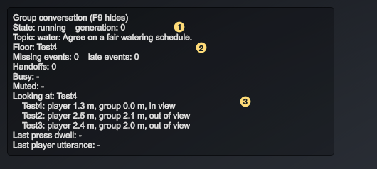

Use the simulator to exercise client behavior without a service connection, and the debug overlay to inspect either simulated or live group state. Neither tool grants preview service access.

## Run the simulator

Add `ConvaiGroupConversationSimulator` from **Convai > Group Conversation Simulator** beside a configured group component. In the shipped Group Conversation sample the simulator is already attached. Enable it, turn off **Connect On Start** on `ConvaiRoomManager`, and enter Play Mode in the Editor or a development build. The selected roster must contain 2–4 active characters with distinct Character IDs.

To use the service, disable the simulator, then turn **Connect On Start** on or connect with your project's normal flow.

The simulator uses synthetic membership IDs, canned text, and the manager's push-to-talk key (T by default). It exercises client events, head-turn behavior, and the overlay but produces no character voice. Hold and release the key while looking toward a member or standing near one to rehearse player-turn handling.

<figure><figcaption>
(1) Check that the state is <strong>running</strong>. (2) <strong>Floor</strong> shows which simulated member holds the turn. (3) The member rows show player distance and whether each character is in view.
</figcaption></figure>

It refuses ordinary release builds and disables itself when a live connection or group session exists. A reconnecting live session also keeps ownership; the simulator must not replace it.

## Inspect the overlay

Add `ConvaiGroupConversationDebugOverlay` from **Convai > Group Conversation Debug Overlay**. F9 toggles visibility by default. The Editor can show it when Play mode starts; player builds start hidden. Non-development builds require the explicit **Allow In Release Builds** setting.

The overlay reports group state, topic, floor, member distances/visibility, and the last addressing decision. Use event counts and state transitions to locate ordering or setup problems, then compare with the actual operation result and audio behavior.

**Show Transcript** is off by default. Keep it off for shared screenshots and recordings unless displaying the player's utterance is explicitly intended. Do not mistake hiding this field for a broader application data-retention policy.

## Read handoff timing during a live session

The group logs a `Handoff:` entry when audio passes from one character to the next. The overlay summarizes measured handoffs, including the median and the 10th and 90th percentiles of the audible gap.

| Field | Interval |
| --- | --- |
| `silence_ms` | Previous line’s last audible sample to the next speaker’s audio start. |
| `wait_ms` | Previous line’s last audible sample to the arrival of the next line-started event. It can be negative when that event reaches Unity before the previous audio finishes. |
| `start_ms` | Arrival of the next line-started event to the next speaker’s audio start. |
| `client_ms` | Next speaker’s bot-started event to audio start, when both events are available in order. |

A separate `Line:` entry reports when a line was first heard or ended unheard, and can show whether the speaker was muted. An inferred line can contribute to the audible gap and client timing. Excluded handoffs are logged and omitted from the overlay’s timing summary. The push-to-talk reply is a player turn and uses the `[ClientLatency]` path with room debug logging enabled. WebGL does not report per-line playback starts for handoff measurements.

The simulator exercises event subscriptions, spatial snapshots, and gaze wiring with canned text. Use a live session to verify microphone capture, actual speaker audio, service arbitration, account access, and handoff timing.

## Next steps


[Troubleshoot group conversation](troubleshooting.md)

