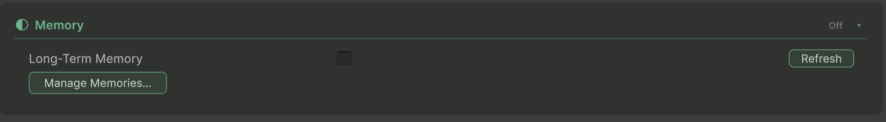

Configure long-term memory in the **Memory** section of the `ConvaiCharacter` Inspector or through `client.Memory`. Read the saved settings before changing a shared character.


Memory settings belong to the character on Convai, so changing them affects other applications that use it. A connection pinned to a character version keeps that version's memory enabled setting; the end-user ID requirement applies across versions. Use a test character when evaluating changes.


<figure><figcaption><p>The Memory card with memory disabled. Enable Long-Term Memory to reveal the end-user ID requirement.</p></figcaption></figure>

## Prerequisites

- Install the Convai Unity SDK and [configure credentials](../../getting-started/configure-api-key.md) for an account that can manage the character.
- Set the character's **Character ID** in the Inspector.
- Choose a stable [end-user identity](end-user-identity.md) for conversations that should use memory.

## Enable or disable memory





### Open the character's Memory section

Select the GameObject containing `ConvaiCharacter`, then expand **Memory**. Wait for its settings to load. If loading fails, resolve the displayed error before editing.


### Set Long-Term Memory

Change **Long-Term Memory** and confirm the dialog for the character you intend to edit. The change is saved through Convai; editing a scene asset alone does not configure character memory.


### Check the end-user requirement

Leave **End-User ID** on **Required** when every conversation must have an identity. Use **Optional** only when your application intentionally allows connections without memory. See [Configure the end-user ID requirement](configure-end-user-id-requirement.md).




Use `MemoryService.GetSettingsAsync` and `UpdateSettingsAsync` from a trusted Editor tool or service. `UpdateSettingsAsync` reads the character's existing settings and preserves settings you omit. The older `client.Characters` memory methods are deprecated.

The following method is a complete helper for an existing administrative tool. Pass a client configured with credentials your tool is allowed to use:

```csharp
using System.Threading;
using System.Threading.Tasks;
using Convai.RestAPI;
using Convai.RestAPI.Internal;

public static class CharacterMemorySettings
{
    public static Task<MemorySettings> SetEnabledAsync(
        ConvaiRestClient client,
        string characterId,
        bool enabled,
        CancellationToken cancellationToken = default)
    {
        return client.Memory.UpdateSettingsAsync(
            characterId, enabled: enabled, cancellationToken: cancellationToken);
    }
}
```

Await the operation and handle `ConvaiRestException` in the calling tool. Read back `client.Memory.GetSettingsAsync(characterId)` to verify `IsEnabled`. Keep account API keys out of distributed player builds.



## Verify the configuration

Reload the character's **Memory** section and confirm that **Long-Term Memory** has the intended value. Reconnect with the same end-user ID, then inspect **Memory** on the `ConvaiManager` Inspector. `CurrentLongTermMemoryStatus` reports what the connect response says; it does not prove that a particular fact has been stored or recalled.

For a concrete memory check, open the [Long Term Memory window](long-term-memory-window.md), select the character and end user, and refresh the returned records.

## Disable memory without deleting records

Changing the enabled setting does not call a memory-deletion API. Treat disabling memory and deleting records as separate actions. To request deletion for one character and end user, use `client.Memory.DeleteAllAsync(characterId, endUserId)` and check the result afterward.

`client.EndUsers.DeleteAsync(endUserId)` deactivates an end user. It is not a replacement for deleting memory records. If you need to request deletion across owned characters, use **Forget End User…** in the [Long Term Memory window](long-term-memory-window.md) before deactivation.

## Troubleshooting

| Symptom | Cause to check | Fix and verification |
|---|---|---|
| Memory settings do not load | Credentials or character access failed | Resolve the shown error and reload; the controls must show saved values before you edit. |
| A change affects another application | Both applications use the same character | Use a separate test character; read back settings for the intended character ID. |
| A pinned connection uses a different enabled setting | The connection selects a released character version | Verify its version selection; do not infer its memory setting from the live character alone. |

## Next steps


[Configure the end-user ID requirement](configure-end-user-id-requirement.md)



[Inspect and manage long-term memories](long-term-memory-window.md)

