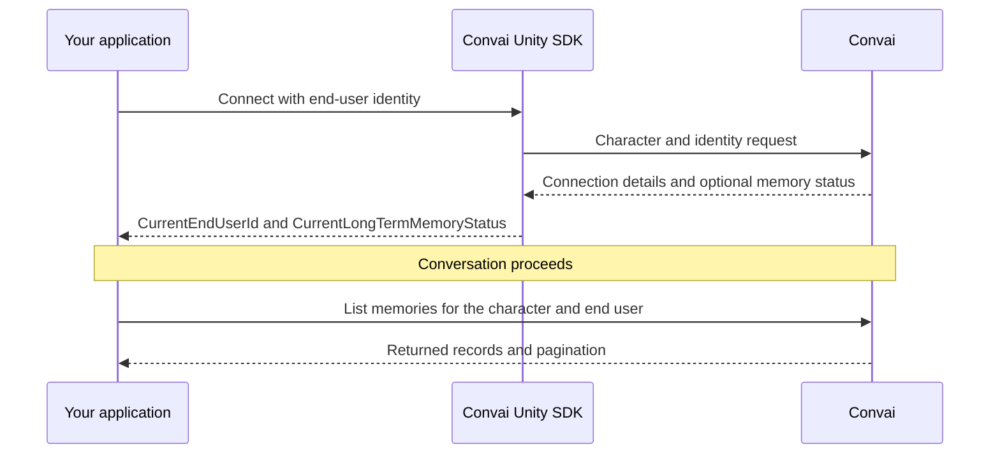

Long-term memory associates stored records with an end user and a character. The Unity SDK supplies identity when it connects and exposes APIs for inspecting the records returned by Convai. Memory extraction and response generation happen outside the Unity client.

## Session lifecycle

The client captures identity when a connection begins. Retries for that connection reuse the captured identity, so replacing a provider or editing a metadata dictionary does not change an attempt already in progress.

The flow separates connection status from stored-record verification:

Stopping Play mode ends the client session. It is not a client-side command to extract memory. Do not use disconnect completion as proof that facts were stored; inspect the memory records separately.

## Memory scoping

Memory operations take a `characterId` and an `endUserId`. A query for a different pair asks for a different set of records. A stable application account identifier lets your application request the same scope across devices; a device identifier identifies a device rather than a signed-in person.

`ConvaiPlayer.PlayerId` is local player identity for presentation. It is separate from the end-user ID resolved for a connection. [End-user identity](end-user-identity.md) explains the default provider and explicit overrides.

## Memory records

`MemoryRecord` contains an `Id`, a natural-language `Memory` string, timestamps, and optional metadata. For example, an application might submit the test fact `Jordan completed the fire safety module.` The text is application data, not an instruction to the SDK's connection state machine.

`MemoryService.AddAsync` returns operation results that include an `Event` string. Read the returned result instead of assuming every submitted fact creates one record or that repeated writes are always merged in a particular way.

## Reported memory status

`ConvaiManager.CurrentLongTermMemoryStatus` reflects the connection response:

| Status | Interpretation |
|---|---|
| `Active` | Convai reported memory active for this connection. It does not prove that a specific fact was extracted or retrieved. |
| `SkippedNoEndUser` | Convai reported that memory was skipped because no end-user ID was sent. |
| `NotReported` | No status is available. This includes disconnected state and responses that omit memory status, including multi-character and group rooms. |

The character's **End-User ID** requirement controls the contract for connections without identity. **Required** can produce a connect refusal; **Optional** permits a connection without memory. See [Configure the end-user ID requirement](configure-end-user-id-requirement.md).

## Memory, session resume, and deletion

Session resume and long-term memory use different identifiers. A character session ID refers to a resumable conversation, while memory operations use the end-user and character pair. A fresh session therefore does not, by itself, delete memory records.

Disabling character memory changes settings. Deleting memory records and deactivating an end user are separate administrative operations. The [Long Term Memory window](long-term-memory-window.md) makes the distinction visible and tracks deletion requests for subsequent checking.

## Next steps


[Long-term memory quick start](quick-start.md)



[Memory management API](memory-management-api.md)

