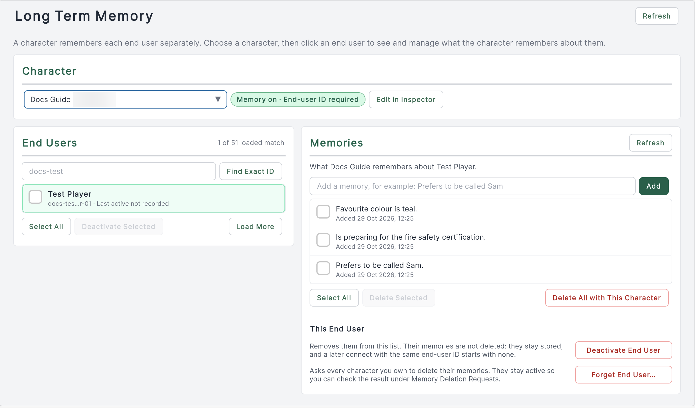

Use the **Long Term Memory** section of **Convai Editor** to inspect records returned by Convai for one character and end user. The window also provides separate controls for memory deletion and end-user deactivation.

## Prerequisites

- Credentials authorized to manage the character and its memory records.
- A character ID and the intended end-user ID. During Play mode, **See What They Remember** on `ConvaiManager` opens this section for the addressed character and reported end user. It appears in the manager's **Live** section while connected, when an end-user ID was sent and the addressed character has a Character ID.
- Test data for evaluating edits or deletion.

## Open a character and end user



### Open Long Term Memory

Choose **Convai > Convai Editor** from the Unity menu, then select **Long Term Memory** in the window's navigation. It is a section of this window, not a separate top-level menu command.


### Choose the character

Use the **Character** drop-down to choose one of the open scenes' characters, or choose **Other character ID…** and paste an ID from the Convai dashboard. A chip beside it reports the character's memory settings, for example **Memory on · End-user ID required**. **Edit in Inspector** selects the scene character so you can change those settings; it is unavailable for a pasted ID.


### Select the end user

The **End Users** pane lists the account's end users. Type in **Filter by name or ID** to filter the loaded rows. **Load More** retrieves another page of 50 end users. When the filter text matches no loaded ID exactly, **Find Exact ID** appears and looks the text up as an end-user ID, including end users not loaded yet. Badges mark **This Editor**, the ID this Editor's Play Mode uses, and, in Play mode, **Current player**.

Click an end user to view their memories in the **Memories** pane. Checkboxes select users for **Deactivate Selected** and are separate from the clicked user whose memories you are inspecting.


### Inspect returned memories

The **Memories** pane sits beside **End Users**, or below it in a narrow window. Use its **Refresh** button to reload the selected pair. **Previous** and **Next** appear when the records span more than one page of 25. Read the status text if a request fails; a failed load is not an empty memory store. If the API key's account doesn't own the character, the pane's status reads `This API key's account doesn't own this character, so its memories can't be managed here.` and **Add** is disabled. When the character's settings can't be read at all, the **Character** chip shows `This character can't be read with this API key.`



<figure><figcaption>
The Long Term Memory section for a test character and a test end user. Actions that remove data are outlined in red.
</figcaption></figure>

## Add or remove individual facts

Type a test fact in the field at the top of the **Memories** pane, then choose **Add**. The window then reloads the list, and the status line reports how many records the API stored; read it rather than assuming one submitted fact creates one record.

Select memory records and use **Delete Selected** to request their deletion. Confirm the selected scope first. **Delete All with This Character** requests deletion for the focused end user and the selected character only.


Memory deletion cannot be undone through this window. Confirm the character and end user before submitting a request. A completed request is not proof that all records have disappeared; use the subsequent check.


## Forget an end user or deactivate them

**Deactivate End User** and **Forget End User…** are under **This End User** in the **Memories** pane while an end user is clicked. Every action that removes data is outlined in red. The actions have different scopes:

| Action | Scope and outcome |
|---|---|
| **Delete All with This Character** | Requests deletion of one character's memories for the focused end user. |
| **Forget End User…** | Lists characters owned by the account and requests memory deletion for each. The end user stays active so the result can be checked. |
| **Deactivate End User** | Deactivates the focused end-user record. It does not request memory deletion. |
| **Deactivate Selected** | Deactivates the end users selected by checkbox. It does not request memory deletion. |

The SDK's end-user contract treats deactivation as separate from erasure. If the goal is to delete memories, request and check memory deletion before deactivating the user.

## Verify deletion requests

The **Memory Deletion Requests** card appears once you request a deletion. Choose **Check** to query whether memories are still listed. A forget request offers **Deactivate End User** only after its checks find none and the request has covered all owned characters without unresolved failures.

Keep the status text for partial, failed, or canceled requests in view. **Cancel** stops a forget operation between characters; it cannot retract requests already sent. An empty result describes what the API returned, not an independent audit of service storage.

## Troubleshooting

| Symptom | Cause to check | Fix and verification |
|---|---|---|
| An end user is absent from loaded rows | Only part of the list is loaded, or the search has no match | Use **Load More** or **Find Exact ID**; confirm the focused identifier privately. |
| A memory does not appear after a conversation | No record has been returned for this pair yet | Verify identity and settings, then choose **Refresh** in the **Memories** pane; do not treat stopping Play mode as an extraction command. |
| The **Memories** pane says the API key's account doesn't own the character | The character belongs to a different Convai account | Use an API key from the account that owns the character, or choose another character. |
| Records remain after deletion was requested | The requested result is not yet reflected in the list, or part of the request failed | Use **Check** and inspect its status before reporting completion. |
| The wrong character's records are visible | Character selection changed | Re-select the intended character and refresh before editing. |

## Next steps


[Memory management API](memory-management-api.md)



[Manage end-user records](end-user-management.md)

