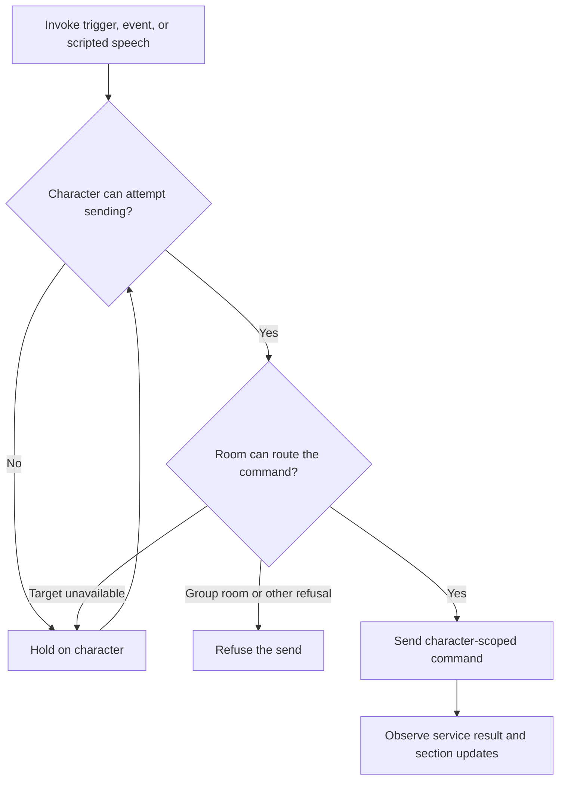

Narrative commands belong to a character, even when several characters share a room. Readiness, conversation targeting, and group conversation mode determine whether the SDK sends, holds, or refuses a command.

## Shared-room command flow

`InvokeTrigger`, `InvokeEvent`, and `InvokeSpeech` return `true` when sent or held locally. The character's `OnTriggerInvoked` event reports `Queued` when it accepted the request into its pending queue. The trigger component raises `OnTriggerQueued` and then `OnTriggerActivated` for that held invocation.

## Pending commands have limits

Each character holds at most `16` narrative requests. When more arrive, it drops the oldest and logs a warning. It sends held requests in order when the room can route them. Template keys keep the latest values for a later update and do not occupy a queue slot.

The character owns the queue. Resetting the trigger component re-arms its local activation. The pending request stays with the character. `Character Ready` in the trigger Inspector reports whether the character is in conversation. A ready character can still be waiting for its shared-room route.

Before a scripted sequence, select the intended target, wait for readiness, send the command, and observe the corresponding section update. Keep section events associated with that character.

## Group conversations use scene events

The connected group room refuses saved narrative triggers, inline narrative events, and scripted speech. When the character refuses a component invocation immediately, the component sets **Last Error** and raises `OnTriggerFailed`. If a command was accepted before the character could send it, the room can refuse it later when the character flushes the queue. Check the room warning in that case.

Use `ConvaiGroupConversation.SendSceneEventAsync` to share information with a group. For scope and operation results, see [Shared and group room context](../dynamic-context/multi-character-and-group-rooms.md).

## Observe confirmation separately

Subscribe to `ConvaiManager.Events.OnServerCommandResultReceived` and filter for `trigger-message` or `update-template-keys`. The character facade’s boolean reports local acceptance. Unanswered narrative triggers use a `15`-second answer timeout; refusal and timeout warnings are throttled by character, command, and reason.


[Troubleshoot narrative design](troubleshooting-and-diagnostics.md)

