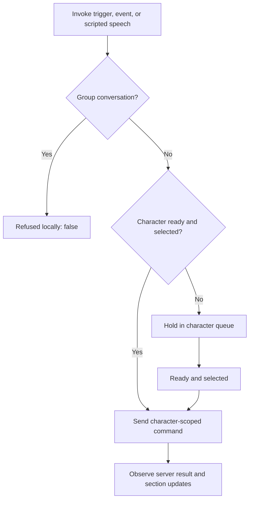

Narrative commands belong to a character, even when several characters share a room. Readiness, conversation targeting, and group conversation mode determine whether the SDK sends, holds, or refuses a command.

## Shared-room command flow

`InvokeTrigger`, `InvokeEvent`, and `InvokeSpeech` return `true` when sent or held locally. This does not confirm processing by Convai. A later operation can fail, time out, or produce a different response than your application expected.

## Pending commands have limits

Each character holds at most `16` narrative trigger requests. If more arrive, the oldest are dropped and a warning is emitted. Template keys keep the character's current values for a later update rather than occupying that trigger queue.

The trigger component's **Queue Until Ready** and **Max Wait Time** describe its own wait before calling the character API. Once the character API accepts the request, the separate target-dependent queue applies. Do not use either queue as durable application state.

Before a scripted sequence, select the intended target, wait for readiness, send the command, and observe the corresponding section update. Keep section events associated with that character's manager.

## Group conversations use a different command

Group rooms refuse saved triggers, inline narrative events, and scripted speech through the character narrative API. They return `false` and issue a warning directing the caller to `ConvaiGroupConversation.SendSceneEventAsync`. A `ConvaiNarrativeDesignTrigger` can therefore keep retrying from collision or proximity without setting Has Triggered or raising its failure event.

Use the group scene-event operation when the intent is shared context for the group. It is not a saved narrative graph transition. See [Shared and group room context](../dynamic-context/multi-character-and-group-rooms.md) for the group flow and operation results.

## Observe confirmation separately

The room service's character-scoped `SendNarrativeTrigger` and `UpdateTemplateKeys` methods return `IConvaiOperation<ServerCommandResult>`. The character facade's boolean remains a local acceptance result. Unanswered narrative triggers use a `15`-second answer timeout; refusal and timeout warnings are throttled by character, command, and reason.


[Troubleshoot narrative design](troubleshooting-and-diagnostics.md)

