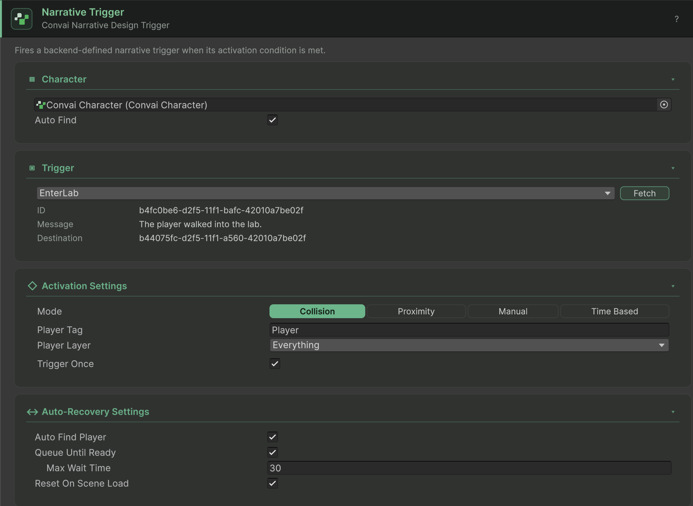

Place `ConvaiNarrativeDesignTrigger` on a scene object and configure when it sends a saved trigger name. This component sends `trigger_name`; its fetched message and destination are read-only metadata, not extra request fields.

## Select the character and trigger



### Add the component

Add **Convai > Convai Narrative Design Trigger** to a doorway, exhibit, or other event target. Assign **Character** explicitly. The **Auto Find** toggle only resolves the character at runtime, so it does not make the Inspector fetch possible without an assignment.


### Fetch the selected character's triggers

In **Trigger**, click **Fetch** beside the picker. The button requires a character with an ID. Select a trigger and check the **ID**, **Message**, and **Destination** rows. Changing the character or selected version clears cached selection and fetches again. Qualified version reads require **API Mode > Upgraded**.


### Choose activation and recovery

Select **Mode** in **Activation Settings**, configure the fields below, then expand **Auto-Recovery Settings** if the character may connect later. Set **Trigger Once** to control repeated activation.


### Verify in Play mode

Use **Activation Runtime > Invoke** for a manual test, or enter the configured zone. Local acceptance appears in **Has Triggered**; verify the resulting section event separately. Read **Runtime Status > Last Error** for a component failure.



<figure><figcaption>
A Narrative Design Trigger with a fetched trigger selected and Collision activation.
</figcaption></figure>

## Activation modes

| Mode | Setup and behavior |
|---|---|
| **Collision** | A trigger collider detects player entry. Use **Player Tag** and **Player Layer** to filter it. Unity physics needs a player collider and a Rigidbody on one of the participating objects. |
| **Proximity** | **Radius** defaults to `3` world units. A distance check runs in `Update`; no collider is required. The Scene view offers a radius handle. Auto-found players use tag/layer filters; a transform supplied with `SetPlayerTransform` is used directly. |
| **Time Based** | Uses the collider setup and **Delay (seconds)**, default `0`. Exiting cancels the countdown. |
| **Manual** | Call `InvokeTrigger()` or `TryInvokeTrigger()` from code. Both return `bool`, so use a public `void` wrapper for an Inspector Unity Event. |

The zone modes expose **Player Tag** (default `Player`) and **Player Layer** (all layers by default). A mask of **Nothing** detects no players. Collision and Time Based show **Add Box Collider** or **Enable Is Trigger** fixes when applicable.

## Recovery and repeated activation

| Setting | Default | Effect |
|---|---|---|
| **Auto Find Player** | `true` | Attempts runtime player lookup when no player is assigned. |
| **Queue Until Ready** | `true` | Waits for the character to enter conversation before attempting the character API. |
| **Max Wait Time** | `30` seconds | Appears when queuing is enabled. `0` waits without a timeout. |
| **Reset On Scene Load** | `true` | Resets component activation when a scene loads. |
| **Trigger Once** | `true` | Prevents another accepted activation until reset. |

`ResetTrigger()` cancels the component's pending wait and re-evaluates status. It does not clear the last error text or validation warnings. After fixing configuration, validate and reset; `ValidateConfiguration()` alone does not restore **Ready**. Runtime failures can also produce `ConfigurationError`.

The character API has a separate bounded queue for readiness and multi-character targeting. Its acceptance does not mean the command reached Convai. Group conversations refuse these commands, and that refusal need not raise the component's `OnTriggerFailed`; use [the shared-room guide](narrative-design-multi-character.md).

## Events and diagnostics

| Event | Meaning |
|---|---|
| `OnTriggerActivated` | The character API accepted the request locally, including a held request. |
| `OnPlayerEnterZone` / `OnPlayerExitZone` | Unity collider callbacks only. The proximity distance check does not raise these events. |
| `OnTriggerFailed` | A component failure with its error message; not a universal server-refusal event. |
| `OnTriggerQueued` | The component started waiting for the character. |

**Diagnostics** exposes **Enable Diagnostics** and **Validate On Start**. Diagnostic messages use Debug logging; enable the Narrative category at Debug in **Convai SDK > Diagnostics** to see them. In Play mode, **Activation Runtime** shows **Has Triggered**, **Player In Zone**, **Invoke**, and **Reset**. **Runtime Status** shows **Current Status**, **Character Ready**, **Last Error**, and **Print Diagnostics to Console**. A disabled component can retain an older displayed status until it is re-evaluated.


[Narrative design usage examples](usage-examples.md)

