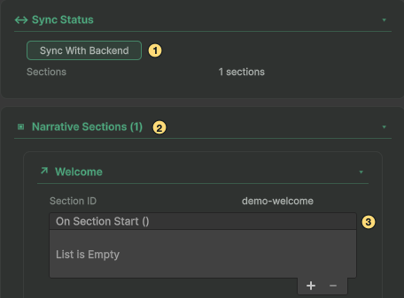
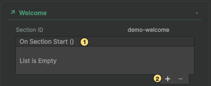

Add `ConvaiNarrativeDesignManager` to the character GameObject to translate section updates into Unity Events. Keep one manager per character and assign the intended character before synchronizing.

## Sync and bind section events



### Add the manager

Select the character GameObject and add **Convai > Narrative Design Manager**. The component looks for a character on the same object; otherwise assign **Character** explicitly.


### Sync the selected character

In **Sync Status**, click **Sync with Backend**. The button reads **Syncing...** while busy and is disabled without a character ID. The request respects the selected character reference. For a `ConvaiCharacter` with Live or a pinned release selected, that selection is preserved; the SDK reads the selected version through the Character API. A bare custom character reference may use the draft authoring read.

Changing the assigned character triggers a sync. If another character ID replaces one with existing section bindings, **Character Change Detected** asks whether to clear them with **Yes, Clear and Switch**. Review those bindings before accepting.

<figure><figcaption>
(1) Assign the <strong>Character</strong>. (2) Use <strong>Sync With Backend</strong> to import its configured sections. (3) The section list shows the locally prepared <strong>Welcome</strong> example.
</figcaption></figure>


### Add scene listeners

Expand a section under **Narrative Sections (N)**. Its title uses the section name or ID. The entry exposes a disabled **Section ID**, **On Section Start**, and **On Section End**. Add a listener to a compatible public Unity Event method, such as your door controller's `Unlock()`.

<figure><figcaption>
(1) Find <strong>On Section Start</strong> in the expanded section. (2) Select <strong>+</strong> to add the listener.
</figcaption></figure>


### Verify a real transition

Enter Play mode and invoke the corresponding saved trigger. Confirm the old section's end event and new section's start event after a changed section ID arrives. Repeated updates for the same ID do not re-run those per-section events.



## Read sync status

| Display | Meaning |
|---|---|
| **Sections** | Section and orphan counts from the local configuration. |
| **Last Sync** | Time of the last completed sync, when available. |
| **Character version changed** | Re-sync for the selected version. |
| **Sync failed** | Last fetch failure; check the message and credentials. |

`SectionSyncResult` reports `SectionsAdded`, `SectionsUpdated`, `SectionsOrphaned`, and `SectionsReactivated`. Sync preserves bindings for matching IDs. An orphaned entry retains its events and displays an orphan warning after removal from the fetched data. Restore and re-sync that section to reactivate its configuration.

There is no **Clear All Sections** button. `ClearAllSectionConfigs()` is a code API that removes the entries and event wiring. Switching character IDs through the confirmation dialog also clears the existing bindings.

## Distinguish global and section events

The collapsed **Events** section contains these global events:

| Event | When it fires |
|---|---|
| `OnAnySectionChanged` | Every matching section payload, including a repeated ID. |
| `OnSectionDataReceived` | Every matching payload, with `NarrativeSectionData`. |
| `OnSectionsSynced` | A successful section sync, with `SectionSyncResult`. |

Use per-section start/end events for transitions. Do not increment a transition counter on every `OnAnySectionChanged` callback without comparing IDs.

The other collapsed section, **Template Keys**, holds local values. Send them explicitly as described in [Configure narrative template keys](template-keys-dynamic-narrative-variables.md).


[Configure narrative design triggers](setting-up-narrative-design-triggers.md)

