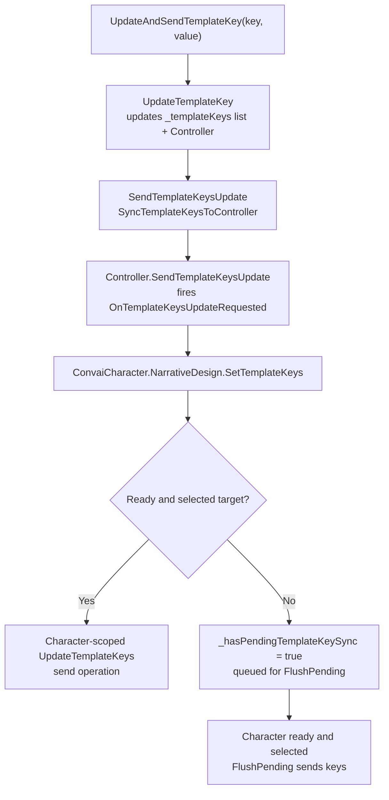

Template keys are runtime key-value pairs that fill placeholders in your character's narrative objectives. Define placeholders in the [Convai dashboard](https://convai.com) using curly-brace syntax — for example, `{PlayerName}` or `{CurrentTask}` — and the SDK sends the actual values from Unity at runtime, so the character can reference them naturally in conversation. A single narrative graph can then serve many sessions with different participants or dynamic state without editing the graph each time.

## Define keys in the Inspector

Open `ConvaiNarrativeDesignManager` in the Inspector and expand the **Template Keys** foldout.

Click **+** to add an entry. Each entry has two fields:

| Field     | Description                                                                                                                    |
| --------- | ------------------------------------------------------------------------------------------------------------------------------ |
| **Key**   | The placeholder name, exactly as written in the narrative design section objective (case-sensitive, without the curly braces). |
| **Value** | The initial value. You can override this at runtime from code.                                                                 |

See the current manager Inspector in [Configure the narrative design manager](setting-up-the-narrative-design-manager.md).

`Awake` copies Inspector values into the manager's local controller only. Call `SendTemplateKeysUpdate()` or `UpdateAndSendTemplateKey()` to pass them to the character API. `UpdateTemplateKey` and `UpdateTemplateKeys` alone do not send.

The **Send to Server** button calls `SendTemplateKeysUpdate()` and is disabled outside Play mode. This is useful for testing value changes mid-session without writing code.

## Update keys at runtime

Use any of the following methods on `ConvaiNarrativeDesignManager` to update keys from code:

**Update a single key:**

```csharp
narrativeManager.UpdateTemplateKey("PlayerName", "Alex");
```

**Update and send immediately (one call):**

```csharp
narrativeManager.UpdateAndSendTemplateKey("ScenarioPhase", "Handwashing");
```

Use `UpdateAndSendTemplateKey` to request delivery after updating a value. Acceptance is local and does not guarantee which response will use it.

**Update multiple keys at once:**

```csharp
narrativeManager.UpdateTemplateKeys(new Dictionary<string, string>
{
    { "PlayerName", "Alex" },
    { "Department",  "Facilities" },
    { "CompletedSteps", "3" }
});
narrativeManager.SendTemplateKeysUpdate();
```

**Read the current key dictionary:**

```csharp
Dictionary<string, string> current = narrativeManager.GetTemplateKeys();
```

## How keys are sent



If the character disconnects and reconnects, the SDK calls `MarkPendingReplayAfterDisconnect` internally so the latest key values are re-sent on the next connection. You never need to re-send keys manually after a reconnect.

## Key naming rules

| Rule                                                          | Example                                                          |
| ------------------------------------------------------------- | ---------------------------------------------------------------- |
| Must match the dashboard placeholder exactly (case-sensitive) | Dashboard: `{playerName}` → Key: `playerName` (not `PlayerName`) |
| No leading or trailing whitespace                             | `"PlayerName"` ✓ — `" PlayerName"` ✗                             |
| No empty key string                                           | Empty names are invalid and logged                                         |
| Values can be empty strings                                   | Key `"OptionalField"` with value `""` is valid                   |

**Good key names:**

| Key                    | Value example |
| ---------------------- | ------------- |
| `PlayerName`           | `"Maria"`     |
| `ScenarioLevel`        | `"Advanced"`  |
| `CompletedCheckpoints` | `"4"`         |
| `SessionStartTime`     | `"09:15"`     |

**Problematic key names:**

| Key             | Problem                                                                                          |
| --------------- | ------------------------------------------------------------------------------------------------ |
| `player name`   | Space in name — will not match `{player name}` placeholders if the dashboard uses `{playerName}` |
| `"PlayerName "` | Trailing space — silent mismatch                                                                 |
| `""`            | Empty — invalid                                                                                  |


Template key values are sent as strings and may appear in dialogue. The manager also logs each updated key and value at Info, visible at the default log level. Do not include passwords, personal identification numbers, API secrets, or any other sensitive data in template key values.


## Set keys on the character directly

If you are working without a `ConvaiNarrativeDesignManager`, you can set template keys directly through the character API:

```csharp
ConvaiCharacter character = GetComponent<ConvaiCharacter>();

// Single key
character.NarrativeDesign.SetTemplateKey("PlayerName", "Alex");

// Multiple keys
character.NarrativeDesign.SetTemplateKeys(new Dictionary<string, string>
{
    { "PlayerName", "Alex" },
    { "Department", "Engineering" }
});
```

An empty manager key logs a warning but may remain as a serialized row. Remove invalid rows; the character API rejects blank or whitespace-only key names. In multi-character rooms, values are held until that character is selected.

The character API and the Manager API both converge on the same character-scoped `ConnectionService.UpdateTemplateKeys` operation internally. You can use either path in the same project, but avoid calling both paths for the same key in the same frame, as this may send redundant updates.

## Next steps


[Narrative design scripting reference](scripting-narrative-design.md)

