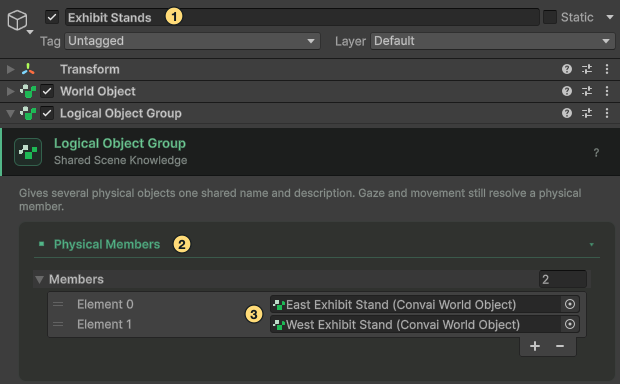
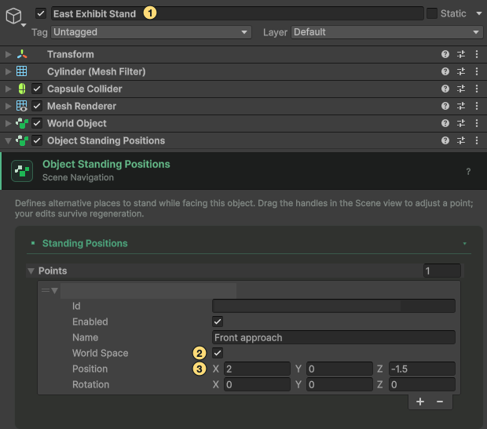

Use a logical group when several physical copies should share one name and description. Add standing positions when a character should approach a particular side of a physical object. These controls are separate from action tour groups and gaze targets.

## Create a logical group



### Prepare the physical copies

Add **Convai > World Object** to each physical object. Keep each active copy's metadata component enabled.


### Create the shared object

Create a root GameObject and add **Convai > Logical Object Group**. Its required World Object component supplies the group's shared name and description. Populate **Physical Members** with the metadata components on the physical copies.

<figure><figcaption>
The (1) <strong>Exhibit Stands</strong> root lists (3) two physical copies under (2) <strong>Physical Members</strong>.
</figcaption></figure>


### Check the projected result

The root represents the active group in scene metadata; its members are omitted from that payload. A root with no active member is omitted too. Inspect `ConvaiWorldObjectRegistry.GetValidMetadata()` to see the projected objects.

Runtime interaction resolves an active physical member using the observer position. A request that names the group resolves to the member nearest the character, which is not always the one the user means, so keep objects separate when users need to tell them apart. Turn on **Include Spatial Context** on the group root's World Object; members produce no spatial facts of their own. With it on, the group's spatial fact describes that nearest member and says how many objects share the name; see [Spatial context from world objects](../dynamic-context/spatial-context.md). Test near more than one copy, then disable a copy and test the remaining selection.



When editing `Members` in code, call `NotifyMembershipChanged()` after the edit. The SDK also polls membership changes, but an explicit notification makes the intent clear.

## Add standing positions

On each physical target, add **Convai > Object Movement Points**. Add entries to **Standing Positions**:

| Field | Use |
| --- | --- |
| `Id` | Stable generated identifier for the point |
| `Enabled` | Include the point in movement selection |
| `Name` | Human-readable approach label |
| `WorldSpace` | Use a world position instead of transforming a local one |
| `Position` | Where the character should stand |
| `Rotation` | Authored orientation |

<figure><figcaption>
On (1) <strong>East Exhibit Stand</strong>, enable (2) <strong>World Space</strong> to interpret (3) <strong>Position</strong> as world coordinates.
</figcaption></figure>

Place points on reachable navigation surfaces with room for the character. The runtime movement path selects a complete reachable approach; an authored point alone does not establish a valid NavMesh path.

The Scene Auto Tagger can generate best-effort points using an existing NavMesh. It does not bake the NavMesh, and missing generated points do not prevent metadata Apply. Inspect the results and test actual navigation separately.

## Verify the behavior

Check the logical payload, the selected physical member, and the character's complete navigation path. Keep the approach position separate from the gaze aim point: changing a standing position does not change the object's descriptive text or the capture camera.

## Next steps


[Scene metadata component reference](component-reference.md)


[Tag a scene with Scene Auto Tagger](scene-auto-tagger.md)

