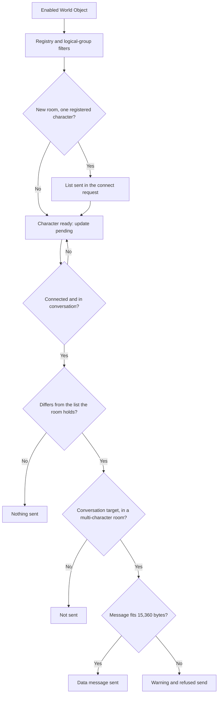

Scene metadata gives a character names and descriptions for relevant Unity objects. Registration, payload selection, local sending, and conversational use are separate stages. `ConvaiCharacter` drives automatic delivery; `ConvaiSceneMetadataCollector` is optional for manual collection and diagnostics.

## Registration and automatic delivery

Enabled `ConvaiObjectMetadata` components register themselves. The registry excludes invalid names, objects with **Include In Metadata** off, physical members represented by an active logical group, and group roots with no active members.

Every valid world object goes in the character's scene description, including objects that also have an action target. When the scene registers one `ConvaiCharacter`, a new room sends the list in its connect request. The connect request is not subject to the data-message limit below, and the SDK adds no limit of its own, so a large scene arrives whole. A scene that registers more than one character (including a group conversation), and any join to an existing room by name, including the automatic rejoin after a dropped connection, send no list in the connect request and use the data message instead. A scene with no valid world objects sends no scene description.

When a character becomes ready, it marks scene metadata pending. The pending update goes out once the character is connected and `IsInConversation`, and only when the list differs from the one the room holds, so a list that arrived in the connect request is not repeated. The lists are compared entry by entry, so a change of order or count also counts as a difference. In a multi-character room the character must also be the conversation target. An empty list is not sent while the room holds no list; once the room holds one, a later empty list replaces it.

The collector reads the same full valid list and sends it as a data message each time it runs. **Collect On Start** attempts a send when the room connects. Manual collection sends to the current target, so it does not broadcast the scene to every member of a room.

A data message, including its envelope, must fit within 15,360 UTF-8 bytes. The sender warns and refuses larger messages, and a refused scene description update leaves the room with the list it had. The limit applies to every update after connect, including the whole scene description when more than one character is registered or after a rejoin, and to collector sends. It does not apply to a scene description sent in the connect request. Authoring text limits and the number of objects do not guarantee that an update fits.

## Live description changes

Setting `ObjectName`, `ObjectDescription`, or `IncludeInMetadata` through the public properties marks registered metadata dirty. Enabling, disabling, registering, or unregistering an object also schedules updates. Each character still follows the connection and target gates above.

Editing serialized fields in the Inspector during Play mode does not use those setters. `OnValidate` fills a blank name and warns about text length; it does not perform the same live synchronization. Use the public properties for runtime edits or deliberately recollect through the collector.

## Tracked values

Tracked properties describe changing object state through Dynamic Context. The internal poll driver evaluates sources every 0.25 seconds. A key combines the trimmed object and property names, such as `LoadingBayDoor.DoorStatus`. A source can be a property, field, or zero-argument method; an entry without a source starts from **Initial Value**.

`SetTrackedPropertyValue` pushes a value without waiting for the poll. Renaming the object removes its old keys and resets the tracked-value cache. The next evaluation reads sourced values again and restores initial values for entries without a source; pushed values must be supplied again if they still matter.

In a group conversation, a non-`Silent` change updates members silently and sends one scene event in the form `LoadingBayDoor.SensorFault is now Jammed.` The service chooses whether and who reacts. This is not a promise of simultaneous or immediate speech from every character.

## Spatial context

**Include Spatial Context** publishes changing distance, direction, visibility, and movement facts through Dynamic Context. On the same 0.25-second poll, the SDK selects objects within 30 metres for characters in a conversation, prioritizing visible objects and then nearer ones, up to 24 facts per character.

Keys use `scene-object.{id}.spatial`. Distances are banded to reduce updates: half-metre steps below 5 metres, metre steps below 10 metres, and 5-metre steps farther away. A fact describes an object's relative position, visibility, and whether it is moving. It names the character it is measured from, as in `Chair: 3 m to Ava's left; visible to Ava; stationary`, and a logical group's fact says how many objects share its name. See [Spatial context from world objects](../dynamic-context/spatial-context.md) for the format. These are client measurements, not proof of what the model perceived.

## Logical groups and movement

A logical group represents several physical copies with one shared name and description. Its members leave the metadata payload; the root represents them while at least one member is active. Runtime resolution chooses a nearby active physical member for interaction. Standing positions are separate approach points, and gaze aim is a separate target calculation.

See [Group objects and add standing positions](group-objects-and-standing-positions.md).

## Choose the context mechanism

| Mechanism | Describes | Authoring and updates |
| --- | --- | --- |
| Scene metadata | What an object is | World Object name and description; pending updates through the character route |
| Tracked properties | A value owned by an object | Inspector source or explicit `SetTrackedPropertyValue` call |
| Spatial context | Where an object is relative to a character | Opt in per object; automatic limited polling |
| Other Dynamic Context | Application state and events | Explicit state/event APIs |

## Next steps


[Scene metadata quick start](quick-start.md)


[Scene metadata component reference](component-reference.md)

