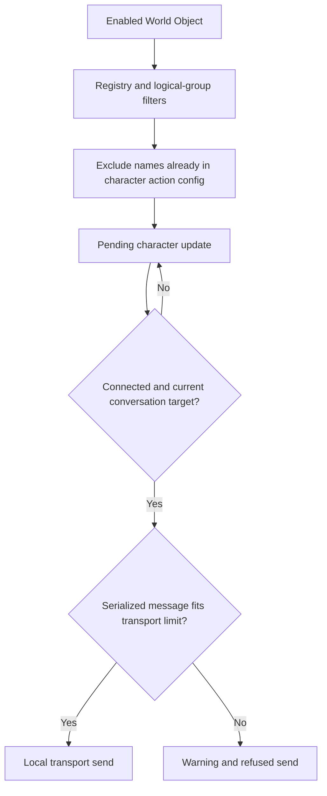

Scene metadata gives a character names and descriptions for relevant Unity objects. Registration, payload selection, local sending, and conversational use are separate stages. `ConvaiCharacter` drives automatic delivery; `ConvaiSceneMetadataCollector` is optional for manual collection and diagnostics.

## Registration and automatic delivery

Enabled `ConvaiObjectMetadata` components register themselves. The registry excludes invalid names, objects with **Include In Metadata** off, physical members represented by an active logical group, and group roots with no active members.

When a character becomes ready, it snapshots names already present in its action configuration and marks scene metadata pending. Its automatic payload also excludes those names to avoid duplicates. The character flushes only while connected and `IsInConversation`; in a multi-character room it must be the conversation target. An initially empty payload is omitted; a later empty payload can clear previously sent data.

The collector reads the registry's full valid list without the character-specific action-name exclusion. **Collect On Start** attempts a send when the room connects. Manual collection sends to the current target, so it does not broadcast the scene to every member of a room.

The full serialized data message, including its envelope, must fit within 15,360 UTF-8 bytes. The sender warns and refuses larger messages. Authoring text limits and the number of objects do not guarantee that the message fits.

## Live description changes

Setting `ObjectName`, `ObjectDescription`, or `IncludeInMetadata` through the public properties marks registered metadata dirty. Enabling, disabling, registering, or unregistering an object also schedules updates. Each character still follows the connection and target gates above.

Editing serialized fields in the Inspector during Play mode does not use those setters. `OnValidate` fills a blank name and warns about text length; it does not perform the same live synchronization. Use the public properties for runtime edits or deliberately recollect through the collector.

## Tracked values

Tracked properties describe changing object state through Dynamic Context. The internal poll driver evaluates sources every 0.25 seconds. A key combines the trimmed object and property names, such as `LoadingBayDoor.DoorStatus`. A source can be a property, field, or zero-argument method; an entry without a source starts from **Initial Value**.

`SetTrackedPropertyValue` pushes a value without waiting for the poll. Renaming the object removes its old keys and resets the tracked-value cache. The next evaluation reads sourced values again and restores initial values for entries without a source; pushed values must be supplied again if they still matter.

In a group conversation, a non-`Silent` change updates members silently and sends one scene event in the form `LoadingBayDoor.SensorFault is now Jammed.` The service chooses whether and who reacts. This is not a promise of simultaneous or immediate speech from every character.

## Spatial context

**Include Spatial Context** publishes changing distance, direction, visibility, and movement facts through Dynamic Context. On the same 0.25-second poll, the SDK selects objects within 30 metres for characters in a conversation, prioritizing visible objects and then nearer ones, up to 24 facts per character.

Keys use `scene-object.{id}.spatial`. Distances are banded to reduce updates: half-metre steps below 5 metres, metre steps below 10 metres, and 5-metre steps farther away. A fact describes an object's relative position, visibility, and whether it is moving. These are client measurements, not proof of what the model perceived.

## Logical groups and movement

A logical group represents several physical copies with one shared name and description. Its members leave the metadata payload; the root represents them while at least one member is active. Runtime resolution chooses a nearby active physical member for interaction. Standing positions are separate approach points, and gaze aim is a separate target calculation.

See [Group objects and add standing positions](group-objects-and-standing-positions.md).

## Choose the context mechanism

| Mechanism | Describes | Authoring and updates |
| --- | --- | --- |
| Scene metadata | What an object is | World Object name and description; pending updates through the character route |
| Tracked properties | A value owned by an object | Inspector source or explicit `SetTrackedPropertyValue` call |
| Spatial context | Where an object is relative to a character | Opt in per object; automatic limited polling |
| Other Dynamic Context | Application state and events | Explicit state/event APIs |

## Next steps


[Scene metadata quick start](quick-start.md)


[Scene metadata component reference](component-reference.md)

