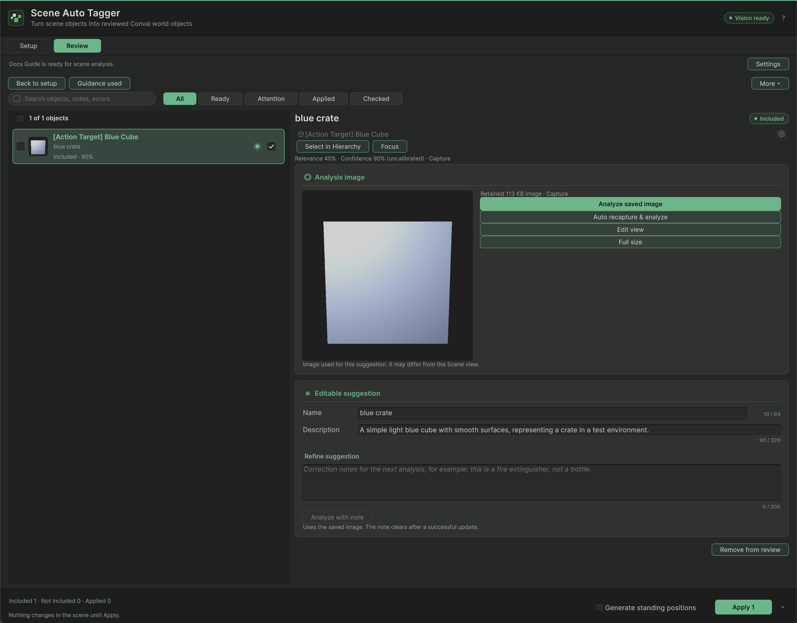

Open **Convai > Scene Auto Tagger** in Edit mode. This reference describes the reviewed 5.0 client UI. The bundled Core is marked unsigned/internal and not customer-distribution-ready; use only an approved preview package until the SDK/Core release owner clears that gate.

## Setup controls

| Control | Behavior |
| --- | --- |
| Character | Selects the account character used for analysis guidance |
| Scene description | Optional environment context, up to 800 characters |
| Draft from Scene view | Sends the current view for a scene-description draft |
| Description focus | Optional guidance, up to 400 characters |
| Current Scene | Discovers relevant candidates in the active scene |
| Selected Objects | Uses explicitly selected objects and their owned geometry |
| Fast / Accurate | Chooses image detail; identification remains a suggestion |
| Re-analyze tagged objects | Includes previously tagged objects in discovery; Apply protects manual metadata |
| Explore current scene / Explore selected objects | Starts discovery, capture, and analysis for the selected scope |

**Vision ready** means local credentials are configured and the native Core loaded. Service authentication, plan access, and a usable answer are checked by actual requests. **Core unavailable** requires the matching supported libraries; checksum, architecture, ABI, or lock mismatch is a package problem. Restart Unity after replacing native libraries with an approved matching package.

## Review controls

| Control | Behavior |
| --- | --- |
| All / Ready / Attention / Applied / Checked | Filters review rows |
| Include control | Determines whether the object participates in Apply |
| Checked state and More | Selects objects for batch operations |
| Name / Description | Editable approved text, fitted to World Object authoring limits |
| Analyze saved image | Requests another description of the retained image |
| Auto recapture & analyze | Captures the current object again, then analyzes |
| Edit view | Changes an isolated preview without sending a Vision request |
| Use view | Saves the edited capture locally and checks the row for analysis |
| Use & analyze | Saves the capture and submits that object for analysis |
| Analyze with note | Reuses the saved image with a correction note and suggestion |
| Remove from review | Removes a row without changing its scene object |
| Generate standing positions | Queries the existing NavMesh for best-effort approach points |
| Back to setup | Discards the current review; already applied scene objects remain |

Cancellation stops remaining work, but an in-flight native request must finish before cleanup completes. The window may wait for that request during cancellation or Editor shutdown.

## Settings

| Setting | Effect |
| --- | --- |
| Minimum local relevance | Filters Current Scene discovery before capture; explicit selection bypasses this threshold |
| Duplicate objects | Keep separate, Nearby clusters, or Group all verified; only geometry/image-verified copies group |
| Nearby clusters | Groups span up to 10 metres horizontally and 3 metres vertically |
| Minimum AI confidence / Include matching | Auto-includes matching suggestions; confidence is uncalibrated and needs human review |
| Reset decisions | Includes unapplied suggestions again while keeping text and notes |
| Reuse metadata across runs | Reuses local cached text; previous images are unavailable |
| Save debug captures locally | Saves troubleshooting images under `Library/ConvaiSceneTagger` |
| Runtime spatial context | Enables spatial facts on applied metadata |
| Action targets | Creates owned action targets |
| Gaze targets | Adds companions through the installed embodiment integration |
| Generate standing positions | Uses the existing NavMesh; does not bake it |

The grouping plan is retained after the first Apply. Generated movement positions are best effort and do not block metadata Apply when unavailable.

## Apply outcomes

Apply records an Undo step and marks scenes dirty without saving. It preserves manual metadata and edited owned companions. Changes to geometry, transforms, or materials since capture can make a result stale; capture again. Inspect the applied components before saving and verify runtime delivery separately.

<figure><figcaption>
Review after analyzing one test object. Nothing changes in the scene until Apply.
</figcaption></figure>

## Failure handling

| Failure | Action |
| --- | --- |
| Missing credentials or unauthorized character | Configure access through the account owner; never paste credentials into diagnostics |
| Core unavailable | Install the approved matching package for the Editor platform and restart |
| Low information | Inspect the object image and framing before choosing Analyze anyway |
| Usage limit or persistent rate limiting | Resolve plan capacity or wait as directed; reducing concurrency does not grant entitlement |
| Capture or invalid response | Inspect the individual object's status and retry only the affected objects |
| Apply conflict | Review authored components or recapture changed objects |

## Next steps


[Tag a scene with Scene Auto Tagger](scene-auto-tagger.md)

