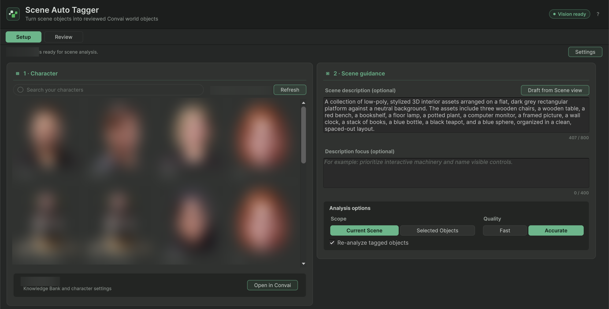

Scene Auto Tagger captures scene objects, asks Convai Vision for suggested names and descriptions, and lets you review them before applying World Object metadata. Analysis does not change the scene; **Apply** does.


This is a 5.0 preview authoring workflow. The reviewed package's native Core is marked `unsigned-internal-prerelease` with `customerDistributionReady: false`. Public distribution requires the SDK/Core release owner's approved package and service availability. **Vision ready** only confirms local credentials and native loading; it does not certify production readiness or backend access.


## Prerequisites

- An approved preview package in a Windows or macOS Unity Editor, in Edit mode.
- Matching native Core libraries and helper files installed with that package. Do not bypass checksum or platform loading failures.
- Configured Convai credentials and access to the selected character and Vision service.
- A saved test scene. For generated standing positions, an existing baked NavMesh.

## Explore, review, and apply



### Open the window and select a character

Choose **Convai > Scene Auto Tagger**. Select an account character. If credentials or Core loading are unavailable, resolve the displayed issue and use **Recheck** before continuing.


### Set guidance and scope

Enter **Scene description (optional)** and **Description focus (optional)**. **Draft from Scene view** sends the current view image for a draft; review its text before using it.

Choose **Current Scene** or **Selected Objects** and **Fast** or **Accurate** quality. Accurate uses more image detail but does not guarantee identification. Use **Re-analyze tagged objects** when existing tags should be considered; manually authored metadata is protected during Apply.

Choose **Explore current scene** or **Explore selected objects**. Captures and context are sent to the configured service. Keep private scene content out of a test run unless you intend to send it.


### Inspect each suggestion

In **Review**, inspect the saved image, proposed **Name**, and **Description**. Correct inaccurate text. A row's include control determines whether Apply uses it; the separate checked state selects batch operations.

For a poor image, use **Edit view**, then **Use view** to save locally or **Use & analyze** to submit it. **Analyze saved image** reuses the retained capture. **Auto recapture & analyze** takes a fresh one. A correction note affects the next analysis of that object and is not stored in the scene.


### Apply approved results

Review **Settings** for duplicate grouping, spatial context, action targets, gaze companions, and standing positions. Apply only the intended objects. The tool records Undo and marks scenes dirty; save the scene after inspecting the result.

Apply preserves manually authored metadata and reports conflicts for objects changed since capture or edited companion components. Re-analyze a changed object rather than assuming an old capture still describes it.


### Test runtime delivery

Inspect the resulting World Objects and groups. Enter Play mode, address the intended character, and verify collection and local delivery using [Scene metadata quick start](quick-start.md). Then test the actual conversation and any navigation separately.

A successful Apply proves that scene components were authored. With one registered character, a new room receives the whole list in its connect request. More than one character, a rejoin, and later changes use a data message limited to 15,360 bytes. Action targets also reach the character through the action-target sync. A sync over 12 KiB is split into actions, objects and characters updates. Each list must fit in one update, or nothing is sent; see [Check when a change reaches Convai](../character-actions/register-targets-from-code.md#check-when-a-change-reaches-convai). Apply warns when the action targets or the world objects pass three quarters of the 15,360-byte limit. Apply does not prove that the list reaches every room member or produces the intended reply.



<figure><figcaption>
Scene Auto Tagger Setup. The character cards are blurred because they show account characters.
</figcaption></figure>

Coding assistants connected through the Unity MCP Server can run the same tagging workflow; see the [MCP tools reference](../../ai-coding-assistant/mcp-tools-reference.md).

## Next steps


[Scene Auto Tagger window reference](scene-auto-tagger-window-reference.md)


[Scene Auto Tagger scripting API](scene-auto-tagger-scripting-api.md)

