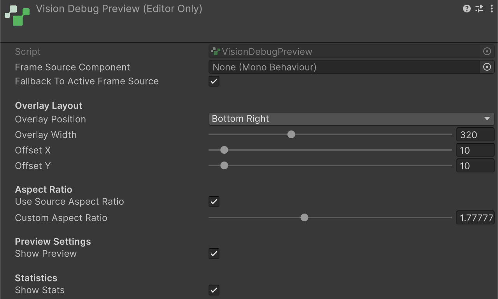
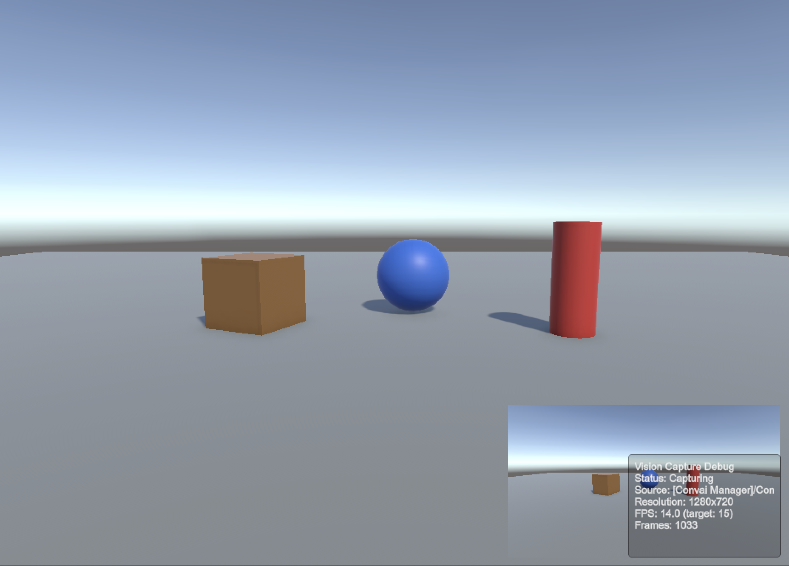

`VisionDebugPreview` is an Editor-only component that renders the live camera feed as a screen overlay and displays a capture statistics panel. Use it to inspect the locally captured image during development. It does not prove the service received or used that image. The sample vision diagnostic tools complement it by confirming that vision status requests and triggers actually reach Convai.

## Add the component

On any scene GameObject, click **Add Component** → **Convai/Vision/Vision Debug Preview (Editor Only)**.

The component auto-discovers the active frame source in the scene. No explicit assignment is required unless multiple frame sources are present.


`VisionDebugPreview` discovers frame sources in priority order: same GameObject, children, parents, then scene-wide search. Assign the **Frame Source Component** field explicitly when multiple frame sources are present to avoid ambiguity.


## Inspector reference

**Preview Settings and Statistics**

| Field            | Type   | Default | Description                           |
| ---------------- | ------ | ------- | ------------------------------------- |
| **Show Preview** | `bool` | `true`  | Enables the camera feed overlay.      |
| **Show Stats** (under **Statistics**)   | `bool` | `true`  | Enables the capture statistics panel. |

**Source fields** (no heading in the Inspector)

| Field                               | Type            | Default             | Description                                                                                                                                   |
| ----------------------------------- | --------------- | ------------------- | --------------------------------------------------------------------------------------------------------------------------------------------- |
| **Frame Source Component**          | `MonoBehaviour` | _(auto-discovered)_ | The frame source to preview. Leave blank to auto-discover.                                                                                    |
| **Fallback To Active Frame Source** | `bool`          | `true`              | When the assigned source has no texture, searches the scene for another active frame source. Useful when the source starts after the preview. |

**Overlay Layout**

| Field                | Type              | Default       | Description                                                                                                         |
| -------------------- | ----------------- | ------------- | ------------------------------------------------------------------------------------------------------------------- |
| **Overlay Position** | `PreviewPosition` | `BottomRight` | Corner of the Game view where the preview is anchored. Options: `TopLeft`, `TopRight`, `BottomLeft`, `BottomRight`. |
| **Overlay Width**    | `int` (160–640)   | `320`         | Preview width in pixels. Height is calculated automatically from the aspect ratio.                                  |
| **Offset X**         | `int` (0–200)     | `10`          | Horizontal inset from the selected corner in pixels.                                                                |
| **Offset Y**         | `int` (0–200)     | `10`          | Vertical inset from the selected corner in pixels.                                                                  |

<figure><figcaption><p>The Vision Debug Preview Inspector with its default values.</p></figcaption></figure>

**Aspect Ratio**

| Field                       | Type          | Default        | Description                                                                                                                |
| --------------------------- | ------------- | -------------- | -------------------------------------------------------------------------------------------------------------------------- |
| **Use Source Aspect Ratio** | `bool`        | `true`         | When enabled, derives aspect ratio from the frame source's `FrameDimensions`. When disabled, uses **Custom Aspect Ratio**. |
| **Custom Aspect Ratio**     | `float` (1–3) | `1.778` (16:9) | Aspect ratio used when **Use Source Aspect Ratio** is disabled.                                                            |

The two source fields come first with no heading, followed by **Overlay Layout**, **Aspect Ratio**, **Preview Settings**, then **Statistics**.

## Statistics overlay

When **Show Stats** is enabled, a 180 × 122 pixel text box is drawn in the preview's corner, on top of the preview. It sits beside the preview only when the preview falls back to IMGUI drawing. The exact output:

```text
Vision Capture Debug
Status: Capturing
Source: [Convai Manager]/ConvaiVisionRoot [camera] (CameraVisionFrameSource)
Resolution: 1280x720
FPS: 14.9 (target: 15)
Frames: 447
```

| Line                          | Source                                            | Notes                                              |
| ----------------------------- | ------------------------------------------------- | -------------------------------------------------- |
| `Status: Capturing / Stopped` | `IsCapturing` on the frame source                 | Boolean string — not the `VisionSourceState` enum. |
| `Source: ...`                 | Hierarchy path + SourceId + type name             | Full path from scene root for disambiguation.      |
| `Resolution: WxH`             | `FrameDimensions`                                 | `0x0` only for a source with no texture yet, such as Quest. A camera source shows its configured size and a webcam source its requested size before capture. |
| `FPS: X.X (target: Y)`        | Measured over 0.5 s intervals + `TargetFrameRate` | Measured FPS updates every 0.5 seconds.            |
| `Frames: N`                   | `FrameCount`                                      | Cumulative total since capture started.            |

<figure><figcaption><p>The preview and statistics panel in the Game view. A long <code>Source</code> line is cut off at the panel edge.</p></figcaption></figure>


**`IsCapturing` vs `IsPublishing`:** The statistics panel shows `IsCapturing` — whether the frame source is producing frames. This is distinct from `ConvaiVisionPublisher.IsPublishing`, which indicates whether a WebRTC video track is actively being sent to Convai. Both can be checked independently; a source may be capturing while publishing is paused or not yet started.


## Script access

These properties can be read from other scripts:

| Property      | Type    | Description                                           |
| ------------- | ------- | ----------------------------------------------------- |
| `ShowPreview` | `bool`  | Gets or sets whether the preview overlay is visible.  |
| `ShowStats`   | `bool`  | Gets or sets whether the statistics panel is visible. |
| `CurrentFps`  | `float` | Measured capture FPS, updated every 0.5 seconds.      |
| `FrameCount`  | `long`  | Cumulative frames from the current frame source.      |
| `IsCapturing` | `bool`  | Whether the current frame source is capturing.        |

## Verify vision requests with the sample tools

`VisionDebugPreview` confirms that a frame source is producing frames locally. It does not confirm that Convai receives the frames or that vision-specific requests get an answer. Import the **LipSync Sample** from Package Manager and open its scene to test that round trip. The scene includes **Dynamic Vision Context Rig** with `DynamicVisionContextSceneTool`, an IMGUI overlay for **Send Text Message**, **Request Vision Status**, and **Trigger Vision**. The Sample Debug Hub prefab exists separately but is not instanced in the shipped sample scenes.

If you add the Sample Debug Hub prefab yourself, its **Vision** panel exposes these controls:

| Control | Action |
| --- | --- |
| **Text message** input + **Send Text** | Sends a plain text message through `ConvaiPlayer.SendTextMessage`. Use this first to confirm the character responds at all. |
| **Vision Status** (ignores prompt and respond-mode inputs) | Calls `ConvaiRoomManager.RequestVisionStatus()`. The result text reports the backend's buffer outcome, active source, and frame age once Convai answers. |
| **Vision prompt** and **Respond mode** inputs + **Vision Trigger** | Calls `ConvaiRoomManager.TriggerVision()` with the prompt text and the parsed respond mode. The result text reports whether frames were attached and whether the request was downgraded. |

The **Respond mode** input accepts `silent`, `auto`, or `must_respond`. An unrecognized value is rejected before the request is sent. The result text then reads `Invalid respond mode '<value>' — use silent, auto or must_respond`.

For example, after a successful trigger the result text reads:

```text
Vision trigger: status=success, outcome=frames_available, attach=attached, frames=5, downgraded=False
```

For a scene-only check without the hub, add `DynamicVisionContextSceneTool` to any GameObject. It exposes the same three actions through an IMGUI overlay and equivalent context menu commands (**Send Text Message**, **Request Vision Status**, **Trigger Vision**). The scene does not place the separate VisionTargets materials as colored test props. Add your own distinct visible objects when testing what the camera sees.

## Known limitations

* Editor only. `VisionDebugPreview` calls `enabled = false` in `Awake()` on non-Editor builds. It does not display a preview in shipped builds.
* In Editor Play mode, the preview works with any build target, including WebGL. It disables itself in every player build. Verify browser publication separately.
* The image uses a generated child Screen Space - Overlay Canvas named `Convai Vision Debug Preview` and a RawImage. Statistics and an image fallback use IMGUI. Inspector layout controls position the overlay.
* Only one statistics panel is drawn per `VisionDebugPreview` component. Add multiple components if you need to compare two frame sources side by side.
* `VisionContextDebugPanel` and `DynamicVisionContextSceneTool` are sample-only components under `SamplesShared/`. They are not part of the runtime SDK and are not included in shipped builds unless you import and keep the sample.

## Next steps


[Publish policies](publishing-and-policies.md)



[Troubleshoot vision](troubleshooting-and-diagnostics.md)

