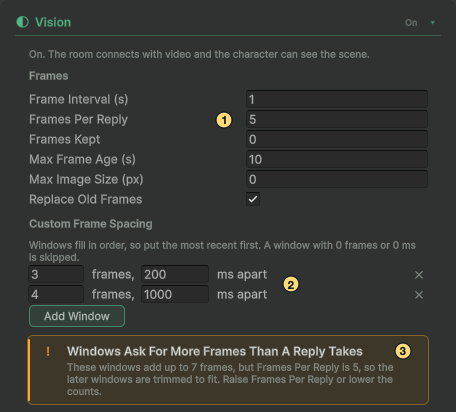
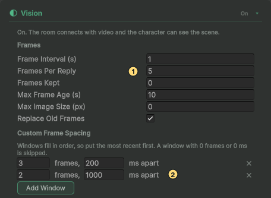

Field-level reference for the three types that configure dynamic vision context: `ConvaiVisionContextMode` enables it per room, `ConvaiVisionInputSettings` tunes backend frame sampling, and `ConvaiRespondModeSettings` sets per-lane respond-mode defaults. See [How vision works](how-vision-works.md#dynamic-vision-context) for what dynamic vision context is, why it exists, and how to enable it on a room.


These settings request service behavior. Account availability, model compatibility, timing, and cost must be confirmed from actual responses and your service configuration.


## `ConvaiVisionContextMode`

Select **Vision** under **Connection** on the room manager. A new room uses this setting to select its connection type and vision policy. A join to an existing room uses that room's configuration. Group conversation uses audio only.

| Setting | Connection | Vision fields in the connect request |
| --- | --- | --- |
| `Off` (default) | Audio | Omits `vision_input_config` and sets `vision_prompt_mode` to `disabled`. |
| `On` | Video | Sends `vision_input_config` and leaves the prompt mode to Convai. |

## `ConvaiVisionInputSettings`

Backend frame-sampling configuration for dynamic vision context, sent as `vision_input_config` on room connect. The client clamps values before serialization. This does not guarantee that the service accepts the configuration. These settings are read once at connect time — changing a sampling field requires a reconnect. Respond modes are the exception; see [`ConvaiRespondModeSettings`](#convairespondmodesettings).

| Field | Wire field | Type | Default | Range |
|---|---|---|---|---|
| Frame Interval (s) | `sample_interval_secs` | `float` | `1` | 0.1–60 |
| Frames Per Reply | `frames_per_turn` | `int` | `5` | 1–20 |
| Frames Kept | `buffer_frames` | `int` | `0` (backend default = Frames Per Reply) | Frames Per Reply–120 when set |
| Custom Frame Spacing | `sampling_windows` | list | empty (uniform sampling at Frame Interval (s)) | see [Sampling windows](#sampling-windows) |
| Max Frame Age (s) | `staleness_seconds` | `float` | `10` | 0.1–120 |
| Max Image Size (px) | `max_resolution` | `int` | `0` (service-selected default) | 64–2048 when set |
| Replace Old Frames | `replace_previous_vision_context` | `bool` | `true` | — |

`Frame Interval (s)` is how often the backend grabs a frame into its buffer. `Frames Per Reply` is how many of those buffered frames get attached the next time the character produces a turn. `Frames Kept` is the size of the rolling buffer itself; leaving it at `0` sizes the buffer to `Frames Per Reply`. `Max Frame Age (s)` discards buffered frames older than this age at attach time. `Replace Old Frames` controls whether a new attach replaces the frames from the previous attach in context, instead of accumulating alongside them.

### Sampling windows

The Inspector shows **Custom Frame Spacing** rows as **N frames, M ms apart**, with **Add Window**. Its caption explains that zero-count or zero-spacing windows are skipped, and it warns when the total exceeds **Frames Per Reply**.

<figure><figcaption>
(1) <strong>Frames Per Reply</strong> sets a budget of five. (2) The two windows ask for three and four frames. (3) The Inspector warns that later windows are trimmed to fit.
</figcaption></figure>

<figure><figcaption>
(1) The budget is still five. (2) Lowering the second count from four to two clears the local warning.
</figcaption></figure>

A sampling window picks a fixed count of frames spaced a fixed interval apart, so a project can combine dense recent motion with sparse older context — for example a `6`-frame window at `300` ms spacing plus a `6`-frame window at `1000` ms spacing (with `Frames Per Reply` set to at least `12`). When no window is configured, the backend samples uniformly at `Frame Interval (s)` instead.

Each window's `Count` and `Interval Ms` default to `0`, and a window is either fully configured or dropped entirely — there is no partial state. Setting only one of `Count` or `Interval Ms` leaves the window at `0` on the other field, and the SDK drops that window before sending `vision_input_config`; it never clamps a `0` ms interval up to the `1` ms floor. This matters because the request can ask for densely spaced frames, so a stray `1` ms window would request maximal capture load for the whole session. A window only reaches the backend when both `Count` (1–20) and `Interval Ms` (1–60000) are set.

If the total `Count` across configured windows exceeds `Frames Per Reply`, the SDK fills windows in order until the budget is used and trims the rest, logging a warning once, instead of sending a configuration the backend would reject.

## `ConvaiRespondModeSettings`

The **When The Character Speaks Up** group contains per-lane respond-mode defaults sent as `respond_modes` on room connect. User text and voice always respond and cannot be lowered; only the four lanes below are configurable. Values use the same `ConvaiRespondMode` enum documented in [Dynamic context scripting API](../dynamic-context/dynamic-context-scripting-api.md#convairespondmode) — `Silent`, `Auto`, and `MustRespond` mean the same thing here as they do for dynamic context.

| Lane | Default | Governs |
|---|---|---|
| Vision Triggers | `Silent` | A `TriggerVisionAsync` request that doesn't set its own `RespondMode` |
| Context Updates | `Auto` | How a dynamic-context text update affects speech |
| Narrative Triggers | `MustRespond` | How a Narrative Design trigger, such as `NarrativeDesign.InvokeTrigger` or `ConvaiNarrativeDesignTrigger`, affects speech. It does not apply to vision triggers |
| Scene Metadata | `Silent` | How scene-metadata updates affect speech |

Sampled frames never start a reply on their own; Convai buffers them and attaches them to the next turn. Because a vision trigger without a `RespondMode` follows the **Vision Triggers** lane, it attaches frames silently by default. Set `RespondMode = ConvaiRespondMode.MustRespond` on the request when the character should answer.

Use `ConvaiManager.UpdateRespondModeAsync` to change a lane for the active session. Await the operation and inspect the result; see [Vision scripting API](scripting-api.md).

## Next steps


[How vision works](how-vision-works.md)



[Dynamic context scripting API](../dynamic-context/dynamic-context-scripting-api.md)



[Vision scripting API](scripting-api.md)

