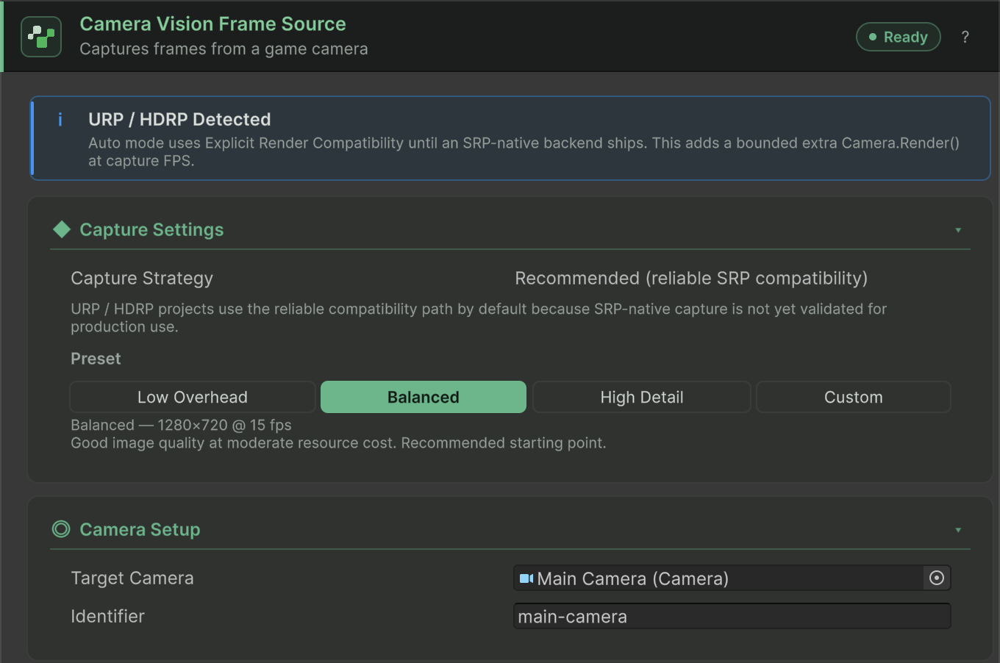
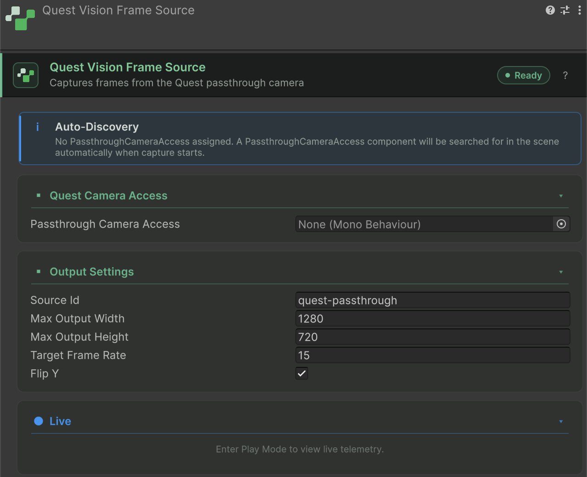

A frame source captures images from your scene and exposes them as a Y-flipped `RenderTexture` for `ConvaiVisionPublisher` to stream. The Convai SDK ships three built-in frame sources: `CameraVisionFrameSource` for Unity scene cameras, `WebcamVisionFrameSource` for physical devices, and `QuestVisionFrameSource` for Meta Quest passthrough.

| Frame source | Best for | Platforms |
| --- | --- | --- |
| `CameraVisionFrameSource` | Streaming any Unity scene camera — main camera, security camera, overhead view | Native platforms and WebGL |
| `WebcamVisionFrameSource` | Streaming a physical camera device attached to the player's machine or mobile device | Native platforms and WebGL |
| `QuestVisionFrameSource` | Streaming the real-world passthrough feed on a Meta Quest 3 or 3S headset | Meta Quest 3 / 3S (requires Meta XR SDK) |

Add a frame source via **Add Component** and type the class name, or navigate the component menu under **Convai → Vision**.

## CameraVisionFrameSource

`CameraVisionFrameSource` captures a Unity Camera into a top-down `RenderTexture`. Add it through **Convai > Vision > Camera Vision Frame Source**.

| Inspector area | Controls |
|---|---|
| **Capture Settings** | Read-only **Capture Strategy**, **Preset** segments, and Custom **Width**, **Height**, **Target FPS**, and **Will Capture At**. |
| **Camera Setup** | **Target Camera** and **Identifier** (default `camera`). A blank camera resolves to a Camera on the same object, then `Camera.main`. |
| **Advanced** | Collapsed debugging controls, including **Internal Backend Override**. Leave automatic backend selection in place for normal use. |

| Preset | Width | Height | FPS |
|---|---|---|---|
| `LowOverhead` | `640` | `480` | `10` |
| `Balanced` | `1280` | `720` | `15` |
| `HighDetail` | `1920` | `1080` | `30` |
| `Custom` | At least `320` | At least `240` | `1`–`30` |

Custom fields are serialized as zero before assignment; an untouched Custom preset therefore resolves to `320 × 240` at `1` fps. Assign deliberate values before using it.

Automatic capture uses Built-in rendering hooks or the explicit compatibility path for SRP. `SrpNative` is unavailable in this implementation and reports `UnsupportedPlatform`; use the compatibility path when diagnosing SRP capture. The optional diagnostic health probe is exposed only in the Inspector's Debug mode, not this custom Inspector. See [Troubleshoot vision](troubleshooting-and-diagnostics.md).

<figure><figcaption>
Camera Vision Frame Source with the Balanced preset and an assigned target camera.
</figcaption></figure>

## WebcamVisionFrameSource

`WebcamVisionFrameSource` uses Unity's `WebCamTexture`, converts frames into a `RenderTexture`, and corrects rotation. Add it through **Convai > Vision > Webcam Vision Frame Source**.

| Inspector area | Controls |
|---|---|
| **Webcam Device — N found** | **Device Name**, plus **Available Devices** with **Select** and **Clear**. Empty uses Unity's system-default camera, not a guaranteed first enumerated device. |
| **Capture Settings** | **Requested Resolution** (default `640 × 480`), **Requested FPS** (default `15`), and **Identifier** (default `webcam`). Actual Resolution is shown in Play mode. |

The requested size and FPS are driver requests, not guaranteed output. Serialized maximum output dimensions default to `1280 × 720` but are not drawn in the normal custom Inspector. `GetAvailableDeviceNames()` lists devices for your own selection UI.

`SwitchWebcamAsync(deviceName)` stops capture before opening the new device. The room remains connected, but the publisher unpublishes when the source stops. After the switch succeeds, call `publisher.EnablePublishing(true)` to publish again, or reconnect the room.

Startup enters `Starting`, may pause in `AwaitingPermission`, returns to `Starting`, and becomes `Ready` on a copied frame. Denial reports `Failed` / `PermissionDenied`. A first-frame wait of `5` seconds can emit `Degraded` / `Timeout`, but the startup path then returns to `Starting`; do not assume that error remains latched. Monitor status and actual frame readiness.

WebGL also supports this source, subject to browser camera access. Test a deployed HTTPS build and permission handling; Editor success is not browser permission evidence. Mobile builds need their platform camera permission configuration.

## QuestVisionFrameSource

`QuestVisionFrameSource` streams the real-world passthrough feed from a Meta Quest 3 or 3S headset, giving Convai characters a live view of the physical environment. The component binds to Meta's `PassthroughCameraAccess` API via reflection so the SDK does not take a hard compile-time dependency on the Meta XR package. In Play Mode, the Inspector's **Live** section shows whether it is capturing, plus **Resolution**, **Target FPS**, **Frames**, **Frame Ready**, **Identifier**, **State** and **Error**, with the source's status message below them when it has one, like the Live sections of `CameraVisionFrameSource` and `WebcamVisionFrameSource`. While **Passthrough Camera Access** is empty, an **Auto-Discovery** note explains that the component searches the scene for one when capture starts.

**Component menu path:** `Convai/Vision/Quest Vision Frame Source`

<figure><figcaption>
The Quest Vision Frame Source Inspector in Edit Mode. The Live section fills in during Play Mode.
</figcaption></figure>

`QuestVisionFrameSource` requires **Meta Quest 3 or 3S** running Horizon OS with the Passthrough Camera API. Quest 2 and Quest Pro do not support `PassthroughCameraAccess`. In the Editor or on other platforms it produces no frames. If no readable `PassthroughCameraAccess` is found when capture starts, the component enters `Failed` with `ErrorKind = InvalidConfiguration`. If one is found but never delivers a readable texture, the component retries the binding three times, one second apart, then enters `Failed` with `DeviceUnavailable` and the message "Quest passthrough source stopped producing readable frames."


**AndroidManifest.xml permissions required.** Your manifest must declare both `horizonos.permission.HEADSET_CAMERA` and `android.permission.CAMERA`. Verify permission grants on the target headset. A missing or unreadable `PassthroughCameraAccess` reports `Failed` / `InvalidConfiguration`; the client cannot establish device permission behavior from the Inspector alone.


**Quest Camera Access**

| Field | Type | Default | Description |
| --- | --- | --- | --- |
| **Passthrough Camera Access** | `MonoBehaviour` | _(auto-discovered)_ | Reference to a `PassthroughCameraAccess` component in the scene. Leave blank to auto-find. |

**Output Settings**

| Field | Type | Default | Description |
| --- | --- | --- | --- |
| **Source Id** | `string` | `"quest-passthrough"` | Identifier used in domain events. |
| **Max Output Width** | `int` | `1280` | Maximum width of the output `RenderTexture`. The output only scales down, keeping the aspect ratio; `0` keeps the source width. |
| **Max Output Height** | `int` | `720` | Maximum height of the output `RenderTexture`. The output only scales down, keeping the aspect ratio; `0` keeps the source height. |
| **Target Frame Rate** | `int` | `15` | Target frames per second for capture. |
| **Flip Y** | `bool` | `true` | Flips the passthrough texture vertically so the published texture is top-down. |

The binding to `PassthroughCameraAccess` is established via reflection at runtime. If the Meta XR package is updated and `PassthroughCameraAccess` changes its API, the component enters `Failed` and sets `StatusMessage`, which the Inspector's **Live** section shows. It does not log the failure. Check for SDK updates in that case.

## Source state reference

All three frame sources implement `IVisionFrameSourceStatusProvider`, which exposes a `State` property and a `StatusChanged` event. Use these to monitor capture health from scripts.

**VisionSourceState**

| State | Meaning |
| --- | --- |
| `Idle` | Capture has not been started. |
| `AwaitingPermission` | Waiting for the user to grant camera permission (Android / iOS). |
| `Starting` | Capture is initializing — device is opening, `RenderTexture`s are being created. |
| `Ready` | Capture is running and frames are being produced. |
| `Degraded` | Capture is running but frame health checks are detecting issues (e.g., consecutive blank frames). |
| `Stopped` | Capture was stopped normally. |
| `Failed` | Capture failed and cannot continue. Check `ErrorKind` and `StatusMessage` for details. |

**VisionSourceErrorKind**

| Error kind | Cause |
| --- | --- |
| `None` | No error. |
| `Timeout` | The source did not produce a usable frame within the expected time window. |
| `PermissionDenied` | Camera permission was denied by the user or the OS. |
| `UnsupportedPlatform` | The source is not supported on this platform (e.g., `SrpNative` capture mode selected). |
| `DeviceUnavailable` | The requested camera device could not be opened. |
| `InvalidConfiguration` | A field value is out of range or inconsistent (check `StatusMessage`). |
| `Unknown` | An unexpected error occurred. |

For scripting against these states and responding to `StatusChanged` events, see [Vision scripting API](scripting-api.md).

## Capture-path availability

| Feature | PC / Mac | Android / iOS | WebGL | Meta Quest 3 / 3S |
| --- | --- | --- | --- | --- |
| `CameraVisionFrameSource` | ✅ | ✅ | ✅ | ✅ |
| `WebcamVisionFrameSource` | ✅ | ✅ (permission flow) | ✅ (browser permission) | Device-dependent |
| `QuestVisionFrameSource` | ❌ | ❌ | ❌ | ✅ (Meta XR SDK required) |
| WebGL canvas capture | ❌ | ❌ | ✅ (automatic) | ❌ |
| `VisionDebugPreview` | ✅ (Editor only) | ✅ (Editor only) | ✅ (Editor only) | ✅ (Editor only) |
| Inspector Max Publish FPS | `30` | `30` | `30` (explicit override) | `30` |

WebGL uses the selected source by default, with Game View as an explicit choice or fallback when no source exists. See [WebGL vision](webgl.md). This table describes client paths, not device or release qualification.

## Next steps


[Publish policies](publishing-and-policies.md)



[Custom frame sources](custom-frame-sources.md)



[Vision scripting API](scripting-api.md)

