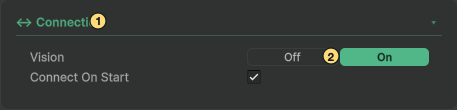
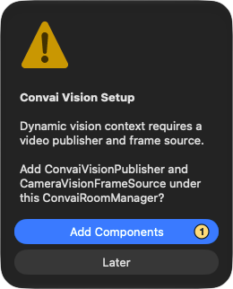
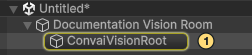
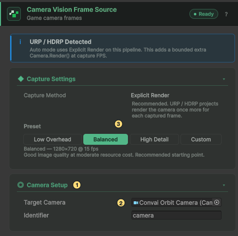

Add vision to an existing single-character scene that already supports conversation. This walkthrough uses a Unity camera and automatic publication. Group conversation rooms do not publish vision.

## Connect and capture



### Enable vision for the room

Select `ConvaiRoomManager`. Under **Connection**, set **Vision** to **On**. The setup dialog can offer **Add Components**, creating a `ConvaiVisionRoot` child with a publisher and camera source.

If components are still missing, the camera-feed warning offers **Add Missing Components**. That action adds the components to the room manager's own GameObject. Select the object actually created by your chosen path.

<figure><figcaption>
(1) Open <strong>Connection</strong> on the room manager. (2) Set <strong>Vision</strong> to <strong>On</strong>.
</figcaption></figure>

<figure><figcaption>
When setup prompts for the camera feed, choose <strong>Add Components</strong> (1).
</figcaption></figure>

<figure><figcaption>
The dialog creates <strong>ConvaiVisionRoot</strong> (1) under the room. Its components are <strong>Convai Vision Publisher</strong> and <strong>Camera Vision Frame Source</strong>.
</figcaption></figure>


### Assign the captured camera

On `CameraVisionFrameSource`, open **Camera Setup** and assign **Target Camera**. When blank, the source tries a Camera on the same object, then `Camera.main`. **Use Main Camera** is available with the missing-camera warning. Explicit assignment avoids ambiguity.

In **Capture Settings**, leave **Preset** at **Balanced** for `1280 × 720` capture at `15` fps. The publisher's policy separately controls the transmitted frame budget.

<figure><figcaption>
(1) Open <strong>Camera Setup</strong>. (2) Assign the camera in <strong>Target Camera</strong>. (3) <strong>Balanced</strong> is selected in <strong>Capture Settings</strong>.
</figcaption></figure>


### Verify capture and publication

Add **Convai > Vision > Vision Debug Preview (Editor Only)**, assign the intended source if there are several, and enter Play mode. Confirm the preview shows the intended image and increasing frame count. Separately check `ConvaiVisionPublisher.IsPublishing` after the room connects. Capture alone does not confirm publication.


### Verify the response

Request vision status or a vision trigger through the [sample debug tool](debug-preview.md). Inspect the returned outcome. A published track does not prove that frames were attached to a response.



## Manual placement

Add `ConvaiVisionPublisher` to the room manager or a child, then add a frame source on that object or beneath it. Assign **Source** explicitly when there are multiple candidates. Runtime discovery does not search the whole scene.

Set the track name on the publisher. The room uses the name reported by the registered publisher. For browser builds, choose the picture deliberately in [WebGL vision](webgl.md).


[Publish policies](publishing-and-policies.md)



[Troubleshoot vision](troubleshooting-and-diagnostics.md)

