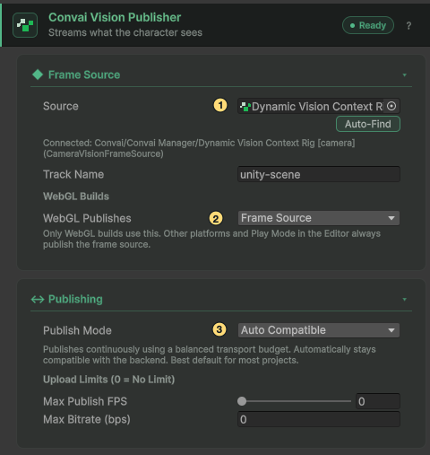
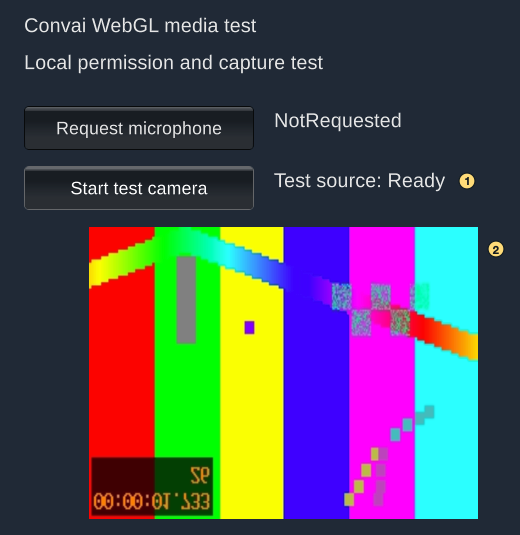

A WebGL build can publish a scene-camera texture, webcam texture, game view, or an application-owned page canvas. Choose the intended picture before building; Editor Play mode always previews the frame source and cannot prove the browser selected the same image.

For a physical webcam, request `Application.RequestUserAuthorization(UserAuthorization.WebCam)` in your WebGL app and wait for the result before starting the source. Serve the build over HTTPS or localhost. An embedded player also needs camera access delegated by its host page. [WebGL deployment](../../platform-guides/webgl.md) covers hosting permissions and fallback behavior.

## Choose the browser picture



### Enable vision in the room

Set **Vision** to **On** under **Connection** and use a `ConvaiVisionPublisher`. The room uses the registered publisher's track name. Group conversation uses audio only.


### Select WebGL Publishes

In the publisher's **Frame Source** section, set **WebGL Publishes** to **Frame Source** or **Game View**. Frame Source is the default. With no source, the publisher falls back to the game view. Game View includes the game's rendered UI.

A source implementing `IVisionPageCanvasSource` always publishes its own `PageCanvasElementId`, even when Game View is selected. It is a source interface, not a third dropdown choice.

<figure><figcaption>
(1) <strong>Source</strong> shows the assigned frame source. (2) <strong>WebGL Publishes</strong> selects what browser builds capture. (3) <strong>Publish Mode</strong> shows the selected policy.
</figcaption></figure>


### Deploy and verify

Serve the build over HTTPS. For webcam capture, grant browser camera permission and wait for a usable frame. Check `IsPublishing`, then request vision status or a trigger and inspect the response. Confirm the content matches the intended source.

<figure><figcaption>
(1) The local webcam source reports <strong>Ready</strong>. (2) The player shows a synthetic browser camera frame. This verifies local capture in Chrome for Testing.
</figcaption></figure>



## Frame-source path

The SDK copies a texture source to a hidden page canvas for browser publication. `CameraVisionFrameSource` and `WebcamVisionFrameSource` are both usable on this path; a custom source must expose valid frames through the same contract. Output alpha is dropped.

`WebGLPublishSource` and `SetWebGLPublishSource(VisionWebGLPublishSource)` expose the selection in code. A live change replaces the published track. After a source stops or fails, restart it and call `EnablePublishing(true)` to resume publication, or reconnect. Switching a webcam is one case where this matters.

## Budget and custom canvases

Policy frame-rate defaults are capped at `15` fps in the browser path. A positive **Max Publish FPS** override is used as configured; the Inspector permits up to `30`. The policy bitrate budget still applies. These values request transport behavior and do not guarantee browser throughput.

For an application-owned canvas, implement `IVisionPageCanvasSource` and keep its element ID valid. Your page code creates the canvas, redraws it while capturing, and keeps it origin-clean. If it must update in background tabs, do not rely only on animation-frame callbacks. An invalid canvas retries; it does not silently switch to Game View. The publisher's readiness budget is `2` active seconds and pauses during permission waiting.


[Custom frame sources](custom-frame-sources.md)



[Vision debug preview](debug-preview.md)

