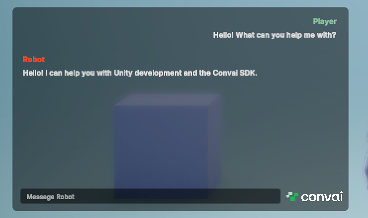

The Convai SDK for Unity includes a ready-made `ChatTranscriptUI` prefab that displays scrolling chat history in real time. The prefab includes its own `Canvas` — drag it into the scene, and it connects to `ConvaiManager` automatically.

## Chat history and captions

`ConvaiManager.ActiveManager.Transcripts` (`ConvaiTranscripts`) exposes conversation entries and live speech-aligned caption state. Use `GetEntries()` and `Subscribe()` for history, or `SubscribeCaptions()` for Active, Completed, Interrupted and Cleared caption updates. History belongs to the current SDK runtime; export it if you need persistent storage. This page adds chat history using the shipped `ChatTranscriptUI` prefab. Captions use a separate, sample-only script with no shipped prefab — see [Chat and subtitle modes](../ui-and-presentation/transcript-ui/chat-and-subtitle-modes.md) to add captions or combine both displays in the same scene.

| Projection | Consumed by | Description |
| --- | --- | --- |
| Chat history | `ChatTranscriptUI` (shipped prefab, covered on this page) | Scrolling message bubbles — separate entries for player and character turns |
| Captions | `SubtitleTranscriptUI` (reference script, no shipped prefab) | In Captions mode, displays current speech. History mode shows finalized entries. |

## Add the chat UI prefab



### Locate the prefab

In the Project window, navigate to:

```text
Packages/Convai SDK for Unity/Prefabs/TranscriptUI/TranscriptUI_Chat.prefab
```
For a display positioned in the scene or an XR environment, use the sibling `TranscriptUI_Chat_WorldSpace.prefab` and configure its world-space Canvas and input raycaster for your interaction system.



### Drag the prefab into the scene

Drag `TranscriptUI_Chat.prefab` into the Hierarchy. The prefab includes its own `Canvas` — no separate `Canvas` setup is required.

Keep **Convai > Settings > Runtime Defaults > Transcript System** enabled. A runtime `TranscriptEnabled` override can also disable presentation.

The chat UI overlay appears in the Game view. The component finds `ConvaiManager` automatically when the scene starts — no manual wiring is needed.

The chat input field requires an `EventSystem` in the scene. If your scene does not already have one, add it via **GameObject > UI > Event System**.


If no `ConvaiManager` is found at startup, the Console logs: `[ChatTranscriptUI] No active ConvaiManager found.`. Check that `ConvaiManager` is in the scene.




## ChatTranscriptUI Inspector fields

If you need to customize the layout, select the prefab instance and inspect the `ChatTranscriptUI` component.

**UI References:**

| Field                    | Type             | Description                                             |
| ------------------------ | ---------------- | ------------------------------------------------------- |
| `scrollRect`             | `ScrollRect`     | The scroll container for the message list               |
| `chatContainer`          | `RectTransform`  | Parent transform where message bubbles are instantiated |
| `characterMessagePrefab` | `GameObject`     | Template for character speech bubbles                   |
| `playerMessagePrefab`    | `GameObject`     | Template for player speech bubbles                      |
| `chatInputField`         | `TMP_InputField` | Text field for typed input (optional)                   |

**Fade Settings:**

| Field          | Default | Description                         |
| -------------- | ------- | ----------------------------------- |
| `fadeDuration` | `0.5` | Seconds for fade-in/out transitions |
| `canvasFader` | Prefab reference | Fade controller. |
| `canvasGroup` | Prefab reference | Canvas group used to control visibility. |

If `chatContainer` is not assigned, messages will not appear and the Console logs: `[ChatTranscriptUI] chatContainer is not assigned - messages will not display`. The bundled prefab has all references pre-wired.

**Input Availability:**

| Field | Default | Purpose |
| --- | --- | --- |
| Gate Input On Availability | On | Disable typed input until the addressed character can accept a message. |
| Notice Text | Optional reference | Show a refusal reason. |
| Refusal Notice Seconds | `4` | Time to display a refusal. |
| Slow Connect Hint Seconds | `35` | When to replace the initial connecting prompt. |
| Prompt fields | State-specific text | Customize no-character, offline, connecting, preparing, ready, responding and unavailable messages. `{0}` is the character name where supported. |
| Group Conversation Prompt | Use push-to-talk to speak | Explain why typed input is unavailable in group conversation. |

**Fonts > Use System Font Fallback** defaults to on. It uses available operating-system fonts for missing glyphs on native platforms. It does not provide complex script shaping or right-to-left layout. For WebGL, supply suitable TextMeshPro font assets and fallback fonts in your project.

If the prefab is present but no messages appear, check **Transcript System**, its runtime override and the component references. If only the input is disabled, inspect the availability prompt: room connection alone does not mean the character is ready.

<figure><figcaption><p>TranscriptUI_Chat in Play mode with one exchange and the ready input prompt.</p></figcaption></figure>

## Usage examples

### Example 1: Full-screen chat overlay in a corporate training simulation

**Scenario:** A corporate onboarding experience displays a full-screen chat history so trainees can review everything the AI mentor said.

**Setup:**

* Drag `TranscriptUI_Chat.prefab` into the Hierarchy
* Leave all references at prefab defaults

**Expected outcome:** Each turn appears as a new bubble — player text on the right, character text on the left. The list scrolls automatically as the conversation grows.

## Next steps

With the transcript UI in place, add lip sync to drive character blendshapes from audio.


[Add lip sync](add-lip-sync/README.md)

