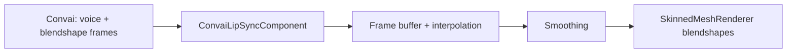

The Convai SDK for Unity includes a real-time lip sync system that drives `SkinnedMeshRenderer` blendshapes in sync with the character's voice audio. It supports three industry-standard blendshape formats and handles playback buffering, smoothing, and fade-out automatically.

## How it works

When Convai sends voice audio, it also streams a sequence of blendshape frames in the character's transport format (ARKit, MetaHuman, or CC4 Extended). The SDK buffers and interpolates these frames, applies optional smoothing, and writes the result to your character's `SkinnedMeshRenderer` every frame.

If the same character also has another module that drives facial blendshapes — for example, an Emotion controller — Convai composites the lip sync output with that module's output internally before writing to the mesh, rather than letting the two write independently. The shipped balance gives the mouth almost entirely to `ConvaiLipSyncComponent` while the character is speaking. With no other facial output module on the character, `ConvaiLipSyncComponent` writes directly to the target meshes as shown above.

## Quick setup



### Add the component

Select the character or its child mesh object and choose **Add Component > Convai > Lip Sync > Convai Lip Sync**.



### Select the profile

In the Inspector, choose the matching **Profile**:

* **ARKit** (`arkit`) — Apple ARKit (61 blendshapes)
* **MetaHuman** (`metahuman`, transport token `mha`) — Unreal MetaHuman (251 blendshapes)
* **CC4 Extended** (`cc4_extended`) — Character Creator 4 Extended (170 blendshapes)



### Assign target meshes

Use **Auto-Find** to locate the child meshes, then check that the **Renderers** list contains the `SkinnedMeshRenderer` components with facial blendshapes. Use **Validator** to inspect the effective map before entering Play Mode.



### Enter Play Mode

Leave **Mapping** empty — the SDK auto-selects a matching bundled map for the chosen profile. Enter Play Mode and speak to the character.

The character's mouth moves in sync with its voice output.


If the mouth does not move, confirm that your `SkinnedMeshRenderer` blendshape names match the expected naming convention for the chosen profile. ARKit uses camelCase names (e.g., `jawOpen`, `mouthSmileLeft`). MetaHuman uses the `CTRL_expressions_` prefix. Use a custom map if your rig uses different names — see [Profiles and mappings](profiles-and-mappings.md).




## Bundled profiles

Choose the profile that matches the blendshape format your character was rigged with.

| Profile      | Profile ID | Blendshapes | Typical character source                  |
| ------------ | ----------------- | ----------- | ----------------------------------------- |
| ARKit        | `arkit`           | 61          | Apple-rigged characters, some custom rigs |
| MetaHuman    | `metahuman`       | 251         | Unreal MetaHuman exported to Unity        |
| CC4 Extended | `cc4_extended`    | 170         | Reallusion Character Creator 4 characters |

If your character was rigged with non-standard blendshape names, create a custom map to route the SDK's output channels to your rig's actual names.


[Profiles and mappings](profiles-and-mappings.md)


## Playback settings

**Core setup:**

| Field              | Default        | Description                                                            |
| ------------------ | -------------- | ---------------------------------------------------------------------- |
| **Profile** (`_lockedProfileId`) | `arkit`        | Transport format the SDK streams (`arkit`, `metahuman`, `cc4_extended`) |
| **Mapping** (`_mapping`)         | _(none)_       | Optional custom mapping asset (leave empty to use bundled auto-map)    |
| **Renderers** (`_targetMeshes`)    | _(empty list)_ | `SkinnedMeshRenderer` components to write blendshapes to               |

**Playback & behavior:**

| Field              | Default | Range    | Description                                                    |
| ------------------ | ------- | -------- | -------------------------------------------------------------- |
| **Lip Smoothing** (`_smoothingFactor`) | `0.5`   | 0–0.9    | Exponential smoothing per frame (higher = smoother but slower) |
| **Fade Transition** (`_fadeOutDuration`) | `0.2`   | 0.05–2.0 | Seconds to fade all blendshapes to 0 when a response is interrupted or canceled |
| `_settleDuration` (serialized only)  | `0.35`  | 0.1–1.0  | Seconds the mouth takes to come to rest after the character's last word, continuing the motion the animation left off with rather than cutting it. See [How a response ends](#how-a-response-ends). |
| `_fadeInDuration` (serialized only)  | `0.1`   | 0–0.5    | Seconds to blend from the pre-playback pose into the first sampled frames at the start of playback, removing the first-frame pop when a response begins (`0` disables it) |
| **A/V Sync Offset** (`_timeOffset`)      | `0.0`   | -0.5–0.5 | Shift playback timing relative to audio (negative = earlier)   |

**Streaming & latency:**

| Field                       | Default    | Range    | Description                                          |
| --------------------------- | ---------- | -------- | ---------------------------------------------------- |
| **Latency Mode** (`_latencyMode`)              | `Balanced` | —        | Preset that controls buffer depth vs. responsiveness |
| **Max Buffered (s)** (`_maxBufferedSeconds`)       | `3.0`      | 1–10     | Ring buffer capacity in seconds                      |
| **Resume Headroom (s)** (`_minResumeHeadroomSeconds`) | `0.12`     | 0.05–0.3 | Buffer refill threshold after starvation             |
| **Deliver Ahead (Preview)** (`_deliverChunksAhead`)       | `false`    | —        | Preview opt-in for indexed NeuroSync chunks          |

**Latency mode options:**

| Mode              | Use case                                                         |
| ----------------- | ---------------------------------------------------------------- |
| `Balanced`        | Default. Recommended for most deployments                        |
| `UltraLowLatency` | Minimal delay; susceptible to starvation on unstable connections |
| `NetworkSafe`     | High buffering; best for unreliable or high-latency networks     |
| `Custom`          | Unlocks manual control over buffer fields above                  |

The custom Inspector exposes **Lip Smoothing**, **Fade Transition**, and **A/V Sync Offset**. `_settleDuration` and `_fadeInDuration` are serialized fields available in the Debug Inspector, not controls in the normal Inspector. **Max Buffered (s)** and **Resume Headroom (s)** appear only with **Latency Mode** set to **Custom**. In Play Mode, expand **Live** to inspect the receive buffer and playback state.

## How a response ends

When a response finishes normally, the mouth settles to rest over **Settle Duration** (`0.35` s by default) rather than snapping shut or holding its last shape. The close continues the motion the last frames were already making — a jaw still rising eases back down with no visible kink, and one already closing keeps closing. This is separate from **Fade Out Duration**, which is the faster cut used when a response is interrupted or canceled instead of finishing on its own.

If you drive `LipSyncPlaybackEngine` directly instead of going through `ConvaiLipSyncComponent`, call `SettleToRest()` to trigger the same settle from your own code, and read `IsSettling` to check whether the current fade-out is a settle rather than a timed cut.

## Ahead chunk delivery preview

**Deliver Ahead (Preview)** enables the SDK to request indexed NeuroSync chunks before their playback position. Leave it disabled for normal projects. Enable it only when you are testing the preview ahead-chunk path for a character that already uses `ConvaiLipSyncComponent`.

When `_deliverChunksAhead` is enabled, the SDK sends `deliver_chunks_ahead=true` in the room connection lip sync configuration. The default request does not include this field, so existing lip sync behavior stays unchanged unless you turn on the preview option.

The SDK buffers ahead chunks by their frame index and waits until frames are contiguous from the start of the response before it starts feeding them to the playback engine. Visual output still waits for the character audio playback signal, so the mouth does not start moving before audible speech begins. If Convai cancels the current NeuroSync timeline or the character turn ends because of an interruption, the SDK clears buffered mouth frames before the next response.

## Usage examples

### Example 1: ARKit character

**Scenario:** A corporate training simulation uses a character rigged with Apple ARKit blendshapes.

**Setup:**

1. Add `ConvaiLipSyncComponent` to the NPC GameObject (same as `ConvaiCharacter`).
2. Set **Profile** to **ARKit**.
3. In the **Renderers** list, add the `SkinnedMeshRenderer` from the avatar's head mesh.
4. Leave `_mapping` empty — the bundled ARKit auto-map covers standard camelCase ARKit blendshape names (`jawOpen`, `mouthSmileLeft`, etc.).

**Expected outcome:** The avatar's mouth, lips, and jaw animate in sync with the character's voice during conversation. The mouth settles to rest smoothly after each response ends (`_settleDuration` = 0.35s default).

### Example 2: MetaHuman character

**Scenario:** A high-fidelity medical simulation uses an Unreal MetaHuman character exported to Unity.

**Setup:**

1. Add `ConvaiLipSyncComponent` to the NPC GameObject.
2. Set **Profile** to **MetaHuman**.
3. In the **Renderers** list, add all `SkinnedMeshRenderer` components on the MetaHuman head and teeth meshes — MetaHuman separates these into multiple renderers.
4. Leave `_mapping` empty — the bundled MetaHuman map targets `CTRL_expressions_` prefixed blendshapes.
5. Increase **Lip Smoothing** to `0.7` for more fluid animation on high-poly rigs.

**Expected outcome:** All facial regions animate together — lips, jaw, cheeks, and tongue shapes — following the mapped incoming facial channels. Smoothing reduces per-frame jitter visible on high-resolution meshes.

## Next steps

With lip sync configured, choose how the player talks to the character.


[Configure conversation input mode](../configure-conversation-input-mode.md)


Or explore the Features section to add Actions, Emotion, Long-Term Memory, or Vision to your characters.


[Features](../../features/README.md)


Review Core Concepts for a deeper understanding of the session lifecycle and event system.


[Core Concepts](../../core-concepts/README.md)

