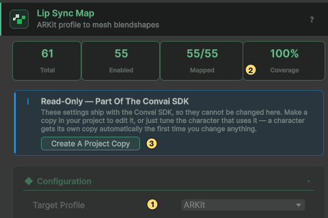

The lip sync system uses two kinds of data to describe how blendshape data flows from Convai to your character's mesh: **profiles** and **maps**. Choose a built-in profile for the incoming stream. Create a map if your mesh uses different blendshape names.

## What is a profile?

A **profile** defines the transport format — it tells the SDK which blendshape channel names to expect in the data stream from Convai. Choose its display name in the component's **Profile** popup. Profile ID identifies the local profile; the transport token is the format requested from Convai. They differ for MetaHuman.

**Three profiles are bundled:**

| ID | Display name | Transport token | Format |
|---|---|---|---|
| `arkit` | ARKit | `arkit` | 61 standard ARKit channels        |
| `metahuman` | MetaHuman | `mha` | 251 MetaHuman CTRL expressions    |
| `cc4_extended` | CC4 Extended | `cc4_extended` | 170 Character Creator 4 channels  |

The three bundled profiles are built into the SDK — there is no `.asset` file to find in the Project window for them, and nothing to import. Select the display name in **Profile**.

## What is a map?

<figure><figcaption>
The bundled map targets <strong>ARKit</strong> (1) and reports full coverage of its enabled mappings (2). Choose <strong>Create A Project Copy</strong> (3) to edit your own asset.
</figcaption></figure>

A **map** routes the source blendshape channels (from the profile) to the actual blendshape names on your character's `SkinnedMeshRenderer`. It also lets you apply per-channel multipliers, offsets, and clamps.

**Four maps are bundled:**

| Map asset                                    | Routes                                  |
| -------------------------------------------- | --------------------------------------- |
| `ConvaiLipSyncDefaultMap_ARKit`              | ARKit → ARKit (passthrough)             |
| `ConvaiLipSyncDefaultMap_MetaHuman`          | MetaHuman → MetaHuman (passthrough)     |
| `ConvaiLipSyncDefaultMap_CC4Extended`        | CC4Extended → CC4Extended (passthrough) |
| `ConvaiLipSyncDefaultMap_ARKitToCC4Extended` | ARKit → CC4Extended (conversion)        |

When `ConvaiLipSyncComponent._mapping` is left empty, the SDK selects the matching passthrough map automatically based on the locked profile ID.

`ConvaiLipSyncMapAsset.Mappings` exposes its entries as `IReadOnlyList<BlendshapeMappingEntry>` — code that reads a map at runtime cannot add, remove, or reorder entries. Author mappings in the Editor; see [Create a custom lip sync map](create-a-custom-blendshape-map.md).

Create a custom map when your character's blendshape names differ from the expected names, or when you need to adjust weight multipliers to match your rig's calibration.

## Registries

`LipSyncProfileCatalog.GetProfiles()` lists the three built-in formats. Profile selection determines the channel names and order. A custom map changes which blendshapes those channels drive.

`ConvaiLipSyncDefaultMapRegistry` supplies default maps for profiles. The resolver loads `Resources/LipSync/DefaultMaps/LipSyncDefaultMapRegistry`. An explicitly assigned compatible map takes precedence over the profile's default; if neither resolves, the SDK uses a disabled fallback map. For a single character, assign the map in **Mapping** instead of changing global default resolution.

## When to create custom assets

| Situation                                               | Create                                                 |
| ------------------------------------------------------- | ------------------------------------------------------ |
| Your rig uses ARKit/MetaHuman/CC4 names exactly         | Nothing — use the bundled map (leave `_mapping` empty) |
| Your rig uses different names for standard blendshapes  | Custom **map** only                                    |
| You receive an ARKit stream but your rig uses CC4 names | Use the bundled `ARKitToCC4Extended` map               |
| Your character uses a completely custom blendshape set  | A custom **map** from the closest supported input format                    |

## Next steps


[Choose a built-in lip sync profile](create-a-lip-sync-profile.md)



[Create a custom lip sync map](create-a-custom-blendshape-map.md)

