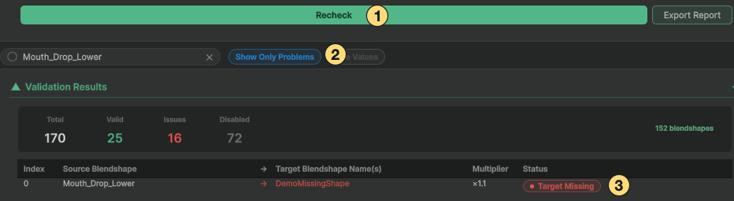
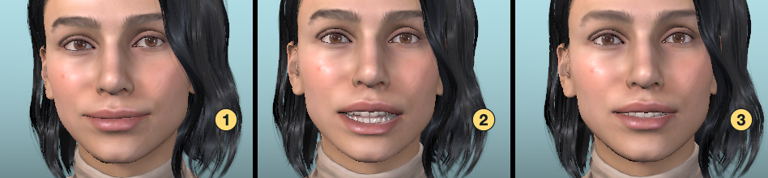

Use the **Lip Sync Mapping Validator** to check whether each source blendshape resolves to a target on the character's meshes. This validates the mapping structure; a live conversation is still needed to judge facial movement and audio timing.

## Check the mapping



### Open the validator from the character

Select a character with `ConvaiLipSyncComponent`. In its Inspector, choose **Validator**. The **Lip Sync Validator** window opens with that component selected.



### Confirm the configuration

Check **Lip Sync Component**, **Mapping Asset** and **Target Meshes**. When a component is assigned, **Profile** follows its selected profile. To inspect an unbound mapping, clear the component and choose the profile and meshes explicitly. Use **Add Mesh Slot** for additional renderers.



### Refresh and inspect results

Choose **Recheck**. The validator rescans the component, meshes and mapping. Use **Search blendshapes** and **Show Only Problems** to find missing targets or disabled mappings. The result table shows the source, target names, multiplier and status.

<figure><figcaption>
Use <strong>Recheck</strong> (1) after changing the mapping. Enable <strong>Show Only Problems</strong> (2) to narrow the list. In this example, <strong>Target Missing</strong> (3) identifies the configured name that the mesh could not resolve.
</figcaption></figure>

Correct target names in the [mapping asset](create-a-custom-blendshape-map.md), then refresh. A source may map to several targets; check that this is intentional. No meshes assigned or no analysis performed is an incomplete check, not a passing result.



### Verify motion and retain evidence

Choose **Export Report** to save the validation results. Enter Play Mode and test a short conversation with the character. Inspect mouth movement, settling and timing; a structurally valid map can still use unsuitable multipliers or the wrong facial mesh.

<figure><figcaption>
Compare the mouth before the reply (1), while the character speaks (2), and after playback ends (3). To assess timing, watch the mouth while listening to the reply.
</figcaption></figure>



If the face stays still despite valid target names, confirm that the session supplies the profile's expected facial data, the component is enabled and the correct renderers are assigned. See [Add lip sync](README.md) for playback and latency controls.
