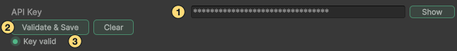

The Convai SDK for Unity's **API Key** authentication mode reads an API key tied to your Convai account directly from the project's saved settings. Use this page to enter that key for local development in the Unity Editor — iterating on a scene, running sample scenes, or testing on a machine only you control.


API Key mode is for local development, not for a build you distribute. A player build produced in API Key mode contains your account API key, obfuscated but not encrypted, inside the shipped `ConvaiSettings` asset. Before you build anything you plan to ship, read [Authentication](../authentication/README.md) and switch to Auth Token mode.




### Copy your API key

Log in to your [Convai dashboard](https://convai.com), navigate to **Account Settings**, and copy your API key.



### Open the Credentials section

In the Unity Editor menu bar, open **Convai > Settings** (or **Edit > Project Settings > Convai SDK**), then scroll to the **Credentials** card. Leave **Auth Mode** set to **Api Key**, its default. Keep **Environment** on **Production**.



### Paste and validate the API key

Paste your API key into the **API Key** field, then select **Validate & Save**. Convai checks the key and, if it accepts the key, the SDK saves it to the project.

The status badge next to the button reports the result: **Key valid** when Convai accepts the key, or an error message such as **Key invalid** when it does not.



### Verify the key is accepted

Confirm that the Credentials badge reads **Key valid**. When you reopen settings, the Editor checks the saved key in the background if its cached result is missing or older than 24 hours. If the service does not answer, the Editor limits retries for the same key to one every five minutes. Scene validation checks whether a key is configured; it does not authenticate that key with Convai.

<figure><figcaption>
(1) Paste the key in the masked field. (2) Select <strong>Validate &amp; Save</strong>. (3) Check for <strong>Key valid</strong>.
</figcaption></figure>




## How the key is used at runtime

In API Key mode, the SDK reads the saved key from `ConvaiSettings` when it connects. Your scene scripts can start the conversation without passing credentials.

`Assets/Resources/ConvaiSettings.asset` stores the key obfuscated (XOR plus Base64), not encrypted — anyone with the SDK source can reverse it. Decide whether to commit this file to source control based on your team's security policy. If an older project kept only a plaintext key, enter it again with **Validate & Save**.

## Move to Auth Token mode before you ship

API Key mode has no equivalent of a server-issued, short-lived credential — the same account key that unlocks your Convai project sits in the build. For any build distributed to testers, players, or end users, switch to Auth Token mode instead, where a build processor strips the account key before the build and a server you control issues short-lived tokens at connect time.


[Authentication](../authentication/README.md)



[Migrate custom credential providers](../advanced-topics/custom-providers/custom-credential-provider.md)


## Next steps

With your API key in place, import a sample scene to verify the SDK is working before you build your own scene.


[Import and run sample scenes](import-and-run-sample-scenes.md)

