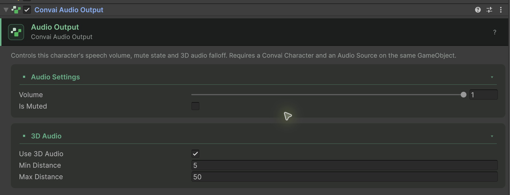

The `ConvaiAudioOutput` component controls how a character's voice plays back in the scene, while `ConvaiSettings` sets the project-wide default volume and audio feedback behavior. Pair either with the `ConvaiAudio` facade on `ConvaiManager` for scripted runtime control of mute state, per-character volume, and audio events.

## Character audio output

Select the character and choose **Add Component > Convai > Convai Audio Output**. Unity adds the required `ConvaiCharacter` and `AudioSource` components if they are missing. Keep this AudioSource reserved for the character voice; put one-shot sounds and unrelated filters on a separate AudioSource.

**Inspector fields:**

| Field          | Default | Description                               |
| -------------- | ------- | ----------------------------------------- |
| `Volume`       | `1.0`   | Playback volume (0–1)                     |
| `IsMuted`      | `false` | Mute this character's audio output        |
| `_use3DAudio`  | `true`  | Enable Unity spatial audio                |
| `_minDistance` | `5`     | Distance at which audio is at full volume |
| `_maxDistance` | `50`    | Maximum distance setting for logarithmic AudioSource rolloff; not a silence cutoff     |

These are defaults for newly added components. Existing scenes keep their saved distances.

Disable **Use 3D Audio** for non-positional scenarios — for example, a kiosk interface where the character always sounds "present" regardless of where the player stands.

In WebGL, the browser plays character speech outside Unity's AudioSource. `Volume` and `IsMuted` also control this browser playback in 5.0, but Unity distance rolloff and `AudioListener.volume` do not. On iOS Safari, the browser controls media volume; mute and a volume of zero still silence the voice.

<figure><figcaption><p>Per-character voice controls are separate from project Runtime Defaults.</p></figcaption></figure>

## Project-wide audio defaults

`ConvaiSettings` exposes two project-wide defaults that apply until a script overrides them.

| Field                   | Default | Description                                                         |
| ----------------------- | ------- | -------------------------------------------------------------------- |
| `CharacterAudioVolume`  | `1`     | Default master volume for character audio (`0`–`1`)                  |
| `AudioFeedbackEnabled`  | `true`  | Plays feedback sounds, such as the listening indicator, by default   |

Configure both fields in the Convai Settings window's **Runtime Defaults** section (**Convai > Settings > Runtime Defaults**), or the equivalent **Edit > Project Settings > Convai SDK > Runtime Defaults** page — both surface the same fields.

These defaults seed `RuntimePreferences` when `ConvaiManager` builds its runtime. Read or change the effective value while a session is running through `ConvaiManager.ActiveManager.ConvaiRuntime.RuntimePreferences`:

```csharp
// Read the current project-wide defaults
float volume = ConvaiManager.ActiveManager.ConvaiRuntime.RuntimePreferences.CharacterAudioVolume;
bool audioFeedbackOn = ConvaiManager.ActiveManager.ConvaiRuntime.RuntimePreferences.AudioFeedbackEnabled;

// Override at runtime — CharacterAudioVolume clamps to the 0-1 range
ConvaiManager.ActiveManager.ConvaiRuntime.RuntimePreferences.CharacterAudioVolume = 0.5f;
ConvaiManager.ActiveManager.ConvaiRuntime.RuntimePreferences.AudioFeedbackEnabled = false;
```


`CharacterAudioVolume` does not change `ConvaiAudioOutput.Volume` on existing characters automatically. Read `RuntimePreferences.CharacterAudioVolume` in your own volume-control script and apply it to `ConvaiAudioOutput` or an audio mixer.


## Audio facade

For scripted audio control, use the `ConvaiAudio` facade accessed through `ConvaiManager.Audio`. This is the recommended API for runtime audio management.

### Microphone control

```csharp
// Mute/unmute the local microphone
ConvaiManager.ActiveManager.Audio.SetMicMuted(true);

// Toggle and get the new state
bool isMuted = ConvaiManager.ActiveManager.Audio.ToggleMicMuted();

// In an async method, start capture after the room is connected.
// Allow Microphone and platform permission must permit capture.
await ConvaiManager.ActiveManager.Audio.StartListeningAsync();
```

### Per-character playback control

```csharp
string characterId = character.CharacterId;

// Mute a specific character
ConvaiManager.ActiveManager.Audio.MuteCharacter(characterId);

// Unmute
ConvaiManager.ActiveManager.Audio.UnmuteCharacter(characterId);

// Check mute state
bool muted = ConvaiManager.ActiveManager.Audio.IsCharacterMuted(characterId);

// Disable remote audio entirely for a character
ConvaiManager.ActiveManager.Audio.SetRemoteAudioEnabled(characterId, false);
```

### Audio events

Subscribe to `OnMicMuteChanged` to keep a mute control synchronized with SDK state. Store the facade you subscribed to so cleanup still removes the handler if `ActiveManager` changes. The complete example below does this.

### Voice level

Read `ConvaiAudioOutput.IsVoiceLevelAvailable` before using `VoiceLevel` for a meter. The level is a linear, unsmoothed amplitude from `0` to `1`, measured over the last 20 ms of playback. An unavailable meter also returns zero, so zero alone does not prove the character is silent.

On native platforms, the reading reflects output volume, listener volume, distance rolloff and temporary volume reduction during interruption. On WebGL it reflects browser playback volume and mute state, but not Unity distance or listener settings. `IsSpeaking` answers a separate question about speech state. See [Show connection and audio levels](../ui-and-presentation/show-connection-and-audio-levels.md) for a display example.

## Usage examples

### Example 1: Mute toggle UI button

**Scenario:** A corporate onboarding simulation includes a mic mute button in the corner of the screen.

```csharp
using Convai.Runtime.Components;
using Convai.Runtime.Facades;
using UnityEngine;
using UnityEngine.UI;

public sealed class MuteButtonController : MonoBehaviour
{
    [SerializeField] private Toggle _muteToggle;
    private ConvaiAudio _audio;

    private void OnEnable()
    {
        _audio = ConvaiManager.ActiveManager?.Audio;
        if (_audio == null || _muteToggle == null) return;
        _muteToggle.onValueChanged.AddListener(OnMuteToggled);
        _audio.OnMicMuteChanged += OnMicMuteChanged;
    }

    private void OnDisable()
    {
        if (_muteToggle != null)
            _muteToggle.onValueChanged.RemoveListener(OnMuteToggled);
        if (_audio != null)
            _audio.OnMicMuteChanged -= OnMicMuteChanged;
        _audio = null;
    }

    private void OnMuteToggled(bool muted) => _audio?.SetMicMuted(muted);

    private void OnMicMuteChanged(bool muted) =>
        _muteToggle.SetIsOnWithoutNotify(muted);
}
```

Enable this control after the manager has initialized.

**Expected outcome:** The toggle follows subsequent microphone mute changes. Pressing it mutes or unmutes the mic. External changes (for example, from push-to-talk logic) also update the toggle automatically.

### Example 2: Per-character volume in a multi-instructor scene

**Scenario:** A language learning simulation has two AI instructors — a main teacher and a conversation partner. Players can independently adjust their volumes.

```csharp
using Convai.Runtime.Components;
using UnityEngine;
using UnityEngine.UI;

public sealed class CharacterVolumeController : MonoBehaviour
{
    [SerializeField] private ConvaiAudioOutput _audioOutput;
    [SerializeField] private Slider _volumeSlider;

    private void OnEnable()
    {
        if (_audioOutput == null || _volumeSlider == null) return;
        _volumeSlider.SetValueWithoutNotify(_audioOutput.Volume);
        _volumeSlider.onValueChanged.AddListener(SetVolume);
    }

    private void OnDisable()
    {
        if (_volumeSlider != null)
            _volumeSlider.onValueChanged.RemoveListener(SetVolume);
    }

    private void SetVolume(float value) => _audioOutput.Volume = value;
}
```

**Expected outcome:** Each slider controls the assigned character's voice output, including browser playback where the browser permits volume changes. The two characters can be heard at different levels independently.

## Next steps

Configure the microphone device and platform-specific audio permissions.


[Configure microphone](configure-microphone.md)

