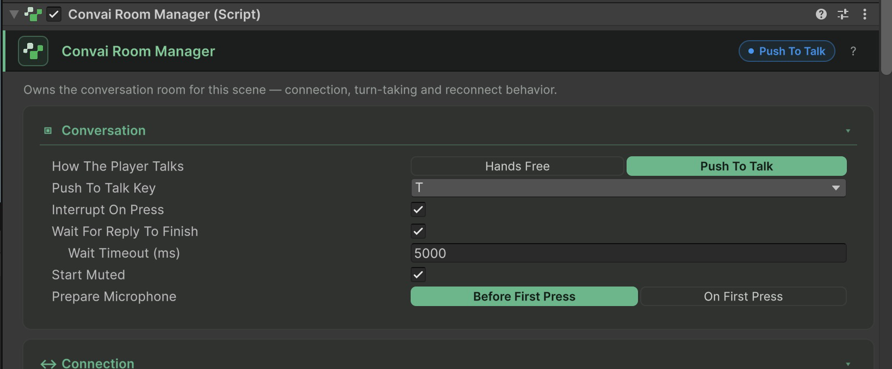

Choose **Hands Free** when speech detection should end the player's turn, or **Push To Talk** when the player holds a control to speak. Set the input mode on `ConvaiRoomManager`. Group conversation requires push-to-talk.

## Find the room settings

Select the manager object and find **Convai Room Manager** in its Inspector. **Conversation** contains **How The Player Talks** and the push-to-talk controls. **Listening** is a separate card below the everyday connection controls; it contains turn detection, voice detection, speech recognition, and microphone processing. **Interruptions** controls how a reply stops when the player cuts in.

<figure><figcaption><p>Conversation controls on the sample room. Listening and Interruptions are separate cards below.</p></figcaption></figure>

If the room uses an asset under **Room Setup Source**, edit the referenced profile to change its read-only values. The component still owns **Push To Talk Key**.

## Configure hands-free input

Set **How The Player Talks** to **Hands Free**. In **Listening > End Of Turn**, choose **SDK Default** or **Custom** for **Turn Detection**. Custom exposes:

| Inspector label | API property | Default | Purpose |
|---|---|---|---|
| **Silence Before Reply (s)** | `CustomTurnDetection.StopSecs` | `3` | Silence threshold for ending the turn |
| **Longest Turn (s)** | `CustomTurnDetection.MaxDurationSecs` | `8` | Upper turn duration |
| **Pre-Speech Audio (ms)** | `CustomTurnDetection.PreSpeechMs` | `0` | Audio retained before speech onset |

For a training exercise where learners pause before answering, try a five-second silence threshold and a 30-second turn limit, then test with representative speech. Larger values let the player pause longer but delay the reply.

**Voice Detection > Thresholds** is separate from end-of-turn detection. **Server Default** leaves speech-detection thresholds to Convai. **Custom** exposes confidence, speech-start and speech-stop timing, and minimum volume. Under **Speech Recognition**, **At Session Start** selects `Automatic`, `On`, or `Off`. Automatic starts recognition for hands-free input and keeps it off until a press in push-to-talk.

## Configure push-to-talk

Set **How The Player Talks** to **Push To Talk**, then choose **Push To Talk Key**. The default is `T`.

| Inspector label | API property | Default | Behavior |
|---|---|---|---|
| **Interrupt On Press** | `PushToTalkPolicy.InterruptBotOnPress` | `true` | A valid press can interrupt the character |
| **Wait For Reply To Finish** | `PushToTalkPolicy.RequireTurnCompletionBeforeNextPress` | `true` | Holds the next turn while waiting for the reply |
| **Wait Timeout (ms)** | `PushToTalkPolicy.TurnCompletionTimeoutMs` | `5000` | Unlocks after inactivity; the wait pauses while the character speaks |
| **Start Muted** | `LocalAudioPolicy.StartMutedInPushToTalk` | `true` | Starts the microphone muted |
| **Prepare Microphone** | `LocalAudioPolicy.PushToTalkStartupMode` | `PrewarmMuted` | **Before First Press** prepares muted capture at connect; **On First Press** waits for the control |

For XR controllers, select `JoystickButton0` for right-hand primary/A, `JoystickButton1` for right-hand secondary/B, `JoystickButton2` for left-hand primary/X, or `JoystickButton3` for left-hand secondary/Y. Once a controller has supplied a press, losing that controller releases it instead of keeping capture open.

For a UI button or your own input framework, use the public `ConvaiPushToTalkController` methods described in [Use your own push-to-talk input](use-your-own-push-to-talk-input.md). Its input ownership prevents the room's built-in polling from also handling the same press. Code that polls another input source can acquire `ConvaiManager.AcquirePushToTalkInput()` and dispose the returned lease when done.

The normal Inspector hides developer policy fields. In code, `PushToTalkPolicy.ReleaseMode` defaults to `Auto`, which uses media drain and commit results where supported. `Legacy` uses `ReleaseTailMs`, whose default is `1000` per bounded finalization window. `AllowSpeechStoppedFallbackAfterSpeechStart` defaults to `false`; when enabled, speech ending is followed by a 1.5-second quiet period before the wait unlocks. See [Push-to-talk lifecycle](../core-concepts/push-to-talk-lifecycle.md) for release failures and recovery.

## Configure capture and interruption

Use **Listening > Microphone** for the device's capture policy:

| Inspector label | Default | Behavior |
|---|---|---|
| **Allow Microphone** | On | Turn off for typed input without capture or a permission request |
| **Echo Cancellation** | Off | Reduces the character's speaker output being captured by the microphone |
| **Noise Suppression** | On | Reduces background noise in native capture |
| **Automatic Gain Control** | Off | Adjusts native microphone gain |

Processing changes apply on the next connection. WebGL uses browser processing. For hands-free input through a phone speaker, enable echo cancellation or use headphones to avoid the character hearing its own voice.

**Interruptions** includes **Fade Out When Interrupted**, **Fade Duration (s)**, and **On-Device Detection**. Fade duration defaults to `0.12` seconds. On-device speech detection is distinct from the server's voice-detection thresholds.

## Switch mode during a session

`SetConversationInputModeAsync()` changes the mode of a connected session without editing the saved room defaults. Check the connection, handle a rejected operation, and keep group conversation in push-to-talk:

```csharp
using System;
using Convai.Runtime.Components;
using Convai.Runtime.Room;
using UnityEngine;

public class InputModeSwitcher : MonoBehaviour
{
    public void UseHandsFree() => ChangeMode(ConversationInputMode.HandsFree);
    public void UsePushToTalk() => ChangeMode(ConversationInputMode.PushToTalk);

    private async void ChangeMode(ConversationInputMode mode)
    {
        ConvaiManager manager = ConvaiManager.ActiveManager;
        if (manager == null || !manager.IsConnected) return;
        try
        {
            await manager.SetConversationInputModeAsync(mode);
        }
        catch (Exception error)
        {
            Debug.LogWarning($"Input mode did not change: {error.Message}");
        }
    }
}
```

Assign either public method to a UI button. Read `ConvaiManager.ActiveConversationInputMode` from the manager instance after the operation. Existing turn-detection, capture, and interruption settings remain the session's baseline.

To observe mode changes, subscribe to the room connection service and unsubscribe from the same instance:

```csharp
using Convai.Runtime.Components;
using Convai.Runtime.Room;
using UnityEngine;

public class InputModeObserver : MonoBehaviour
{
    private IConvaiRoomConnectionService room;

    private void OnEnable()
    {
        ConvaiManager manager = ConvaiManager.ActiveManager;
        if (manager != null && manager.TryGetRoomConnectionService(out room))
            room.ConversationInputModeChanged += HandleModeChanged;
    }

    private void OnDisable()
    {
        if (room != null) room.ConversationInputModeChanged -= HandleModeChanged;
        room = null;
    }

    private void HandleModeChanged(ConversationInputMode mode) => Debug.Log(mode);
}
```

Enable the observer after the scene's manager has initialized. Calls made outside the connected state fail with `SessionErrorCodes.SessionInvalidState`. A group room also rejects switching to hands-free input.

## Verify and continue

In hands-free mode, speak and pause to confirm the selected end-of-turn behavior. In push-to-talk, hold and release the configured control, wait for the reply, and confirm that a subsequent press works. A successful mode switch alone does not prove microphone permission or device capture.


[Configure character audio](configure-character-audio.md)



[Configure microphone](configure-microphone.md)

