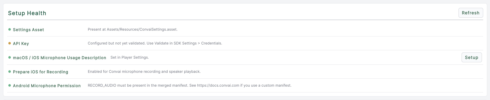
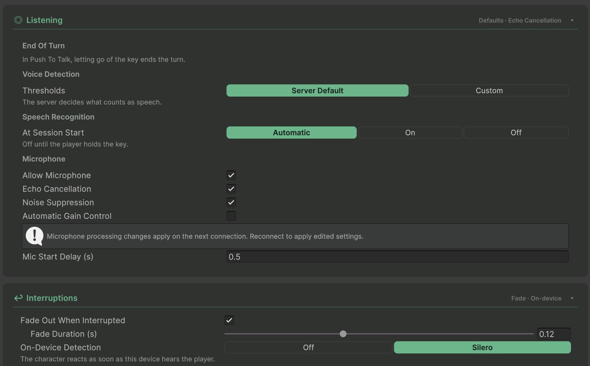

The Convai SDK for Unity opens the microphone according to the room's input policy, when microphone capture is allowed. Select a device and configure platform permissions before testing voice. For a session that never requests microphone permission, turn off **Allow Microphone** before connecting.

## Microphone device selection

To list available microphone devices and let the player choose one:

```csharp
using System.Collections.Generic;
using System.Threading.Tasks;
using Convai.Runtime.Components;
using Convai.Shared.Abstractions;
using Convai.Shared.Types;
using UnityEngine;

public class MicrophoneDevicePicker : MonoBehaviour
{
    public async Task SwitchToDeviceAsync(int deviceIndex)
    {
        ConvaiManager manager = ConvaiManager.ActiveManager;
        if (manager == null || !manager.TryGetMicrophoneDeviceService(out IMicrophoneDeviceService service))
        {
            Debug.LogWarning("Start the Convai runtime before selecting a microphone.");
            return;
        }

        IReadOnlyList<ConvaiMicrophoneDevice> devices = service.GetAvailableDevices();
        foreach (ConvaiMicrophoneDevice device in devices)
            Debug.Log($"{device.Name} (Index: {device.Index})");

        await manager.Audio.StartListeningAsync(microphoneIndex: deviceIndex);
    }
}
```

On WebGL, `GetAvailableDevices()` returns an empty list outside the Editor. Microphone access on WebGL goes through the browser's Web Audio API and does not support Unity's native device enumeration.

## Set the project-wide default device

`ConvaiSettings.DefaultMicrophoneDeviceId` sets the microphone the SDK uses before any script calls `StartListeningAsync` with a specific device index. An empty string resolves to the system default device.



### Open the Runtime Defaults section

Open **Edit > Project Settings > Convai SDK**, or select **Convai > Settings** in the Unity Editor menu bar. Scroll to the **Runtime Defaults** card.



### Pick a device

Use the **Microphone** dropdown to select a connected device by name, or leave it at **System Default** to follow the operating system's device order.



### Refresh the device list if needed

Select **Refresh** to re-enumerate connected microphones if you plugged in or removed a device after opening the window.



## Platform-specific setup

### Android

The SDK requests permission when capture starts. Unity includes the microphone permission when it builds a project using the microphone APIs. If you supply a custom manifest, check that the merged manifest still contains:

```xml
<uses-permission android:name="android.permission.RECORD_AUDIO" />
```

You do not need to create a custom manifest solely for this permission.

When the SDK requests the permission, Android shows its standard permission dialog. If the player grants it, recording starts automatically. If denied, the SDK logs a warning and the microphone remains inactive.

### macOS and iOS

Add a microphone usage description to your `Info.plist`. In Unity, set this via **Player Settings > iOS > Other Settings > Microphone Usage Description**:

```text
"This app uses the microphone to support voice conversations with AI characters."
```

Open **Convai > Settings > Setup Health** and use **Setup** beside **macOS / iOS Microphone Usage Description**. For iOS, also enable **Prepare iOS for Recording**. The SDK requests microphone authorization on macOS and iOS when capture needs it.

<figure><figcaption><p>Project health checks for microphone permissions and recording configuration.</p></figcaption></figure>


Set a microphone usage description before building an app that records on macOS or iOS. If permission was denied, enable it in the operating system privacy settings before testing again.


### WebGL

A browser may require a gesture for blocked audio playback. Microphone capture separately requires HTTPS (or localhost) and permission. On each eligible scene click or tap after connection, the manager rechecks playback and calls `EnableAudioAndStartListening()` if needed; pointer events over UI are excluded. For a dedicated start button or when the automatic option is disabled, use one of these methods:

* **`Audio.EnableAudioPlayback()`** — unlocks browser audio output only. Use this when you want character voice to play but are not yet starting the microphone (for example, during a tutorial before the player speaks).
* **`ConvaiManager.EnableAudioAndStartListening()`** — unlocks browser audio output **and** opens the microphone. Use this when the player is ready to begin a full conversation.

```csharp
using Convai.Runtime.Components;
using UnityEngine;

public class BrowserVoiceStartButton : MonoBehaviour
{
    // Assign this method to a UI Button's On Click event.
    public void StartVoice()
    {
        ConvaiManager manager = ConvaiManager.ActiveManager;
        if (manager != null) manager.EnableAudioAndStartListening();
    }
}
```

If browser playback remains blocked, click the scene or your start button and check `Audio.RequiresUserGesture`. When microphone capture is disabled, `EnableAudioAndStartListening()` enables playback without opening the microphone.

## Microphone processing and level

Under **Convai Room Manager > Listening > Microphone**, configure **Echo Cancellation**, **Noise Suppression**, and **Automatic Gain Control**. Native defaults are off, on, and off respectively. Processing changes apply on the next connection. WebGL uses browser processing.

Read `ConvaiRoomManager.MicrophoneLevel` for a continuous audio level, and check `IsMicrophoneLevelAvailable` before interpreting zero as silence. A level meter is separate from the speech-detection decision.

Turn off **Allow Microphone** before connecting for text input with voice replies. Use `SetMicrophoneAllowed(false)` to stop capture during an active session, or `SetMicrophoneAllowed(true)` to permit it again. See [Run a text-only session](run-a-text-only-session.md).

## Next steps

With audio configured, add a transcript UI to display conversation text.


[Add chat UI](add-chat-ui.md)


<figure><figcaption><p>This existing sample enables echo cancellation. Newly configured policies default to echo cancellation off; choose processing for your application.</p></figcaption></figure>
