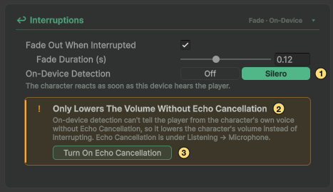

A player can interrupt a character by speaking during a hands-free conversation. The room controls how the voice fades and whether the device listens for the interruption locally. Start with a working [hands-free conversation](configure-conversation-input-mode.md) and an allowed microphone.

## Set up the room



### Choose the fade

Select `ConvaiRoomManager` and expand **Interruptions**. Enable **Fade Out When Interrupted** for a short fade when playback stops. **Fade Duration (s)** defaults to `0.12` seconds and accepts `0.04` to `0.25` seconds.



### Choose who detects speech

Leave **On-Device Detection** set to **Off** to rely on Convai's speech detection. Select **Silero** on a native player to detect speech locally as well. The SDK creates the detector. WebGL uses the browser capture path and does not load the native detector.



### Enable echo cancellation for local interruptions

On native builds, enable **Echo Cancellation** under **Listening > Microphone** or select **Turn On Echo Cancellation** in the **Interruptions** warning. Reconnect to apply the change. This helps distinguish the player's voice from character audio coming through the speakers. The detector can lower playback volume on a speech candidate. It can commit an interruption locally only when the capture source reports active acoustic echo cancellation. Otherwise Convai still decides when to interrupt.

<figure><figcaption>
(1) Select <strong>Silero</strong> under <strong>On-Device Detection</strong>. (2) The warning explains that Silero only lowers playback volume while echo cancellation is off. (3) Select <strong>Turn On Echo Cancellation</strong> to update the microphone setting.
</figcaption></figure>




## Verify on the target device

Let a character start a reply. Stay silent for one turn, then speak during the next. Check that speaker playback alone does not interrupt the first reply, that the second gives way to the player, and that the following reply plays at the expected volume. Repeat with the microphone and audio output your players will use.

If the voice only gets quieter, read `ConvaiRoomManager.IsMicrophoneAcousticEchoCancellationActive` during capture. `true` means the capture source reports active cancellation. `false` means it is inactive, and `null` means the source cannot report it. Check the device and reconnect after changing capture settings.

For the server's speech thresholds, see [Voice activity detection](../core-concepts/voice-activity-detection.md). For a player holding a talk button, see [Push-to-talk lifecycle](../core-concepts/push-to-talk-lifecycle.md).
