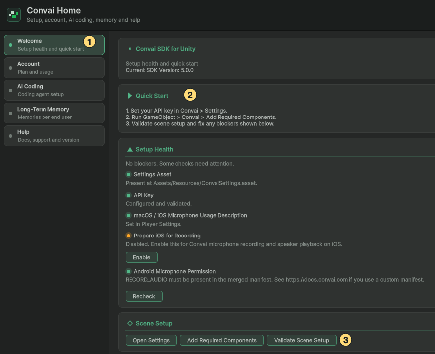
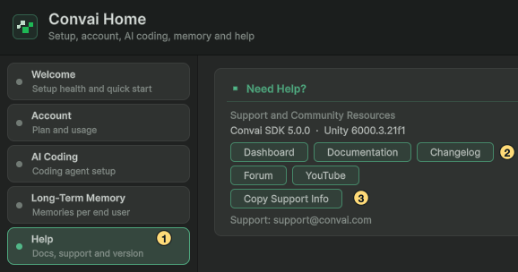

Open **Convai > Home** to inspect your account, set up a coding assistant, or work with player memories. Open **Convai > Settings** for credentials and project defaults. That command opens **Edit > Project Settings > Convai SDK**.

## Convai Home sections

| Section | What you can do |
| --- | --- |
| **Welcome** | Check project setup health and find the next setup task. |
| **Account** | Inspect account and usage information for the configured credentials. |
| **AI Coding** | Check Unity CLI MCP integration and install the project skill or instructions for your coding assistant. |
| **Long-Term Memory** | Find an end user and inspect or manage that user's memories for a character. |
| **Help** | Find documentation and community links, check the displayed SDK and Unity versions, and copy support information. |

<figure><figcaption>
(1) Select <strong>Welcome</strong> to review the setup checklist. (2) Follow <strong>Quick Start</strong> to configure credentials and set up a scene. (3) Use <strong>Scene Setup</strong> to open settings, add required components, or validate the scene.
</figcaption></figure>

<figure><figcaption>
(1) Select <strong>Help</strong> in the sidebar. (2) Open <strong>Documentation</strong> or <strong>Changelog</strong>. (3) Select <strong>Copy Support Info</strong> to copy environment details for a support ticket.
</figcaption></figure>

## Where to change a setting

Use [Project Settings](project-settings-reference.md) for credentials, project-wide defaults, and logging. Select the character's Inspector to edit its identity, session resume, or audio. Select the room manager to configure connection and input. Save room or character components on a prefab to reuse the same values in other scenes.

See [Install the project skill](../ai-coding-assistant/install-project-skill.md) for coding assistant integration or [Long Term Memory window](../features/long-term-memory/long-term-memory-window.md) for memory management.
