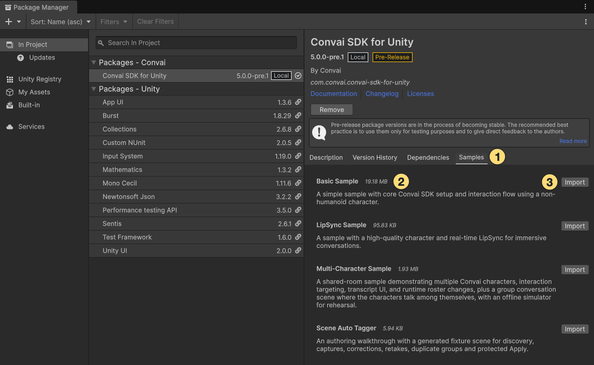
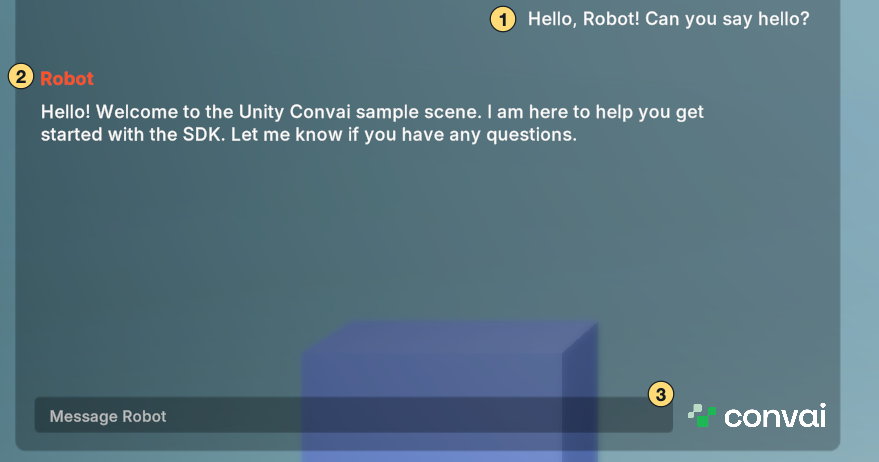
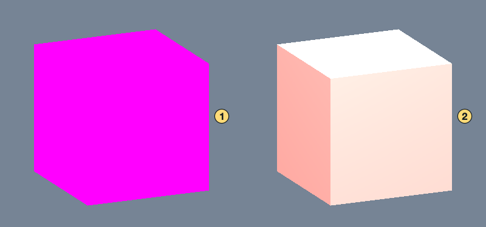

The Convai SDK for Unity declares four sample packages. Running one is the fastest way to confirm your installation, API key, and audio setup are working before you build your own scene.

| Sample | Description |
| --- | --- |
| **Basic Sample** | Core setup and interaction flow with `Convai_Char_Robot`, a non-humanoid character |
| **LipSync Sample** | High-quality character `Sofia` with real-time lip sync |
| **Multi-Character Sample** | A shared-room sample with interaction targeting, transcript UI, runtime roster changes, and a separate Group Conversation scene. |
| **Scene Auto Tagger** | An Editor authoring walkthrough. Generate its fixture with **Convai > Samples > Create Scene Tagger Fixture** after importing the sample |

The steps for locating the samples differ depending on how you installed the SDK.





### Open Package Manager

In the Unity Editor, open **Window > Package Manager**. Select **In Project**, then select **Convai SDK for Unity** from the package list.



### Import a sample

In the detail panel on the right, click the **Samples** tab. Click **Import** next to the sample you want to run.

<figure><figcaption><p>Select (1) <strong>Samples</strong>, find (2) <strong>Basic Sample</strong>, and click (3) <strong>Import</strong> on that row.</p></figcaption></figure>

Unity copies the sample assets into `Assets/Samples/Convai SDK for Unity/<version>/`. A new folder appears under `Assets/Samples/` in the Project window.



### Open the scene

In the Project window, navigate to the imported sample folder and open its `.unity` scene file.







### Locate the samples

When installed via the Asset Store, all sample scenes are imported into your project automatically. In the Project window, navigate to:

```text
Assets/Convai SDK For Unity/Samples/
```

Look for `BasicSample`, `LipSyncSample`, `MultiCharacterSample`, and `SceneTagger`. Verify the folders in your installed Asset Store package; its release can differ from Package Manager.



### Open the scene

Open the `.unity` scene file inside the sample folder you want to run.





Once the scene is open:



### Enter Play Mode

Press **Play**. The Unity Console logs the following lines as the SDK initializes:

* `[ConvaiRuntime] Started successfully` — SDK initialized all internal services
* `[RoomConnectionRuntimeAdapter] Room connection succeeded (mode=create).` — the room connected to Convai

In the **Basic Sample**, focus the Game view. When the chat field reads **Message Robot**, type a greeting and press **Enter**. To speak using the sample’s default push-to-talk control, hold **T** while speaking and release it when you finish. Listen for the Robot’s reply and check that it appears in the chat.

<figure><figcaption><p>(1) Your message appears on the right. (2) The Robot’s reply appears on the left. (3) When <strong>Message Robot</strong> returns, you can send another message.</p></figcaption></figure>

If no response appears and the Console shows warnings, check [Validate your setup](validate-your-setup.md) for a diagnostic checklist.



For the shared-room sample, use URP, import TextMesh Pro Essential Resources, and assign Character IDs available to your account. See [Multi-Character Sample](../features/multi-character-sessions/multi-character-sample.md) for target selection and the separate group scene.

The Multi-Character Sample also contains `GroupConversationSample.unity`. Follow the [group conversation sample guide](../features/group-conversation/run-the-sample.md) for its preview prerequisites and offline simulator. For Editor tagging, follow [Scene Auto Tagger](../features/scene-metadata/scene-auto-tagger.md).

## Sample render pipeline notes

Sample scenes are built with the Universal Render Pipeline (URP). In a project that uses the Built-in Render Pipeline, URP materials can appear bright pink. Use URP for the sample, or assign materials that use shaders compatible with your project. Preserve the material properties you need, such as its base color and texture.

<figure><figcaption><p>(1) The imported cube’s <strong>URP Lit</strong> shader renders magenta in a Built-in project. (2) A <strong>Standard</strong> material using the same base color restores the cube’s shading in that project.</p></figcaption></figure>

## Next steps

Now that you have confirmed the SDK is working, learn what each scene component does before building your own setup.


[Scene components reference](scene-components.md)

