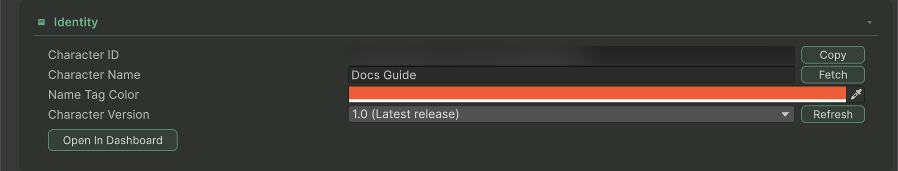

Choose a released **Character Version** to keep a scene tied to a particular character release. **Live** uses the current character. This selects a character configuration version, independently of the Unity SDK package version.

## Select a released version



### Prepare access to released versions

Configure your API key and set **Convai > Settings > Credentials > API Mode** to **Upgraded** for a workspace that supports the upgraded Character API. Enter a valid **Character ID** on the character. See [Choose a REST API mode](../advanced-topics/choose-a-rest-api-mode.md) for this setting's scope.



### Choose the version

Select the character and open **Identity > Character Version**. Use **Refresh** to reload releases, then choose a version from the popup. The latest release is labeled **Latest release**. If the service has no releases, **Live** is the only available choice.

When **Character Setup Source** is **Profile Asset**, edit the version on the assigned Character Profile asset. The component shows the selected profile value as read-only.



### Save and verify the selection

Save the changed scene, prefab or profile asset. Select it again and confirm the chosen release remains selected. Connect with that configuration and check for version-related connection errors before distributing the application.



<figure><figcaption>
A character pinned to its released version 1.0. The drop-down also lists Live and every release the API returns.
</figcaption></figure>

## Resolve a saved-version warning

The SDK saves the exact release reference returned by the API. Do not manufacture a reference by appending a version to the character ID.

| State | Meaning and action |
| --- | --- |
| Released versions unavailable | Check API Mode, credentials, workspace, environment and API URL, then Refresh. |
| No released versions yet | Publish an appropriate character release through your character-management workflow, or use Live. |
| Saved version marked unavailable | The saved reference is absent from the fetched list. It is preserved; choose an available release or Live deliberately. |
| Reselect required | The saved version has no API reference. Choose the release again from the API-backed list. |

The Inspector does not silently change an unavailable pin to Live. A preserved pin is not evidence that the service can still connect it; verify that connection separately.
